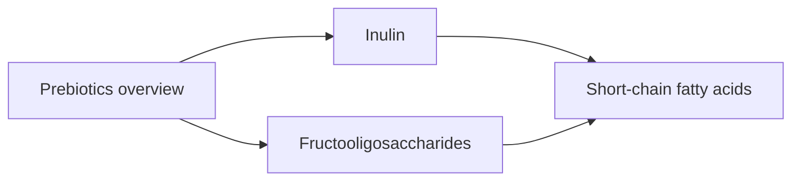

# Prebiotics

Prebiotics are food components that humans cannot digest but that selectively feed beneficial gut bacteria. These notes give an overview and describe inulin and fructooligosaccharides (FOS). Related notes: [Dietary fiber](../foundations/dietary-fiber.md), [Fermented foods](../foundations/fermented-foods.md) and [Butyric acid and sodium butyrate](../../../../natural-sciences/chemistry/biochemistry/lipids/butyric-acid.md).

## Map

## Reading order

1. [Prebiotics overview](prebiotics-overview.md)
2. [Inulin](inulin.md)
3. [Fructooligosaccharides (FOS)](fructooligosaccharides.md)
