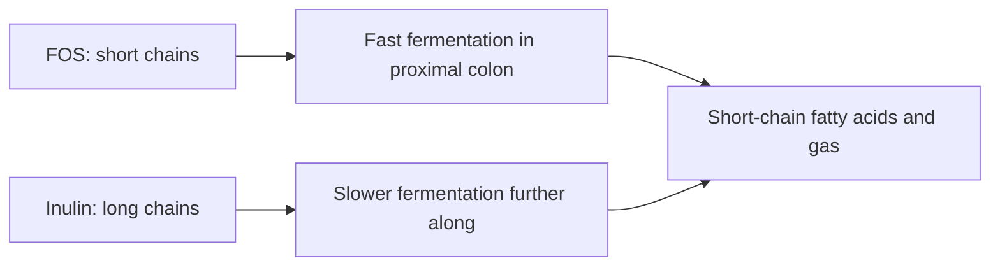

# Fructooligosaccharides (FOS)

## Summary

Fructooligosaccharides (FOS) are short chains of fructose (usually 2 to 9 units) ending in glucose, a soluble fiber and prebiotic found in onions, garlic, bananas, artichokes and chicory. They reach the colon undigested and increase bifidobacteria and lactobacilli. They improve stool regularity and calcium absorption. Unlike claims that they ease irritable bowel syndrome, FOS are FODMAPs and often worsen bloating in people with IBS.

*This note is educational. It is not medical advice and does not replace a doctor, dietitian or pharmacist, especially during pregnancy, illness or when taking medicines.*

## Prerequisites

- [Inulin](inulin.md)

## Core concepts

### Definition

*Fructooligosaccharides* (oligofructose) are short-chain fructans with a degree of polymerization of about 2 to 9. They are produced by partial breakdown of inulin or synthesized from sucrose.

### Analogy

FOS are like the short, easy-to-chew version of inulin for gut bacteria: they are eaten quickly and early in the colon, while long inulin chains are fermented more slowly further along. The analogy breaks because fast fermentation also produces gas quickly, which causes bloating.

### Mechanism

FOS resist digestion in the small intestine and are fermented rapidly in the proximal colon by bifidobacteria, producing short-chain fatty acids, lactate and gas. Effects resemble those of inulin but are faster. They are mildly sweet (about 30 percent of sucrose) and used in foods and infant formula.

The flowchart compares FOS and inulin fermentation.

### Proposed effects and evidence

Each entry states the proposed effect and how strong the human evidence is, using the grades defined in the [Evidence grades](../evidence-grades.md) note.

- **Prebiotic effect: more bifidobacteria and lactobacilli.** Consistent finding. Evidence: strong.
- **Gut health and regular bowel movements.** Improves stool frequency. Evidence: moderate.
- **Blood glucose regulation.** Small effects in type 2 diabetes. Evidence: limited.
- **Weight control through satiety.** Small effects. Evidence: limited.
- **Lower cholesterol.** Inconsistent. Evidence: limited.
- **Immune support.** Limited human evidence. Evidence: limited.
- **Protection against inflammatory bowel disease.** A trial of FOS in Crohn disease found no benefit. Evidence: not supported.
- **Bone health through calcium and magnesium absorption.** Increases calcium absorption. Evidence: moderate.
- **Better absorption of minerals such as iron.** Animal and limited human data. Evidence: limited.
- **Relief of irritable bowel syndrome.** FOS are FODMAPs; a low-FODMAP diet, which limits them, reduces IBS symptoms. Evidence: not supported.

## Worked example

A person with irritable bowel syndrome adds a FOS supplement after reading it helps constipation. Bloating and pain worsen. A dietitian explains that fructans are FODMAPs and recommends a low-FODMAP trial; in the study by Halmos and colleagues (2014), symptoms fell on a low-FODMAP diet compared with a typical diet.

## Trade offs and when to use it

FOS are safe for most people. People with IBS should test their tolerance cautiously.

## Common mistakes

- **Using FOS to treat IBS.** They often worsen symptoms.
- **High doses at once.** Rapid fermentation causes gas.

## Practice

1. How do FOS differ from inulin?
2. Which bacteria do FOS increase?
3. Why can FOS worsen irritable bowel syndrome?

### Answers

1. FOS are shorter chains fermented faster.
2. Bifidobacteria and lactobacilli.
3. They are rapidly fermented FODMAPs.

## Further reading

- Gibson, G. R., Hutkins, R., Sanders, M. E. et al. (2017). Expert consensus document: The International Scientific Association for Probiotics and Prebiotics (ISAPP) consensus statement on the definition and scope of prebiotics. Nature Reviews Gastroenterology and Hepatology, 14, 491-502. [DOI](https://doi.org/10.1038/nrgastro.2017.75). Definition of prebiotics.
- Halmos, E. P., Power, V. A., Shepherd, S. J. et al. (2014). A diet low in FODMAPs reduces symptoms of irritable bowel syndrome. Gastroenterology, 146(1), 67-75. [DOI](https://doi.org/10.1053/j.gastro.2013.09.046). Trial of low-FODMAP diet in irritable bowel syndrome.
