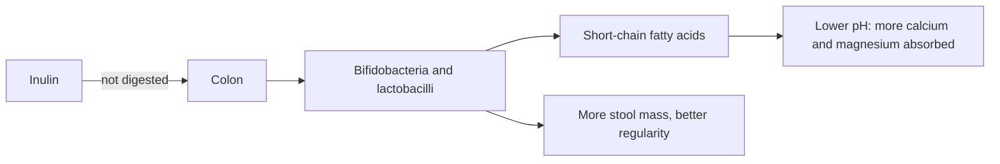

# Inulin

## Summary

Inulin is a soluble fiber and prebiotic, a fructan made of fructose chains, found in chicory root, Jerusalem artichoke, artichokes, garlic, onions, leeks and bananas. It escapes digestion in the upper gut and is fermented in the colon, increasing bifidobacteria and lactobacilli. It improves stool frequency and increases calcium absorption. Effects on blood glucose, cholesterol and weight are small. It is widely used in foods to replace fat and sugar.

*This note is educational. It is not medical advice and does not replace a doctor, dietitian or pharmacist, especially during pregnancy, illness or when taking medicines.*

## Prerequisites

- [Prebiotics overview](prebiotics-overview.md)

## Core concepts

### Definition

*Inulin* is a fructan: a chain of 2 to 60 fructose units with beta(2,1) bonds, usually ending in a glucose. Human enzymes cannot break beta(2,1) bonds. Inulin from chicory is the main commercial source.

### Analogy

Inulin is like a long, sweet rope that human scissors (enzymes) cannot cut. It passes into the colon intact, where gut bacteria have the right scissors and use it as food. The analogy breaks because, unlike a rope, it also dissolves and forms a gel that adds texture to foods.

### Mechanism

Inulin reaches the colon, where bifidobacteria and other bacteria ferment it into short-chain fatty acids and gas. Lower colon pH increases solubility and absorption of calcium and magnesium. Increased bacterial mass and water binding increase stool weight and frequency. Short-chain fatty acids may modestly affect liver lipid and glucose metabolism and stimulate satiety hormones (GLP-1, PYY).

The flowchart shows inulin in the gut.

### Proposed effects and evidence

Each entry states the proposed effect and how strong the human evidence is, using the grades defined in the [Evidence grades](../evidence-grades.md) note.

- **Gut health and microbiota balance.** Increases bifidobacteria consistently. Evidence: strong.
- **Regular bowel movements and less constipation.** Meta-analyses show improved stool frequency and consistency. Evidence: moderate.
- **Immune support.** Indirect, through gut microbiota; limited human data. Evidence: limited.
- **Blood glucose regulation in type 2 diabetes.** Small reductions in fasting glucose in some meta-analyses. Evidence: limited.
- **Weight control through satiety.** Small effects. Evidence: limited.
- **Lower total and LDL cholesterol.** Small or inconsistent effects. Evidence: limited.
- **Bone health through calcium and magnesium absorption.** Increased calcium absorption and bone mineralization in adolescents. Evidence: moderate.
- **Relief in inflammatory bowel disease.** Small, mixed studies; can worsen symptoms in some. Evidence: very limited.
- **Skin health and acne.** No meaningful evidence. Evidence: very limited.
- **Use in functional and low-calorie foods.** Used to replace fat and sugar. Evidence: established physiology.

## Worked example

In a trial (Abrams and colleagues, 2005), adolescents taking 8 g daily of an inulin and oligofructose mix for a year absorbed more calcium and gained more bone mineral than controls. For an adult, 5 to 10 g daily from chicory inulin powder in yogurt, or from foods such as onions, leeks and garlic, supports gut bacteria; higher doses cause gas.

## Trade offs and when to use it

Inulin is safe and inexpensive. People with irritable bowel syndrome often tolerate it poorly because it is a FODMAP.

## Common mistakes

- **Taking 20 g on the first day.** Start low and increase.
- **Using inulin for irritable bowel symptoms.** It often worsens bloating.

## Practice

1. What is inulin chemically?
2. How does inulin increase calcium absorption?
3. Name three food sources of inulin.

### Answers

1. A fructan chain of fructose units with beta(2,1) bonds.
2. Fermentation lowers colon pH, increasing mineral solubility.
3. Chicory root, onions and garlic (also leeks, artichokes, bananas).

## Further reading

- Gibson, G. R., Hutkins, R., Sanders, M. E. et al. (2017). Expert consensus document: The International Scientific Association for Probiotics and Prebiotics (ISAPP) consensus statement on the definition and scope of prebiotics. Nature Reviews Gastroenterology and Hepatology, 14, 491-502. [DOI](https://doi.org/10.1038/nrgastro.2017.75). Definition of prebiotics.
- Abrams, S. A., Griffin, I. J., Hawthorne, K. M. et al. (2005). A combination of prebiotic short- and long-chain inulin-type fructans enhances calcium absorption and bone mineralization in young adolescents. American Journal of Clinical Nutrition, 82(2), 471-476. [DOI](https://doi.org/10.1093/ajcn/82.2.471). Trial of inulin-type fructans and calcium absorption.
