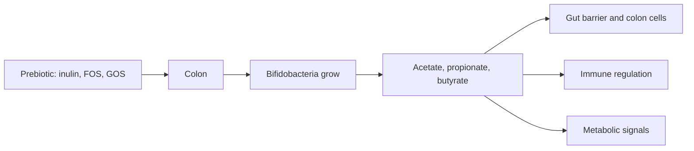

# Prebiotics overview

## Summary

Prebiotics are food components that human enzymes cannot digest and that are selectively used by beneficial gut bacteria, providing a health benefit. They act as food for bacteria such as bifidobacteria. Fermentation of prebiotics in the colon produces short-chain fatty acids (acetate, propionate and butyrate) that nourish the gut lining and influence metabolism and immunity. The main prebiotics are inulin-type fructans (inulin, FOS) and galactooligosaccharides (GOS).

*This note is educational. It is not medical advice and does not replace a doctor, dietitian or pharmacist, especially during pregnancy, illness or when taking medicines.*

## Prerequisites

- [Dietary fiber](../foundations/dietary-fiber.md)

## Core concepts

### Definition

A *prebiotic* is "a substrate that is selectively utilized by host microorganisms conferring a health benefit" (ISAPP consensus, 2017). *Probiotics* are live microorganisms that confer a health benefit; *synbiotics* combine both.

| Type | Characteristics | Examples and sources |
| --- | --- | --- |
| Fructooligosaccharides (FOS) | Short fructose chains, fermented by beneficial bacteria; increase bifidobacteria | Oligofructose; chicory root, onion, garlic, leek, bananas |
| Galactooligosaccharides (GOS) | Galactose-containing oligosaccharides that support bifidobacteria | Human milk, some dairy products |
| Inulin | Longer fructose polysaccharide; supports beneficial bacteria and calcium and magnesium absorption | Chicory root, onion, garlic, leek |
| Other oligosaccharides | Short carbohydrate chains not digested in the upper gut | Raffinose and stachyose in legumes; resistant dextrins |
| Beta-glucans | Cereal polysaccharides that support gut bacteria | Oats, barley |

The notes list maltodextrins as prebiotic oligosaccharides; ordinary maltodextrin is digested in the small intestine and is not a prebiotic, while resistant maltodextrin (resistant dextrin) is fermentable fiber. Inulin is itself a fructan; FOS are its shorter-chain relatives. Beta-glucans are fermentable fibers but are not always classified as prebiotics because their effects are less selective.

### Analogy

Prebiotics are like fertilizer for a garden of gut bacteria: they do not add new plants (that is what probiotics do), but they help the good plants already there grow. The analogy breaks because the "plants" also feed you back, by producing short-chain fatty acids.

### Mechanism

Prebiotics are polysaccharides or oligosaccharides resistant to digestion in the upper gut. Their chemical structure lets them reach the colon, where bacteria ferment them into short-chain fatty acids (acetate, propionate and butyrate), lactate and gases. Short-chain fatty acids lower colon pH, feed colonocytes (butyrate), strengthen the gut barrier, regulate immune cells and affect appetite hormones ([Butyric acid and sodium butyrate](../../../../natural-sciences/chemistry/biochemistry/lipids/butyric-acid.md)).

The flowchart shows prebiotic fermentation.

### Proposed effects and evidence

Each entry states the proposed effect and how strong the human evidence is, using the grades defined in the [Evidence grades](../evidence-grades.md) note.

- **Increase in bifidobacteria.** Consistent finding. Evidence: strong.
- **Better stool frequency.** Inulin improves constipation in meta-analyses. Evidence: moderate.
- **Stronger immunity and metabolic health.** Plausible; human outcome evidence is limited. Evidence: limited.

## Worked example

A person adds 10 g of chicory inulin daily. Within 2 weeks, stool tests show more bifidobacteria, and stool frequency rises slightly. Bloating and gas are common in the first days; starting with 3 to 5 g and increasing slowly reduces them.

## Trade offs and when to use it

Prebiotics in foods (onions, garlic, leeks, bananas, oats) are a safe way to support gut bacteria. People with irritable bowel syndrome often react badly to fructans and GOS (FODMAPs).

## Common mistakes

- **Starting with high doses.** Increase gradually to reduce gas.
- **Confusing prebiotics and probiotics.** Prebiotics feed bacteria; probiotics are bacteria.

## Practice

1. What is a prebiotic?
2. Name three short-chain fatty acids.
3. Which bacteria do inulin and FOS increase most?

### Answers

1. A substrate selectively used by gut microorganisms that gives a health benefit.
2. Acetate, propionate and butyrate.
3. Bifidobacteria.

## Further reading

- Gibson, G. R., Hutkins, R., Sanders, M. E. et al. (2017). Expert consensus document: The International Scientific Association for Probiotics and Prebiotics (ISAPP) consensus statement on the definition and scope of prebiotics. Nature Reviews Gastroenterology and Hepatology, 14, 491-502. [DOI](https://doi.org/10.1038/nrgastro.2017.75). ISAPP consensus on the definition of prebiotics.
- Koh, A., De Vadder, F., Kovatcheva-Datchary, P. et al. (2016). From dietary fiber to host physiology: short-chain fatty acids as key bacterial metabolites. Cell, 165(6), 1332-1345. [DOI](https://doi.org/10.1016/j.cell.2016.05.041). Review of short-chain fatty acids.
