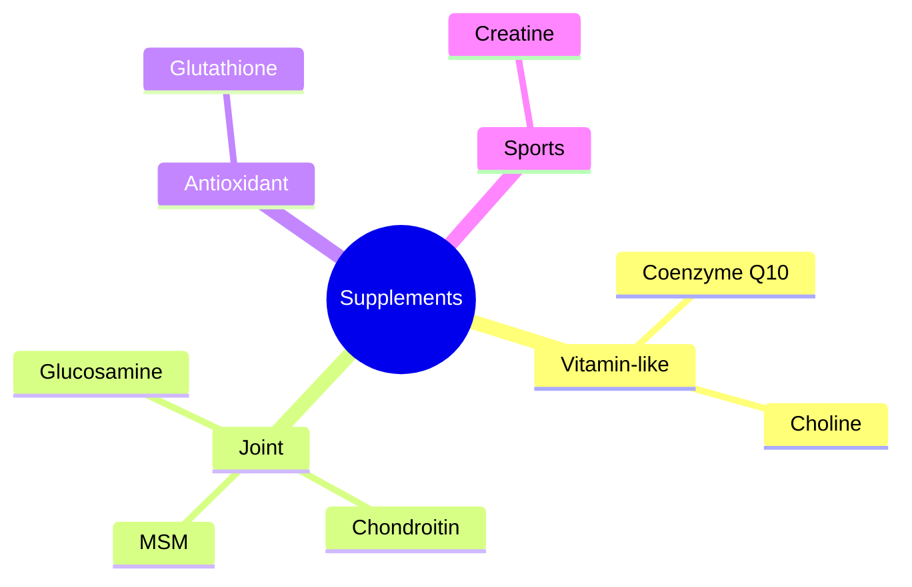

# Supplements

These notes cover popular dietary supplements that are not vitamins or minerals: vitamin-like compounds (coenzyme Q10, choline), joint supplements (glucosamine, chondroitin, MSM), the antioxidant tripeptide glutathione and creatine, the best-studied sports supplement. Amino acid supplements are in [amino acids](../../../../natural-sciences/chemistry/biochemistry/amino-acids/README.md) and fatty acid supplements in [lipids](../../../../natural-sciences/chemistry/biochemistry/lipids/README.md).

## Map

## Reading order

1. [Creatine](creatine.md)
2. [Coenzyme Q10](coenzyme-q10.md)
3. [Choline](choline.md)
4. [Glucosamine](glucosamine.md)
5. [Chondroitin](chondroitin.md)
6. [Methylsulfonylmethane (MSM)](msm.md)
7. [Glutathione](glutathione.md)
