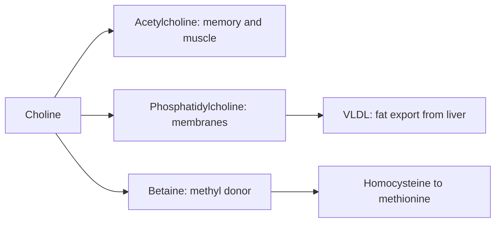

# Choline

## Summary

Choline is an essential nutrient, usually grouped with the B vitamins, needed for the neurotransmitter acetylcholine, for cell membranes (phosphatidylcholine), for methyl groups and for exporting fat from the liver. The body makes some, but not enough, so it must come from food (eggs, liver, meat, fish, soy). Choline bitartrate is one of the most common supplement forms. Deficiency causes fatty liver and muscle damage. Choline is especially important in pregnancy for fetal brain development.

*This note is educational. It is not medical advice and does not replace a doctor, dietitian or pharmacist, especially during pregnancy, illness or when taking medicines.*

## Prerequisites

No prior notes are needed.

## Core concepts

### Definition

*Choline* is a quaternary ammonium compound. The US Institute of Medicine recognized it as an essential nutrient in 1998. *Choline bitartrate* is a salt of choline and tartaric acid (about 41 percent choline); other forms are alpha-GPC, citicoline and phosphatidylcholine (lecithin, [Phospholipids and lecithin](../../../../natural-sciences/chemistry/biochemistry/lipids/phospholipids-and-lecithin.md)).

### Analogy

Choline is like a multipurpose building block in a city: it becomes signal cables (acetylcholine), building walls (phosphatidylcholine in membranes), delivery trucks for fat out of the liver (VLDL) and tags that switch genes on and off (methyl groups). The analogy breaks because the "city" can make some of the blocks itself, though not enough.

### Mechanism

- **Acetylcholine.** Choline acetyltransferase combines choline with acetyl-CoA to make acetylcholine, the neurotransmitter of memory, attention and muscle contraction.
- **Membranes.** Phosphatidylcholine and sphingomyelin are major membrane lipids.
- **Liver fat export.** Phosphatidylcholine is needed to package triglycerides into VLDL; without it, fat accumulates (choline deficiency causes fatty liver).
- **Methylation.** Choline is oxidized to betaine, which donates a methyl group to convert homocysteine to methionine.
- **Pregnancy.** The fetus takes large amounts for brain development.

The flowchart shows the main uses of choline.

### Proposed effects and evidence

Each entry states the proposed effect and how strong the human evidence is, using the grades defined in the [Evidence grades](../evidence-grades.md) note.

- **Brain function, memory and learning.** Needed for acetylcholine; supplements do not clearly improve memory in healthy adults. Evidence: limited.
- **Liver health and fatty liver prevention.** Deficiency causes fatty liver; adequate intake prevents this. Evidence: established physiology.
- **Fat metabolism, weight and lipid profile.** Needed for fat export; no evidence for weight loss or lipid improvement from supplements. Evidence: very limited.
- **Nervous system and nerve-muscle communication.** Acetylcholine is the neuromuscular transmitter. Evidence: established physiology.
- **Cardiovascular health through homocysteine.** Betaine lowers homocysteine; event benefit not shown. High choline intake raises TMAO, which is linked to cardiovascular risk. Evidence: limited.
- **Fetal brain development and neural tube.** Important in pregnancy; higher intake is associated with fewer neural tube defects and better infant cognition in small trials. Evidence: limited.
- **Physical endurance.** Choline levels fall in long events; supplementation has not clearly improved performance. Evidence: limited.
- **Muscle recovery.** Deficiency causes muscle damage; recovery benefits of supplements are not shown. Evidence: very limited.

## Worked example

**Intake.** Adequate intake: 550 mg men, 425 mg women, 450 mg in pregnancy, 550 mg in breastfeeding; UL 3,500 mg. One egg provides about 150 mg, 100 g of beef liver about 420 mg. Most adults, and most pregnant women, eat less than the adequate intake. High doses cause a fishy body odor, sweating and low blood pressure.

**Example.** A pregnant vegetarian who eats no eggs gets about 250 mg choline daily from soy, legumes and vegetables. Most prenatal vitamins contain little or no choline. Adding two eggs a day, or a supplement providing about 200 mg (about 500 mg choline bitartrate), brings her near the adequate intake.

## Trade offs and when to use it

Choline is easy to obtain from eggs, meat and fish. Vegans and pregnant women should check their intake; most prenatal vitamins contain little choline.

## Common mistakes

- **Assuming prenatal vitamins cover choline.** Most contain little or none.
- **Taking very high doses.** They cause fishy odor and low blood pressure.

## Practice

1. Name three uses of choline in the body.
2. What happens in choline deficiency?
3. Which food is a rich, common source of choline?

### Answers

1. Acetylcholine, phosphatidylcholine for membranes, methyl groups via betaine (also VLDL export).
2. Fatty liver and muscle damage.
3. Eggs.

## Further reading

- NIH Office of Dietary Supplements. Choline: Fact Sheet for Health Professionals. [Link](https://ods.od.nih.gov/factsheets/Choline-HealthProfessional/). Reference intakes, sources and evidence.
- Zeisel, S. H., da Costa, K. A. (2009). Choline: an essential nutrient for public health. Nutrition Reviews, 67(11), 615-623. [DOI](https://doi.org/10.1111/j.1753-4887.2009.00246.x). Review of choline as an essential nutrient.
