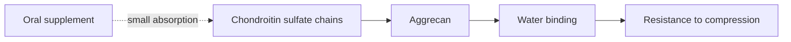

# Chondroitin

## Summary

Chondroitin is a glycosaminoglycan found in connective tissue, especially joint cartilage, where it helps cartilage retain water and resist compression. Supplements contain chondroitin sulfate, usually from bovine, porcine, chicken or shark cartilage. It is used to relieve osteoarthritis symptoms. A Cochrane review found small improvements in pain, with low-quality evidence; large independent trials found little effect.

*This note is educational. It is not medical advice and does not replace a doctor, dietitian or pharmacist, especially during pregnancy, illness or when taking medicines.*

## Prerequisites

- [Glycosaminoglycans](../../../../natural-sciences/chemistry/biochemistry/carbohydrates/glycosaminoglycans.md)

## Core concepts

### Definition

*Chondroitin sulfate* is a sulfated glycosaminoglycan, a long chain of alternating N-acetylgalactosamine and glucuronic acid. Many chondroitin chains attach to a core protein to form *aggrecan*, the main proteoglycan of cartilage ([Glycosaminoglycans](../../../../natural-sciences/chemistry/biochemistry/carbohydrates/glycosaminoglycans.md)).

### Analogy

Chondroitin chains in cartilage are like the bristles of a bottle brush loaded with water: their negative charges repel each other and attract water, so the brush resists being squashed. Supplements aim to add bristles, but the body breaks most of them down before they reach the joint. The analogy breaks because some fragments may still act as signals.

### Mechanism

In cartilage, chondroitin sulfate binds water and gives compressive stiffness. Oral chondroitin is a large molecule; only a small fraction is absorbed intact. Proposed effects: inhibiting cartilage-degrading enzymes (metalloproteinases), reducing inflammation and stimulating proteoglycan production. Prescription-grade chondroitin is approved as a drug in some European countries.

The flowchart shows chondroitin in cartilage.

### Proposed effects and evidence

Each entry states the proposed effect and how strong the human evidence is, using the grades defined in the [Evidence grades](../evidence-grades.md) note.

- **Joint health, elasticity and cushioning.** Structural role in cartilage is established; oral supplements do not rebuild it. Evidence: established physiology.
- **Relief of joint pain in osteoarthritis of the knee and hip.** Cochrane: small improvement in pain over 6 months, low-quality evidence. Evidence: limited.
- **Slowing cartilage degradation.** Some trials show slightly less joint space narrowing. Evidence: limited.
- **Anti-inflammatory action.** Laboratory evidence. Evidence: limited.
- **Improved joint function.** Small effects. Evidence: limited.
- **Recovery after joint injuries.** No meaningful evidence. Evidence: very limited.
- **Synergy with glucosamine.** Combinations did not clearly outperform placebo in GAIT. Evidence: limited.
- **Better quality of life.** Small, inconsistent improvements. Evidence: limited.
- **Reduced need for painkillers.** Some trials report less analgesic use. Evidence: limited.

## Worked example

A 65-year-old with knee osteoarthritis tries chondroitin sulfate 800 to 1,200 mg daily for 3 months. Based on trials, the expected pain reduction is small (about 10 points on a 100-point scale, close to the threshold of what patients notice). Exercise therapy and weight loss, if needed, have larger effects. If no clear improvement is felt after 3 months, continuing makes little sense.

## Trade offs and when to use it

Chondroitin is safe; the main limitation is small benefit and variable product quality (some products contain less than labeled). It may interact with warfarin.

## Common mistakes

- **Relying on chondroitin instead of exercise.** Exercise therapy is the first-line treatment.
- **Buying unregulated products.** Choose pharmaceutical-grade products where available.

## Practice

1. What is chondroitin sulfate?
2. How does chondroitin help cartilage resist compression?
3. What did the Cochrane review conclude?

### Answers

1. A sulfated glycosaminoglycan in cartilage.
2. Its negative charges attract water.
3. Small pain improvement with low-quality evidence.

## Further reading

- Singh, J. A., Noorbaloochi, S., MacDonald, R. et al. (2015). Chondroitin for osteoarthritis. Cochrane Database of Systematic Reviews, CD005614. [DOI](https://doi.org/10.1002/14651858.CD005614.pub2). Cochrane review of chondroitin for osteoarthritis.
- Clegg, D. O., Reda, D. J., Harris, C. L. et al. (2006). Glucosamine, chondroitin sulfate, and the two in combination for painful knee osteoarthritis. New England Journal of Medicine, 354(8), 795-808. [DOI](https://doi.org/10.1056/NEJMoa052771). GAIT trial.
