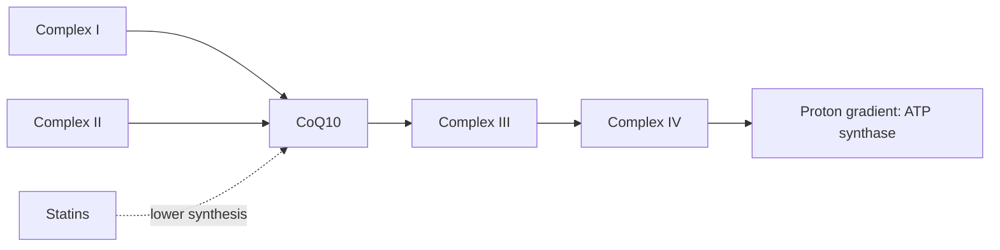

# Coenzyme Q10

## Summary

Coenzyme Q10 (CoQ10, ubiquinone) is a vitamin-like compound made by the body and found in small amounts in meat (especially heart and liver), fish, nuts and some oils. It carries electrons in the mitochondrial electron transport chain, where ATP is made, and is an antioxidant in membranes. Levels are highest in organs with high energy needs (heart, liver, kidneys) and fall with age and with statin use. Evidence supports modest benefits in heart failure and blood pressure, and possibly in migraine; it did not help Parkinson disease.

*This note is educational. It is not medical advice and does not replace a doctor, dietitian or pharmacist, especially during pregnancy, illness or when taking medicines.*

## Prerequisites

- [Oxidative phosphorylation](../../../../natural-sciences/chemistry/biochemistry/oxidative-phosphorylation.md)

## Core concepts

### Definition

*Coenzyme Q10* is a fat-soluble benzoquinone with a chain of 10 isoprene units. It exists in an oxidized form (*ubiquinone*) and a reduced form (*ubiquinol*). It is synthesized from tyrosine and the mevalonate pathway, the same pathway that makes cholesterol and that statins inhibit.

### Analogy

CoQ10 is like a ferry in the mitochondrial power plant, carrying electrons from complexes I and II across to complex III. Without enough ferries, the plant produces less ATP. As ubiquinol, it is also a guard that protects membranes from oxidation. The analogy breaks because, in most people, there are already enough ferries, so adding more does not speed up the plant.

### Mechanism

- **Electron transport.** CoQ10 accepts electrons from complex I and complex II and passes them to complex III, contributing to the proton gradient that drives ATP synthase ([Oxidative phosphorylation](../../../../natural-sciences/chemistry/biochemistry/oxidative-phosphorylation.md), [Mitochondria](../../../../natural-sciences/biology/cell-biology/mitochondria.md)).
- **Antioxidant.** Ubiquinol protects membrane lipids and LDL from oxidation and regenerates vitamin E.
- **Statins.** Statins block HMG-CoA reductase, reducing both cholesterol and CoQ10 synthesis; blood CoQ10 falls by about 20 to 40 percent.
- **Absorption.** It is poorly absorbed; taking it with fat improves absorption.

The flowchart shows CoQ10 in the electron transport chain.

### Proposed effects and evidence

Each entry states the proposed effect and how strong the human evidence is, using the grades defined in the [Evidence grades](../evidence-grades.md) note.

- **Heart health in heart failure.** Q-SYMBIO (420 patients) found fewer major cardiovascular events with 300 mg daily over 2 years; a single trial needing confirmation. Evidence: moderate.
- **Lower blood pressure.** Meta-analyses show reductions, but many trials are small and of low quality. Evidence: limited.
- **Mitochondrial function and energy production.** Essential electron carrier; primary CoQ10 deficiency is treated with supplements. Evidence: established physiology.
- **Protection against oxidative stress and neurodegeneration.** Antioxidant in membranes; no proven benefit in Alzheimer disease. Evidence: limited.
- **Migraine prevention.** A small trial found fewer attacks with 300 mg daily; listed as possibly effective in guidelines. Evidence: limited.
- **Slowing Parkinson disease.** The QE3 trial of high-dose CoQ10 was stopped for futility. Evidence: not supported.
- **Fertility.** Some trials show improved sperm parameters; evidence for women is limited. Evidence: limited.
- **Reducing statin muscle side effects.** Meta-analyses disagree; a 2018 analysis found reduced muscle symptoms. Evidence: limited.

## Worked example

A 70-year-old taking a statin reports muscle aches. Her doctor checks creatine kinase (normal) and suggests trying 100 to 200 mg CoQ10 daily with a meal for 2 to 3 months while keeping the statin, explaining that evidence is mixed. Her aches lessen somewhat, which could be a real effect or a placebo response.

## Trade offs and when to use it

CoQ10 is safe, but it may reduce the effect of warfarin. Ubiquinol is better absorbed but more expensive; both work.

## Common mistakes

- **Stopping statins because of CoQ10 depletion.** The heart benefit of statins is well proven; discuss muscle symptoms with a doctor.
- **Taking CoQ10 on an empty stomach.** Take it with fat for better absorption.

## Practice

1. What is the role of CoQ10 in mitochondria?
2. Why do statins lower CoQ10?
3. What did the QE3 trial find?

### Answers

1. It carries electrons from complexes I and II to complex III.
2. They block the mevalonate pathway that makes both cholesterol and CoQ10.
3. No benefit of CoQ10 in early Parkinson disease.

## Further reading

- Mortensen, S. A., Rosenfeldt, F., Kumar, A. et al. (2014). The effect of coenzyme Q10 on morbidity and mortality in chronic heart failure: results from Q-SYMBIO: a randomized double-blind trial. JACC: Heart Failure, 2(6), 641-649. [DOI](https://doi.org/10.1016/j.jchf.2014.06.008). Q-SYMBIO trial in heart failure.
- Qu, H., Guo, M., Chai, H. et al. (2018). Effects of coenzyme Q10 on statin-induced myopathy: an updated meta-analysis of randomized controlled trials. Journal of the American Heart Association, 7(19), e009835. [DOI](https://doi.org/10.1161/JAHA.118.009835). Meta-analysis of CoQ10 for statin myopathy.
- Parkinson Study Group QE3 Investigators (2014). A randomized clinical trial of high-dosage coenzyme Q10 in early Parkinson disease: no evidence of benefit. JAMA Neurology, 71(5), 543-552. [DOI](https://doi.org/10.1001/jamaneurol.2014.131). QE3 trial in Parkinson disease.
- Sándor, P. S., Di Clemente, L., Coppola, G. et al. (2005). Efficacy of coenzyme Q10 in migraine prophylaxis: a randomized controlled trial. Neurology, 64(4), 713-715. [DOI](https://doi.org/10.1212/01.WNL.0000151975.03598.ED). Trial of CoQ10 in migraine.
