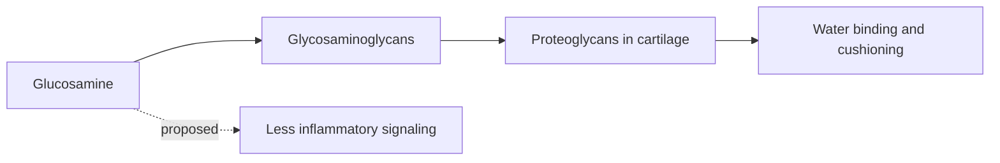

# Glucosamine

## Summary

Glucosamine is a naturally occurring amino sugar and a building block of glycosaminoglycans and proteoglycans in joint cartilage. Supplements contain glucosamine sulfate, glucosamine hydrochloride or N-acetylglucosamine, often combined with chondroitin and MSM. It is widely used for osteoarthritis. Large trials and meta-analyses show that, compared with placebo, the effect on pain is small and usually not clinically important; some trials of crystalline glucosamine sulfate showed slower joint space narrowing.

*This note is educational. It is not medical advice and does not replace a doctor, dietitian or pharmacist, especially during pregnancy, illness or when taking medicines.*

## Prerequisites

- [Glycosaminoglycans](../../../../natural-sciences/chemistry/biochemistry/carbohydrates/glycosaminoglycans.md)

## Core concepts

### Definition

*Glucosamine* is an amino monosaccharide (2-amino-2-deoxyglucose). The body makes it from glucose and glutamine. It is a precursor of hyaluronic acid, keratan sulfate and other glycosaminoglycans ([Glycosaminoglycans](../../../../natural-sciences/chemistry/biochemistry/carbohydrates/glycosaminoglycans.md)).

### Analogy

Glucosamine is like bricks delivered to a construction site where cartilage is being repaired. The idea is that more bricks speed the repair. In reality, the site rarely lacks bricks; the problem is that the builders (cartilage cells) are slow and worn out. The analogy breaks because some glucosamine may also act as a mild anti-inflammatory signal, not only as a brick.

### Mechanism

Chondrocytes use glucosamine to build glycosaminoglycans, which attract water and give cartilage its cushioning. Oral glucosamine is absorbed and reaches the joint fluid in small amounts. Proposed mechanisms include stimulating proteoglycan synthesis, inhibiting cartilage-degrading enzymes and reducing inflammatory signaling (NF-kB). The sulfate may contribute, since sulfate is needed for glycosaminoglycan synthesis.

The flowchart shows the proposed role of glucosamine.

### Proposed effects and evidence

Each entry states the proposed effect and how strong the human evidence is, using the grades defined in the [Evidence grades](../evidence-grades.md) note.

- **Joint health and cartilage regeneration.** Does not regenerate cartilage in humans. Evidence: not supported.
- **Relief of osteoarthritis pain, especially of the knee.** Small effects in meta-analyses; GAIT found no significant overall effect; network meta-analysis found no clinically relevant effect. Evidence: limited.
- **Improved joint function and mobility.** Small or no effect compared with placebo. Evidence: limited.
- **Anti-inflammatory action.** Laboratory evidence; clinical effect small. Evidence: limited.
- **Slowing osteoarthritis progression.** Two trials of crystalline glucosamine sulfate showed less joint space narrowing over 3 years; other trials did not. Evidence: limited.
- **Recovery after joint injuries.** No meaningful evidence. Evidence: very limited.
- **Synergy with chondroitin and MSM.** Combination products do not clearly outperform placebo. Evidence: limited.
- **Skin health through hyaluronic acid.** Small studies of N-acetylglucosamine on skin. Evidence: very limited.
- **Digestive health.** Small studies of N-acetylglucosamine in inflammatory bowel disease. Evidence: very limited.

## Worked example

In the GAIT trial (Clegg and colleagues, 2006), 1,583 people with knee osteoarthritis received glucosamine 1,500 mg, chondroitin 1,200 mg, both, celecoxib or placebo for 24 weeks. Response rates were 60 percent with placebo, 64 percent with glucosamine and 67 percent with the combination (not significant overall), and 70 percent with celecoxib. A subgroup with moderate to severe pain showed a possible benefit of the combination that needs confirmation.

## Trade offs and when to use it

Glucosamine is safe for most people, though shellfish-derived products may concern people with allergies, and it may slightly raise blood glucose in some. Guidelines (for example the American College of Rheumatology) recommend against it for osteoarthritis; some European guidelines allow crystalline glucosamine sulfate.

## Common mistakes

- **Expecting cartilage to regrow.** No human evidence supports regeneration.
- **Continuing for years without benefit.** Stop if no improvement after about 3 months.

## Practice

1. What is glucosamine?
2. What did the GAIT trial find?
3. Which form showed slower joint space narrowing in some trials?

### Answers

1. An amino sugar used to build glycosaminoglycans in cartilage.
2. No significant overall benefit compared with placebo.
3. Crystalline glucosamine sulfate.

## Further reading

- Clegg, D. O., Reda, D. J., Harris, C. L. et al. (2006). Glucosamine, chondroitin sulfate, and the two in combination for painful knee osteoarthritis. New England Journal of Medicine, 354(8), 795-808. [DOI](https://doi.org/10.1056/NEJMoa052771). GAIT trial of glucosamine and chondroitin.
- Wandel, S., Jüni, P., Tendal, B. et al. (2010). Effects of glucosamine, chondroitin, or placebo in patients with osteoarthritis of hip or knee: network meta-analysis. BMJ, 341, c4675. [DOI](https://doi.org/10.1136/bmj.c4675). Network meta-analysis of glucosamine and chondroitin.
