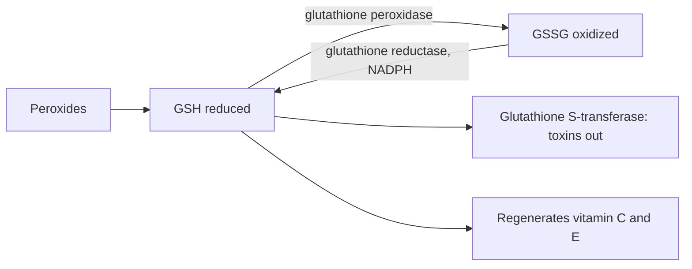

# Glutathione

## Summary

Glutathione (GSH) is a tripeptide of glutamate, cysteine and glycine and the most important antioxidant made inside cells. It neutralizes reactive oxygen species, regenerates vitamins C and E, and binds toxins and drugs in the liver for excretion. Low glutathione is linked to many chronic diseases. Oral glutathione is partly broken down in the gut, but a 6-month trial found that 250 to 1,000 mg daily raised body stores. Precursors such as N-acetylcysteine also raise it. Evidence for clinical benefits of supplements is limited.

*This note is educational. It is not medical advice and does not replace a doctor, dietitian or pharmacist, especially during pregnancy, illness or when taking medicines.*

## Prerequisites

- [Oxidative stress](../../../../natural-sciences/chemistry/biochemistry/oxidative-stress.md)

## Core concepts

### Definition

*Glutathione* (gamma-L-glutamyl-L-cysteinylglycine) exists in a reduced form (GSH) and an oxidized form (GSSG). Its *thiol group* (-SH) on cysteine donates electrons. The GSH to GSSG ratio is a marker of cellular redox status.

### Analogy

Glutathione is like the main fire brigade of the cell: it puts out oxidative fires (peroxides) and helps the other firefighters (vitamins C and E) get back on duty. In the liver, it also escorts toxic visitors out of the body. The analogy breaks because the brigade is made on site; adding pre-made firefighters from outside (oral GSH) works only partly.

### Mechanism

- **Antioxidant.** Glutathione peroxidase (which contains selenium) uses GSH to reduce hydrogen peroxide and lipid peroxides, producing GSSG; glutathione reductase (with NADPH and riboflavin-derived FAD) regenerates GSH ([Selenium](../minerals/selenium.md), [Vitamin B2 (riboflavin)](../vitamins/vitamin-b2.md)).
- **Regeneration of other antioxidants.** GSH reduces dehydroascorbate back to vitamin C, which regenerates vitamin E.
- **Detoxification.** Glutathione S-transferases attach GSH to toxins, drugs and carcinogens, making them water-soluble for excretion. After an acetaminophen overdose, liver GSH is depleted, and N-acetylcysteine is the antidote ([N-acetylcysteine](../../../../natural-sciences/chemistry/biochemistry/amino-acids/n-acetylcysteine.md)).
- **Immunity.** Lymphocyte function depends on adequate GSH.
- **Synthesis.** Cysteine availability limits synthesis.

The flowchart shows the glutathione cycle.

### Proposed effects and evidence

Each entry states the proposed effect and how strong the human evidence is, using the grades defined in the [Evidence grades](../evidence-grades.md) note.

- **Strong antioxidant action.** Central intracellular antioxidant. Evidence: established physiology.
- **Detoxification in the liver.** Essential for conjugation of toxins, drugs and heavy metals. Evidence: established physiology.
- **Immune support.** Needed by lymphocytes; supplements increased NK cell activity in one trial. Evidence: limited.
- **Brain protection against Parkinson and Alzheimer disease.** Intravenous and intranasal glutathione showed no clear benefit in Parkinson trials. Evidence: limited.
- **Cardiovascular health and blood pressure.** Observational links; no outcome trials. Evidence: very limited.
- **Regeneration of other antioxidants.** Regenerates vitamins C and E. Evidence: established physiology.
- **Support in chronic diseases.** Under study; no proven clinical benefit. Evidence: very limited.
- **Protection from UV damage and skin lightening.** Small trials of oral glutathione show slight skin lightening; intravenous use for whitening is unsafe and unproven. Evidence: limited.
- **Diabetes and insulin sensitivity.** Small studies with precursors (glycine and NAC) raised GSH and improved some markers. Evidence: limited.
- **Anti-aging and longevity.** Low GSH is associated with aging; no evidence that supplements slow aging. Evidence: very limited.

## Worked example

In a 6-month randomized trial (Richie and colleagues, 2015), 54 adults took 250 mg or 1,000 mg oral glutathione daily or placebo. Body stores in blood, red cells and lymphocytes rose by 30 to 35 percent at the high dose, and NK cell cytotoxicity doubled. Stores returned to baseline after stopping. The trial measured markers, not health outcomes.

## Trade offs and when to use it

Glutathione supplements are safe orally. N-acetylcysteine is cheaper and well studied for raising glutathione. Intravenous glutathione for skin whitening carries risks and is not recommended by regulators.

## Common mistakes

- **Believing oral glutathione is fully destroyed.** A trial showed body stores rise with daily use.
- **Using intravenous glutathione for skin whitening.** It is unproven and potentially harmful.

## Practice

1. Which three amino acids make glutathione?
2. Which mineral is needed for glutathione peroxidase?
3. What is the antidote for acetaminophen overdose and why?

### Answers

1. Glutamate, cysteine and glycine.
2. Selenium.
3. N-acetylcysteine, because it restores liver glutathione.

## Further reading

- Richie, J. P., Nichenametla, S., Neidig, W. et al. (2015). Randomized controlled trial of oral glutathione supplementation on body stores of glutathione. European Journal of Nutrition, 54(2), 251-263. [DOI](https://doi.org/10.1007/s00394-014-0706-z). Trial of oral glutathione and body stores.
- Smilkstein, M. J., Knapp, G. L., Kulig, K. W. et al. (1988). Efficacy of oral N-acetylcysteine in the treatment of acetaminophen overdose. Analysis of the national multicenter study (1976 to 1985). New England Journal of Medicine, 319(24), 1557-1562. [DOI](https://doi.org/10.1056/NEJM198812153192401). N-acetylcysteine for acetaminophen overdose.
