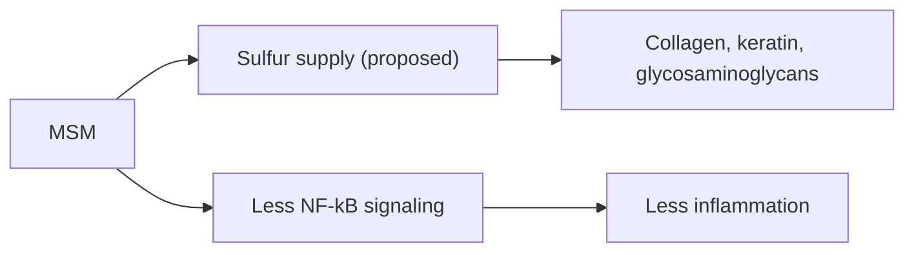

# Methylsulfonylmethane (MSM)

## Summary

Methylsulfonylmethane (MSM) is an organic sulfur compound present in small amounts in fruit, vegetables, grains and animal tissues. It is a popular supplement for joints and skin, on the idea that it supplies sulfur for collagen, keratin and other structural proteins. Small trials suggest modest reductions in osteoarthritis pain and exercise-induced muscle soreness; most other claims lack evidence. It appears safe at doses up to several grams per day.

*This note is educational. It is not medical advice and does not replace a doctor, dietitian or pharmacist, especially during pregnancy, illness or when taking medicines.*

## Prerequisites

No prior notes are needed.

## Core concepts

### Definition

*Methylsulfonylmethane* ((CH3)2SO2) is an organosulfur compound, an oxidation product of dimethyl sulfoxide (DMSO).

### Analogy

MSM is marketed as a delivery of sulfur bricks for the body's connective tissue. The body, however, gets most of its sulfur from the amino acids methionine and cysteine in protein. The analogy breaks because MSM may also have direct anti-inflammatory effects unrelated to sulfur supply.

### Mechanism

Sulfur is part of methionine, cysteine, glutathione, keratin and the sulfate groups of glycosaminoglycans. Whether MSM sulfur is used for these is unclear. Laboratory studies show MSM reduces NF-kB activity and inflammatory cytokines and acts as an antioxidant.

The flowchart shows the proposed actions of MSM.

### Proposed effects and evidence

Each entry states the proposed effect and how strong the human evidence is, using the grades defined in the [Evidence grades](../evidence-grades.md) note.

- **Joint health and osteoarthritis pain.** Small trials (for example 3 g twice daily for 12 weeks) found modest pain improvement. Evidence: limited.
- **Anti-inflammatory action.** Laboratory and small human studies. Evidence: limited.
- **Pain relief including headaches and fibromyalgia.** No meaningful evidence for headaches or fibromyalgia. Evidence: very limited.
- **Skin health, wrinkles and rosacea.** Small studies, some with topical MSM. Evidence: very limited.
- **Muscle recovery after exercise.** Small trials show less soreness. Evidence: limited.
- **Hair and nail health through keratin.** One small industry-funded study. Evidence: very limited.
- **Immune support.** No meaningful evidence. Evidence: very limited.
- **Detoxification and heavy metal removal.** No evidence. Evidence: not supported.
- **Mobility and flexibility.** Follows from small effects on joint pain. Evidence: limited.
- **Allergy symptom relief.** One small trial in seasonal allergic rhinitis. Evidence: very limited.

## Worked example

In a 12-week trial (Kim and colleagues, 2006), 50 people with knee osteoarthritis took 3 g MSM twice daily or placebo. The MSM group had modestly less pain and better function, but the trial was small and the effect would need confirmation in larger studies.

## Trade offs and when to use it

MSM is well tolerated (mild digestive upset possible). Evidence for benefits is limited and comes mainly from small trials.

## Common mistakes

- **Using MSM as a detox agent.** There is no evidence for this.
- **Expecting large effects on arthritis.** Effects in trials are modest.

## Practice

1. What is MSM?
2. What is the best-supported use of MSM?
3. Where does most body sulfur come from?

### Answers

1. An organic sulfur compound.
2. Modest relief of osteoarthritis pain.
3. The amino acids methionine and cysteine.

## Further reading

- Butawan, M., Benjamin, R. L., Bloomer, R. J. (2017). Methylsulfonylmethane: applications and safety of a novel dietary supplement. Nutrients, 9(3), 290. [DOI](https://doi.org/10.3390/nu9030290). Review of MSM applications and safety.
