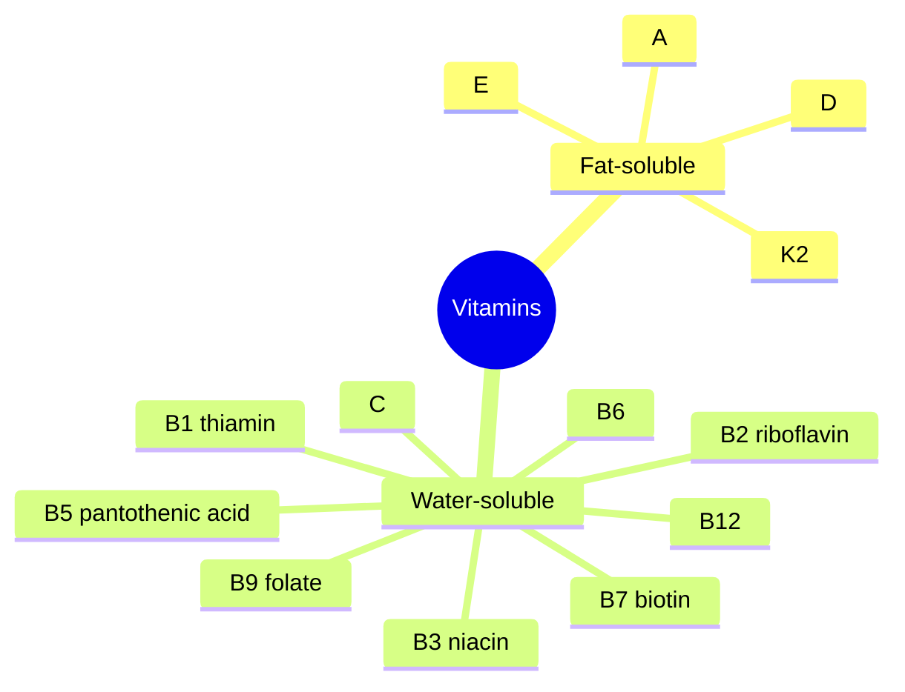

# Vitamins

Vitamins are organic compounds the body needs in small amounts and cannot make in sufficient quantity. There are 13: four fat-soluble (A, D, E, K) and nine water-soluble (C and eight B vitamins). Start with the overview, then read individual vitamins.

## Map

## Reading order

1. [Vitamins overview](vitamins-overview.md)
2. [Vitamin A](vitamin-a.md)
3. [Vitamin D](vitamin-d.md)
4. [Vitamin E](vitamin-e.md)
5. [Vitamin K2](vitamin-k2.md)
6. [Vitamin C](vitamin-c.md)
7. [Vitamin B1 (thiamin)](vitamin-b1.md)
8. [Vitamin B2 (riboflavin)](vitamin-b2.md)
9. [Vitamin B3 (niacin)](vitamin-b3.md)
10. [Vitamin B5 (pantothenic acid)](vitamin-b5.md)
11. [Vitamin B6](vitamin-b6.md)
12. [Vitamin B7 (biotin)](vitamin-b7.md)
13. [Vitamin B9 (folate)](vitamin-b9.md)
14. [Vitamin B12](vitamin-b12.md)
