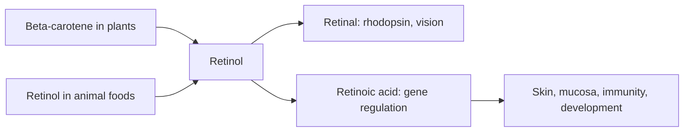

# Vitamin A

## Summary

Vitamin A is a fat-soluble vitamin needed for vision, immunity, skin and mucous membranes, and cell growth and differentiation. It exists as preformed retinol in animal foods and as provitamin A carotenoids (such as beta-carotene) in plants. Deficiency causes night blindness and raises infection risk, and is a major problem in low-income countries. Excess preformed vitamin A is toxic and can cause birth defects, and beta-carotene supplements increased lung cancer in smokers.

*This note is educational. It is not medical advice and does not replace a doctor, dietitian or pharmacist, especially during pregnancy, illness or when taking medicines.*

## Prerequisites

- [Vitamins overview](vitamins-overview.md)

## Core concepts

### Definition

*Vitamin A* is a group of fat-soluble retinoids: retinol, retinal and retinoic acid. *Provitamin A carotenoids* (beta-carotene, alpha-carotene, beta-cryptoxanthin) are converted to retinol in the body. Intake is expressed in *retinol activity equivalents* (RAE).

### Analogy

Vitamin A is like the film in an old camera and the instruction manual for building cells. In the eye, retinal is the light-sensitive film; in other tissues, retinoic acid tells cells what to become. The analogy breaks because too much of this "manual" is harmful, especially to a developing fetus.

### Mechanism

**Vision.** In the retina, 11-cis-retinal binds opsin to form rhodopsin, the pigment for vision in low light. Light converts it to all-trans-retinal, starting the nerve signal. Deficiency first causes night blindness and, if severe, xerophthalmia and blindness.

**Gene regulation.** Retinoic acid binds nuclear receptors (RAR and RXR) and regulates genes for cell growth and differentiation in skin, mucous membranes, immune cells, bone and the developing embryo.

**Immunity and barriers.** Vitamin A maintains the mucous membranes of the respiratory and digestive tracts (the first line of defense) and supports immune cell function, including NK cells.

The flowchart shows the forms of vitamin A and their roles.

### Intake and food sources

| Item | Value |
| --- | --- |
| RDA (adults) | 900 µg RAE men, 700 µg RAE women |
| UL (preformed retinol) | 3,000 µg per day |
| Animal sources (retinol) | Liver, eggs, milk, butter, fatty fish (salmon, mackerel) |
| Plant sources (carotenoids) | Carrots, sweet potatoes, pumpkin, spinach, kale, other green and orange vegetables and fruit |

100 g of beef liver contains about 7,000 to 9,000 µg RAE, more than twice the UL; pregnant women are advised not to eat liver frequently.

### Proposed effects and evidence

Each entry states the proposed effect and how strong the human evidence is, using the grades defined in the [Evidence grades](../evidence-grades.md) note.

- **Vision.** Essential for rhodopsin and vision in dim light; deficiency causes night blindness. Evidence: established physiology.
- **Skin health and acne.** Retinoids regulate skin cell growth; prescription retinoids (tretinoin, isotretinoin) treat acne, but dietary vitamin A does not have the same effect. Evidence: strong.
- **Immune support.** Deficiency increases infections; supplementation reduces child mortality in deficient populations. Evidence: strong.
- **Cell development and tissue differentiation.** Essential for fetal and child development. Evidence: established physiology.
- **Protection against oxidative stress through carotenoids.** Carotenoids are antioxidants in the test tube; beta-carotene supplements did not prevent disease and increased lung cancer in smokers. Evidence: not supported.
- **Health of mucous membranes.** Needed for respiratory and digestive mucosa. Evidence: established physiology.
- **Bone health.** Needed for bone growth; excess is linked to higher fracture risk. Evidence: moderate.
- **Digestive health.** Maintains gut mucosa; benefit beyond adequacy not shown. Evidence: limited.
- **Hormonal function.** Involved in synthesis of some hormones, including sex hormones; clinical relevance unclear. Evidence: very limited.
- **Fertility.** Needed for reproduction; excess supplements are toxic, especially in pregnancy. Evidence: established physiology.

## Worked example

A person eats a carrot (about 500 µg RAE from beta-carotene) and a portion of spinach with olive oil. The fat improves carotenoid absorption, and the body converts beta-carotene to retinol as needed, so carotenoids from food do not cause vitamin A toxicity. Eating 100 g of liver weekly provides plenty; eating it daily during pregnancy would exceed the UL.

## Trade offs and when to use it

Food sources are safe. Preformed vitamin A supplements above the UL can cause liver damage, bone loss and birth defects. Smokers should not take beta-carotene supplements.

## Common mistakes

- **Taking high-dose vitamin A in pregnancy.** Preformed vitamin A above the UL can cause birth defects.
- **Thinking carotene-rich foods cause toxicity.** Conversion is regulated; only skin yellowing (carotenemia) occurs.

## Practice

1. What is the role of retinal in vision?
2. What are the two dietary forms of vitamin A?
3. What did the ATBC trial find?

### Answers

1. It forms rhodopsin, the pigment for vision in dim light.
2. Preformed retinol (animal foods) and provitamin A carotenoids (plants).
3. Beta-carotene supplements increased lung cancer in smokers.

## Further reading

- NIH Office of Dietary Supplements. Vitamin A: Fact Sheet for Health Professionals. [Link](https://ods.od.nih.gov/factsheets/VitaminA-HealthProfessional/). Reference intakes, sources and safety.
- Alpha-Tocopherol, Beta Carotene Cancer Prevention Study Group (1994). The effect of vitamin E and beta carotene on the incidence of lung cancer and other cancers in male smokers. New England Journal of Medicine, 330(15), 1029-1035. [DOI](https://doi.org/10.1056/NEJM199404143301501). Trial of beta-carotene in smokers.
