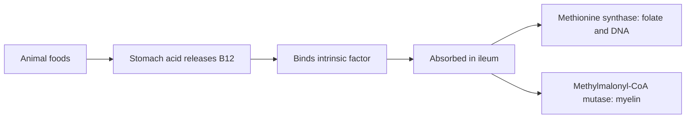

# Vitamin B12

## Summary

Vitamin B12 (cobalamin) is a water-soluble vitamin containing cobalt. It is needed for red blood cell formation, DNA synthesis, nerve myelin and energy metabolism. It is found almost only in animal foods, so vegans need supplements or fortified foods. Absorption requires intrinsic factor from the stomach; deficiency is common in older adults and with metformin or acid-reducing drugs, and causes megaloblastic anemia and nerve damage that can become permanent.

*This note is educational. It is not medical advice and does not replace a doctor, dietitian or pharmacist, especially during pregnancy, illness or when taking medicines.*

## Prerequisites

- [Vitamins overview](vitamins-overview.md)

## Core concepts

### Definition

*Vitamin B12* is a group of cobalt-containing compounds (cobalamins): methylcobalamin and adenosylcobalamin are the coenzyme forms; cyanocobalamin and hydroxocobalamin are common supplement and injection forms. *Intrinsic factor* is a protein from the stomach needed for B12 absorption in the ileum.

### Analogy

B12 is like the key that frees folate. Without B12, folate gets trapped in one form (the "methyl trap") and cannot be used to build DNA, so red blood cells cannot mature. B12 also maintains the insulation of nerves. The analogy breaks because B12 has a second, separate job in mitochondria that has nothing to do with folate.

### Mechanism

Two enzymes need B12:

- **Methionine synthase** (methylcobalamin) transfers a methyl group from 5-methyltetrahydrofolate to homocysteine, forming methionine and regenerating usable folate. Without it, folate is trapped and DNA synthesis slows (megaloblastic anemia), and homocysteine rises.
- **Methylmalonyl-CoA mutase** (adenosylcobalamin) converts methylmalonyl-CoA to succinyl-CoA. Without it, methylmalonic acid accumulates, which is thought to contribute to myelin damage and neuropathy.

**Absorption.** Stomach acid releases B12 from food proteins; it binds haptocorrin, then intrinsic factor in the small intestine, and is absorbed in the terminal ileum. Pernicious anemia (autoimmune loss of intrinsic factor), atrophic gastritis, proton pump inhibitors and metformin reduce absorption. About 1 percent of oral B12 is absorbed by passive diffusion without intrinsic factor, so high oral doses (1,000 µg) can treat deficiency. Liver stores last several years.

The flowchart shows B12 absorption and functions.

### Intake and food sources

| Item | Value |
| --- | --- |
| RDA | 2.4 µg; 2.6 µg in pregnancy |
| UL | Not set |
| Food sources | Meat (beef, chicken), fish (salmon, tuna), eggs, dairy (milk, yogurt, cheese), fortified plant drinks and cereals |
| At-risk groups | Vegans, adults over 50 (atrophic gastritis), people on metformin or proton pump inhibitors, after gastric surgery, pernicious anemia |

### Proposed effects and evidence

Each entry states the proposed effect and how strong the human evidence is, using the grades defined in the [Evidence grades](../evidence-grades.md) note.

- **Red blood cell production.** Deficiency causes megaloblastic anemia. Evidence: established physiology.
- **Nervous system health and myelin.** Deficiency causes neuropathy, sensory loss, memory and concentration problems. Evidence: established physiology.
- **DNA synthesis.** Required through the folate cycle. Evidence: established physiology.
- **Energy metabolism and fatigue.** Deficiency causes fatigue; B12 injections do not increase energy in people who are not deficient. Evidence: not supported.
- **Antioxidant protection.** Not a recognized function. Evidence: very limited.
- **Heart health through homocysteine.** Lowers homocysteine; trials showed no reduction in cardiovascular events. Evidence: not supported.
- **Mental health and cognition.** Deficiency causes depression and cognitive decline; supplements do not improve cognition in people with normal levels. Evidence: limited.
- **Digestive health and stomach acid.** Not a function of B12; low stomach acid causes deficiency rather than the reverse. Evidence: not supported.
- **Prevention of neurodegenerative diseases.** No benefit shown in trials. Evidence: limited.
- **Reproductive health.** Deficiency is linked to infertility; correction may help. Evidence: limited.

## Worked example

A 70-year-old taking metformin and a proton pump inhibitor for years develops numb feet and fatigue. Blood tests show low B12 and high methylmalonic acid. Treatment with 1,000 µg oral B12 daily (or injections) normalizes levels within weeks; nerve symptoms improve over months, but long-standing damage may remain.

## Trade offs and when to use it

Supplements are essential for vegans and often needed in older adults. B12 has no known toxicity.

## Common mistakes

- **Relying on spirulina or seaweed for B12 on a vegan diet.** They contain inactive analogs; use supplements or fortified foods.
- **Treating anemia with folic acid alone in older adults.** Check B12 to avoid masking deficiency.

## Practice

1. What protein is needed for B12 absorption?
2. Name two enzymes that need B12.
3. Which groups are at risk of deficiency?

### Answers

1. Intrinsic factor.
2. Methionine synthase and methylmalonyl-CoA mutase.
3. Vegans, older adults, people on metformin or proton pump inhibitors.

## Further reading

- NIH Office of Dietary Supplements. Vitamin B12: Fact Sheet for Health Professionals. [Link](https://ods.od.nih.gov/factsheets/VitaminB12-HealthProfessional/). Reference intakes, absorption and evidence.
