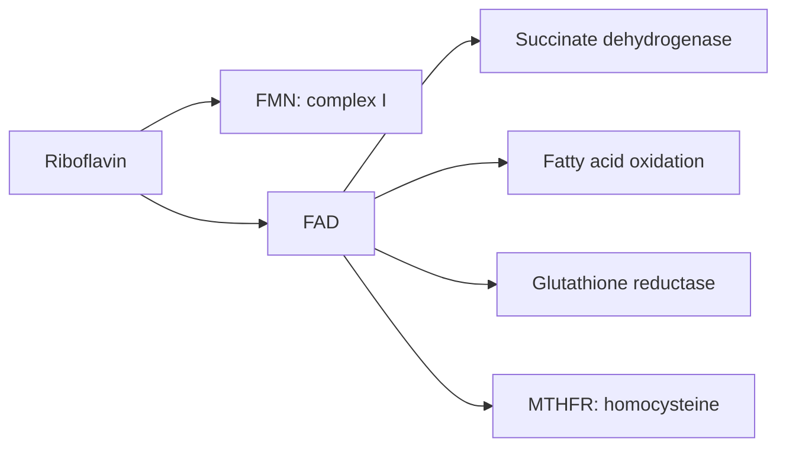

# Vitamin B2 (riboflavin)

## Summary

Riboflavin (vitamin B2) is a water-soluble vitamin that forms the coenzymes FMN and FAD. These carry electrons in energy metabolism, including the Krebs cycle, fatty acid breakdown and the electron transport chain. Riboflavin is also needed to recycle glutathione and to activate vitamin B6 and folate. Deficiency causes cracks at the corners of the mouth, an inflamed tongue and sore throat. High-dose riboflavin (400 mg) reduces migraine frequency in some trials.

*This note is educational. It is not medical advice and does not replace a doctor, dietitian or pharmacist, especially during pregnancy, illness or when taking medicines.*

## Prerequisites

- [Vitamins overview](vitamins-overview.md)

## Core concepts

### Definition

*Riboflavin* is a water-soluble B vitamin. It is the precursor of *flavin mononucleotide* (FMN) and *flavin adenine dinucleotide* (FAD), coenzymes of flavoproteins that carry electrons.

### Analogy

Riboflavin is like the battery inside many hand-held tools: FAD and FMN pick up electrons in one reaction and deliver them in another. The analogy breaks because these batteries also help recharge other vitamins (B6, folate) and glutathione.

### Mechanism

- **Energy metabolism.** FAD is a coenzyme of succinate dehydrogenase (Krebs cycle and complex II), acyl-CoA dehydrogenase (fatty acid oxidation, [Beta-oxidation](../../../../natural-sciences/chemistry/biochemistry/beta-oxidation.md)) and other enzymes; FMN is part of complex I ([Oxidative phosphorylation](../../../../natural-sciences/chemistry/biochemistry/oxidative-phosphorylation.md)).
- **Antioxidant recycling.** FAD is the coenzyme of glutathione reductase, which regenerates reduced glutathione.
- **Other vitamins.** Riboflavin is needed to convert vitamin B6 to its active form and for methylenetetrahydrofolate reductase (MTHFR), linking it to homocysteine metabolism.

The flowchart shows riboflavin's coenzymes.

### Intake and food sources

| Item | Value |
| --- | --- |
| RDA | 1.3 mg men, 1.1 mg women |
| UL | Not set (excess turns urine bright yellow) |
| Food sources | Meat (beef, liver), dairy (milk, yogurt, cheese), eggs, nuts, seeds, green leafy vegetables (spinach, broccoli), fortified cereals |

### Proposed effects and evidence

Each entry states the proposed effect and how strong the human evidence is, using the grades defined in the [Evidence grades](../evidence-grades.md) note.

- **Energy metabolism.** FAD and FMN are essential electron carriers. Evidence: established physiology.
- **Skin health: angular cheilitis and glossitis.** Deficiency causes these; correction treats them. Evidence: established physiology.
- **Eye protection and cataract prevention.** Observational links with cataract; trials inconsistent. Evidence: limited.
- **Nervous system function.** Deficiency can contribute to neuropathy. Evidence: limited.
- **Health of mucous membranes.** Deficiency causes sore throat and inflamed mucosa. Evidence: established physiology.
- **Antioxidant action.** Indirect, through glutathione reductase. Evidence: established physiology.
- **Heart health through homocysteine.** Lowers homocysteine in people with the MTHFR 677TT genotype; effect on events not shown. Evidence: limited.
- **Growth and development.** Needed for growth. Evidence: established physiology.
- **Migraine prevention.** 400 mg daily halved migraine frequency in about half of patients in a small trial; recommended as a possible option in some guidelines. Evidence: moderate.
- **Protection against metabolic diseases.** No specific human evidence beyond adequacy. Evidence: very limited.

## Worked example

A patient with frequent migraines takes 400 mg riboflavin daily for 3 months, as in Schoenen and colleagues' trial, where 59 percent of patients had at least a 50 percent reduction in migraine days versus 15 percent on placebo. The only side effect is bright yellow urine. The trial was small (55 patients), so the effect needs confirmation.

## Trade offs and when to use it

Riboflavin is cheap and safe; deficiency is uncommon except in people with very low dairy and meat intake or alcohol use disorder.

## Common mistakes

- **Expecting fast results in migraine.** Effects appear after about 3 months.
- **Worrying about yellow urine.** It is harmless excretion of excess riboflavin.

## Practice

1. Which coenzymes are made from riboflavin?
2. Name two signs of riboflavin deficiency.
3. What dose was used for migraine prevention?

### Answers

1. FMN and FAD.
2. Angular cheilitis and glossitis.
3. 400 mg daily.

## Further reading

- NIH Office of Dietary Supplements. Riboflavin: Fact Sheet for Health Professionals. [Link](https://ods.od.nih.gov/factsheets/Riboflavin-HealthProfessional/). Reference intakes and evidence.
- Schoenen, J., Jacquy, J., Lenaerts, M. (1998). Effectiveness of high-dose riboflavin in migraine prophylaxis. A randomized controlled trial. Neurology, 50(2), 466-470. [DOI](https://doi.org/10.1212/wnl.50.2.466). Randomized trial of riboflavin for migraine.
