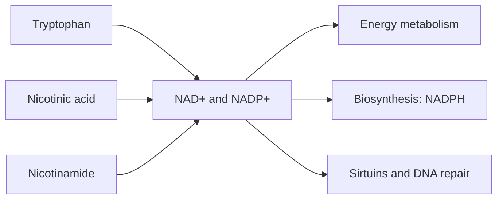

# Vitamin B3 (niacin)

## Summary

Niacin (vitamin B3) is a water-soluble vitamin that exists as nicotinic acid and nicotinamide. It forms NAD+ and NADP+, coenzymes in hundreds of reactions of energy metabolism and biosynthesis. The body can also make niacin from tryptophan. Deficiency causes pellagra (dermatitis, diarrhea, dementia). High-dose nicotinic acid lowers LDL, triglycerides and lipoprotein(a) and raises HDL, but in large trials on top of statins it did not reduce heart attacks and caused side effects.

*This note is educational. It is not medical advice and does not replace a doctor, dietitian or pharmacist, especially during pregnancy, illness or when taking medicines.*

## Prerequisites

- [Vitamins overview](vitamins-overview.md)

## Core concepts

### Definition

*Niacin* refers to nicotinic acid and nicotinamide (niacinamide). They are precursors of *NAD+* (nicotinamide adenine dinucleotide) and *NADP+*. Intake is expressed in *niacin equivalents* (NE), where 60 mg tryptophan counts as about 1 mg niacin.

### Analogy

NAD+ is like a shuttle bus for electrons: it picks them up in glycolysis and the Krebs cycle and drops them at the electron transport chain to make ATP. NADP+ is a second shuttle line for building molecules. The analogy breaks because NAD+ is also consumed in signaling and DNA repair, not only recycled.

### Mechanism

- **Energy.** NAD+ accepts electrons in glycolysis, pyruvate oxidation, the Krebs cycle and beta-oxidation, becoming NADH, which feeds the electron transport chain.
- **Biosynthesis.** NADPH provides reducing power for fatty acid and cholesterol synthesis and regenerates glutathione.
- **Signaling and repair.** NAD+ is used by sirtuins and PARP enzymes (DNA repair).
- **Pharmacological lipid effects.** At 1 to 3 g per day, nicotinic acid reduces release of fatty acids from fat tissue and hepatic VLDL production, lowering LDL, triglycerides and Lp(a) and raising HDL. Nicotinamide has no lipid effect.

The flowchart shows niacin forms and roles.

### Intake and food sources

| Item | Value |
| --- | --- |
| RDA | 16 mg NE men, 14 mg NE women |
| UL | 35 mg from supplements and fortified foods (flushing threshold) |
| Food sources | Meat (chicken, turkey, beef), fish (tuna, salmon), nuts, seeds, whole grains, some vegetables and fruit; also made from tryptophan |

Side effects of high-dose nicotinic acid: flushing, itching, liver toxicity, higher blood glucose and gout.

### Proposed effects and evidence

Each entry states the proposed effect and how strong the human evidence is, using the grades defined in the [Evidence grades](../evidence-grades.md) note.

- **Energy metabolism.** NAD+ and NADP+ are essential for converting carbohydrates, fats and proteins to energy. Evidence: established physiology.
- **Improved cholesterol levels.** High-dose nicotinic acid lowers LDL and triglycerides and raises HDL, but added to statins it did not reduce cardiovascular events (AIM-HIGH, HPS2-THRIVE). Evidence: not supported.
- **Skin health and acne.** Topical niacinamide improves acne and skin barrier in trials; oral effects less clear. Evidence: moderate.
- **Nervous system function.** Deficiency causes depression, anxiety and neuritis. Evidence: established physiology.
- **Prevention and treatment of pellagra.** Niacin cures pellagra (dermatitis, diarrhea, dementia). Evidence: established physiology.
- **Metabolic functions: fatty acid and hormone synthesis.** NADPH is needed for these syntheses. Evidence: established physiology.
- **Anti-inflammatory action.** Laboratory evidence; clinical evidence limited. Evidence: very limited.
- **Heart health through lipid profile.** Lipid changes do not translate into fewer events on top of statins. Evidence: not supported.
- **Digestive health.** Deficiency causes diarrhea and mucosal inflammation. Evidence: established physiology.
- **Reduced risk of neurodegenerative diseases.** Observational and laboratory data; NAD+ precursors under study. Evidence: very limited.

## Worked example

A patient with high Lp(a) and low HDL already takes a statin. Adding 2 g of extended-release niacin raises HDL by about 25 percent and lowers Lp(a) by about 20 percent. In HPS2-THRIVE (25,673 patients), however, niacin did not reduce major vascular events and increased serious side effects, so guidelines no longer recommend it for this purpose ([Lipoprotein(a)](../../../../natural-sciences/chemistry/biochemistry/lipids/lipoprotein-a.md)).

## Trade offs and when to use it

Dietary niacin is safe; deficiency is rare where diets are varied. Pharmacological doses are no longer recommended for cardiovascular prevention.

## Common mistakes

- **Taking high-dose niacin for cholesterol on your own.** It causes side effects without proven benefit on events.
- **Confusing niacin and nicotinamide.** Only nicotinic acid affects lipids and causes flushing.

## Practice

1. Which coenzymes are made from niacin?
2. What are the three Ds of pellagra?
3. Why is niacin no longer used to prevent heart disease?

### Answers

1. NAD+ and NADP+.
2. Dermatitis, diarrhea and dementia.
3. Trials on top of statins showed no reduction in events and more side effects.

## Further reading

- NIH Office of Dietary Supplements. Niacin: Fact Sheet for Health Professionals. [Link](https://ods.od.nih.gov/factsheets/Niacin-HealthProfessional/). Reference intakes and evidence.
- HPS2-THRIVE Collaborative Group (2014). Effects of extended-release niacin with laropiprant in high-risk patients. New England Journal of Medicine, 371(3), 203-212. [DOI](https://doi.org/10.1056/NEJMoa1300955). HPS2-THRIVE trial of niacin.
- AIM-HIGH Investigators (2011). Niacin in patients with low HDL cholesterol levels receiving intensive statin therapy. New England Journal of Medicine, 365(24), 2255-2267. [DOI](https://doi.org/10.1056/NEJMoa1107579). AIM-HIGH trial of niacin.
