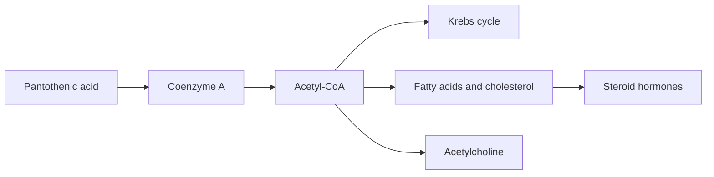

# Vitamin B5 (pantothenic acid)

## Summary

Pantothenic acid (vitamin B5) is a water-soluble vitamin that forms coenzyme A (CoA), central to energy metabolism and to the synthesis of fatty acids, cholesterol, steroid hormones and acetylcholine. It occurs in almost all foods ("pantothen" means "from everywhere"), so deficiency is very rare. Most marketing claims for skin, hair and stress have little support.

*This note is educational. It is not medical advice and does not replace a doctor, dietitian or pharmacist, especially during pregnancy, illness or when taking medicines.*

## Prerequisites

- [Vitamins overview](vitamins-overview.md)

## Core concepts

### Definition

*Pantothenic acid* is a water-soluble B vitamin and the precursor of *coenzyme A* (CoA) and of the acyl carrier protein used in fatty acid synthesis.

### Analogy

Coenzyme A is like a universal handle that attaches to small carbon fragments so enzymes can grab them: the acetyl group in acetyl-CoA is the most famous example. The analogy breaks because CoA is not just a handle but also activates the fragment for reactions.

### Mechanism

CoA carries acyl groups as thioesters:

- acetyl-CoA enters the Krebs cycle and is the starting point for fatty acids, cholesterol and steroid hormones;
- fatty acids are activated as acyl-CoA before beta-oxidation;
- acetyl-CoA is used to make the neurotransmitter acetylcholine.

The flowchart shows coenzyme A at the center of metabolism.

### Intake and food sources

| Item | Value |
| --- | --- |
| Adequate intake | 5 mg per day |
| UL | Not set |
| Food sources | Meat (chicken, beef, liver), fish, dairy (yogurt, cheese), legumes (beans, lentils), nuts (almonds, hazelnuts), seeds (sunflower, sesame), green vegetables (broccoli, spinach), whole grains, mushrooms, eggs |

### Proposed effects and evidence

Each entry states the proposed effect and how strong the human evidence is, using the grades defined in the [Evidence grades](../evidence-grades.md) note.

- **Energy metabolism.** Part of CoA, essential for the Krebs cycle. Evidence: established physiology.
- **Support of hormone synthesis (adrenaline, cortisol).** CoA is needed for steroid synthesis; supplements do not improve adrenal function in healthy people. Evidence: established physiology.
- **Skin health and acne.** One small trial of high-dose pantothenic acid found reduced acne lesions. Evidence: very limited.
- **Hair health and hair loss.** Common in hair cosmetics as panthenol (moisturizing); no evidence that it prevents hair loss. Evidence: very limited.
- **Wound healing.** Topical dexpanthenol may support healing of minor wounds and burns. Evidence: limited.
- **Nervous system and acetylcholine.** Needed for acetylcholine synthesis. Evidence: established physiology.
- **Antioxidant action.** Little evidence of direct antioxidant effect. Evidence: very limited.
- **Cholesterol regulation.** Pantethine (a derivative) modestly lowered LDL in small trials. Evidence: limited.
- **Digestive health.** No specific evidence. Evidence: very limited.
- **Mental health, depression and anxiety.** No meaningful human evidence. Evidence: very limited.

## Worked example

A typical mixed diet provides about 5 to 10 mg pantothenic acid daily without any planning: 100 g chicken liver alone contains about 6 mg. This is why deficiency was only observed in experimental diets and severe malnutrition (for example "burning feet syndrome" in prisoners of war).

## Trade offs and when to use it

Supplements are unnecessary for most people. Dexpanthenol creams are a reasonable option for minor skin irritation.

## Common mistakes

- **Buying B5 supplements for hair loss.** There is no evidence.
- **Worrying about deficiency.** It is extremely rare.

## Practice

1. Which coenzyme contains pantothenic acid?
2. Why is deficiency rare?
3. Name two syntheses that need CoA.

### Answers

1. Coenzyme A.
2. Pantothenic acid occurs in almost all foods.
3. Fatty acids and steroid hormones (also acetylcholine).

## Further reading

- NIH Office of Dietary Supplements. Pantothenic Acid: Fact Sheet for Health Professionals. [Link](https://ods.od.nih.gov/factsheets/PantothenicAcid-HealthProfessional/). Reference intakes and evidence.
