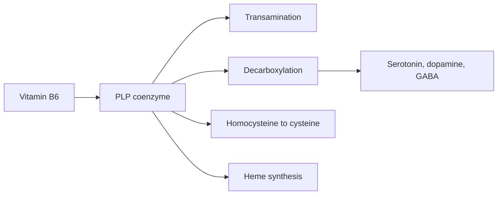

# Vitamin B6

## Summary

Vitamin B6 is a group of water-soluble compounds (pyridoxine, pyridoxal, pyridoxamine) whose active form, pyridoxal 5'-phosphate (PLP), is a coenzyme for more than 100 enzymes, mostly in amino acid metabolism. It is needed to make serotonin, dopamine, norepinephrine and GABA, for heme synthesis and for homocysteine metabolism. Deficiency causes dermatitis, anemia, depression and confusion. Long-term high doses (above about 50 to 100 mg daily) cause peripheral neuropathy.

*This note is educational. It is not medical advice and does not replace a doctor, dietitian or pharmacist, especially during pregnancy, illness or when taking medicines.*

## Prerequisites

- [Vitamins overview](vitamins-overview.md)

## Core concepts

### Definition

*Vitamin B6* includes pyridoxine, pyridoxal and pyridoxamine and their phosphates. *Pyridoxal 5'-phosphate* (PLP) is the active coenzyme.

### Analogy

PLP is like a multi-tool for reshaping amino acids: it helps move amino groups (transamination), remove carboxyl groups (decarboxylation) and rearrange molecules. Many neurotransmitters are made by its decarboxylation function. The analogy breaks because too much of this multi-tool, from supplements, damages nerves.

### Mechanism

- **Amino acid metabolism.** PLP enables transamination (moving amino groups between amino acids and keto acids) and decarboxylation.
- **Neurotransmitters.** Decarboxylation of 5-hydroxytryptophan to serotonin, L-DOPA to dopamine, glutamate to GABA, histidine to histamine.
- **Homocysteine.** PLP is the coenzyme of cystathionine beta-synthase, which converts homocysteine to cysteine (with B12 and folate in the other branch).
- **Heme synthesis** and glycogen breakdown (glycogen phosphorylase).

The flowchart shows key reactions using PLP.

### Intake and food sources

| Item | Value |
| --- | --- |
| RDA | 1.3 mg (adults 19 to 50); 1.7 mg men and 1.5 mg women over 50 |
| UL | 100 mg (US); 12 mg (EFSA, 2023) |
| Food sources | Meat, fish, potatoes, bananas, nuts, whole grains, chickpeas; also supplements |

Long-term intake above the UL can cause sensory neuropathy (numbness and tingling in hands and feet).

### Proposed effects and evidence

Each entry states the proposed effect and how strong the human evidence is, using the grades defined in the [Evidence grades](../evidence-grades.md) note.

- **Amino acid metabolism.** Essential coenzyme for transamination and decarboxylation. Evidence: established physiology.
- **Neurotransmitter production.** Needed for serotonin, dopamine, norepinephrine and GABA synthesis. Evidence: established physiology.
- **Immune support.** Deficiency impairs lymphocyte function. Evidence: established physiology.
- **Homocysteine regulation.** B6 with B12 and folate lowers homocysteine, but trials found no reduction in cardiovascular events. Evidence: not supported.
- **Skin health and acne.** Deficiency causes dermatitis; benefit for acne not shown. Evidence: very limited.
- **Cognitive function.** Low levels are associated with worse cognition; supplements did not improve cognition in trials. Evidence: limited.
- **Cardiovascular health.** See homocysteine; no event reduction. Evidence: not supported.
- **Relief of premenstrual syndrome symptoms.** A systematic review suggested benefit at up to 100 mg daily, but included trials were of low quality. Evidence: limited.
- **Digestive health.** No specific evidence. Evidence: very limited.
- **Sleep quality through melatonin and serotonin.** Plausible mechanism; little human evidence. Evidence: very limited.
- **Nausea in pregnancy.** Recommended by obstetric guidelines, alone or with doxylamine. Evidence: moderate.

## Worked example

A woman takes several supplements: a B complex with 50 mg B6, a magnesium product with 20 mg B6 and an energy drink powder with 10 mg. Her total is 80 mg daily, far above the EFSA UL of 12 mg. After a year she develops tingling in her feet, and her blood B6 is high. Stopping the supplements gradually resolves the symptoms.

## Trade offs and when to use it

Food sources are safe. Check the total B6 from all supplements, because many products contain it.

## Common mistakes

- **Stacking several supplements with B6.** Add up the total daily dose.
- **Expecting homocysteine lowering to prevent heart disease.** Trials showed no event reduction.

## Practice

1. What is the active form of vitamin B6?
2. Name two neurotransmitters that require B6.
3. What is the main risk of long-term high doses?

### Answers

1. Pyridoxal 5'-phosphate.
2. Serotonin and dopamine (also GABA, norepinephrine).
3. Peripheral sensory neuropathy.

## Further reading

- NIH Office of Dietary Supplements. Vitamin B6: Fact Sheet for Health Professionals. [Link](https://ods.od.nih.gov/factsheets/VitaminB6-HealthProfessional/). Reference intakes, toxicity and evidence.
- Wyatt, K. M., Dimmock, P. W., Jones, P. W. et al. (1999). Efficacy of vitamin B-6 in the treatment of premenstrual syndrome: systematic review. BMJ, 318(7195), 1375-1381. [DOI](https://doi.org/10.1136/bmj.318.7195.1375). Systematic review of B6 and premenstrual syndrome.
