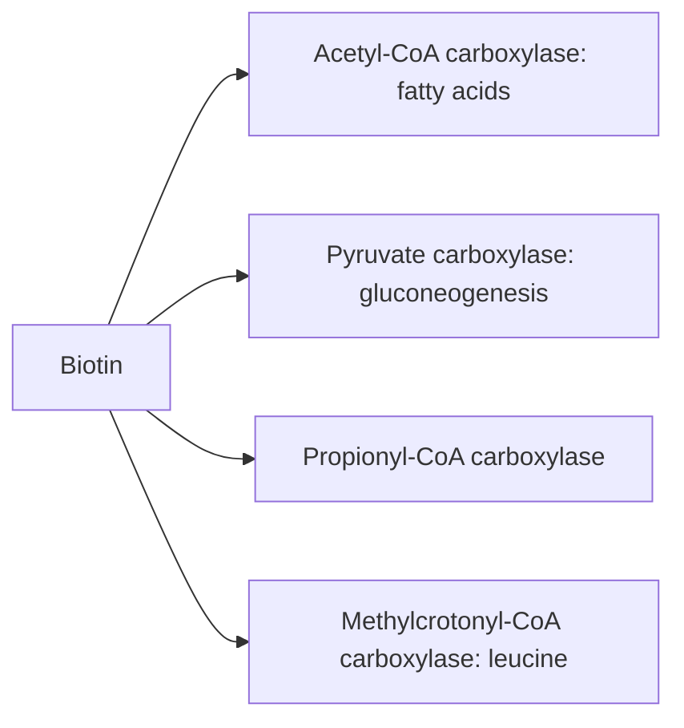

# Vitamin B7 (biotin)

## Summary

Biotin (vitamin B7) is a water-soluble vitamin that serves as a coenzyme for five carboxylase enzymes involved in fatty acid synthesis, gluconeogenesis and amino acid breakdown. Deficiency is rare and causes hair loss, a scaly rash around the eyes, nose and mouth, and neurological symptoms. Biotin is heavily marketed for hair, skin and nails, but benefit is shown only in deficiency. High-dose biotin supplements interfere with many laboratory tests, including thyroid and cardiac troponin tests.

*This note is educational. It is not medical advice and does not replace a doctor, dietitian or pharmacist, especially during pregnancy, illness or when taking medicines.*

## Prerequisites

- [Vitamins overview](vitamins-overview.md)

## Core concepts

### Definition

*Biotin* is a water-soluble B vitamin that acts as the coenzyme of carboxylases: acetyl-CoA carboxylase (fatty acid synthesis), pyruvate carboxylase (gluconeogenesis), propionyl-CoA carboxylase and methylcrotonyl-CoA carboxylase (amino acid breakdown).

### Analogy

Biotin is like a forklift that carries carbon dioxide molecules and attaches them to other molecules. Without the forklift, the building of fatty acids and the making of new glucose stall. The analogy breaks because, unlike a forklift, biotin is attached permanently to its enzyme.

### Mechanism

Biotin is covalently bound to carboxylase enzymes. It picks up bicarbonate (as CO2) and transfers it to a substrate:

- acetyl-CoA to malonyl-CoA (fatty acid synthesis);
- pyruvate to oxaloacetate (gluconeogenesis, [Gluconeogenesis](../../../../natural-sciences/chemistry/biochemistry/gluconeogenesis.md));
- breakdown of leucine and odd-chain fatty acids.

Raw egg white contains avidin, which binds biotin strongly; eating large amounts of raw egg white can cause deficiency. Cooking destroys avidin.

The flowchart shows biotin-dependent carboxylases.

### Intake and food sources

| Item | Value |
| --- | --- |
| Adequate intake | 30 µg per day |
| UL | Not set |
| Food sources | Liver, egg yolk, salmon; legumes (lentils, peas, beans, chickpeas); almonds, walnuts, sunflower seeds; oats, barley, wheat; broccoli, spinach, potatoes; avocado, raspberries |

Supplements of 5,000 to 10,000 µg (common in hair products) can falsely raise or lower results of immunoassays, including thyroid hormones and troponin (FDA, 2017). Tell the laboratory or doctor before blood tests.

### Proposed effects and evidence

Each entry states the proposed effect and how strong the human evidence is, using the grades defined in the [Evidence grades](../evidence-grades.md) note.

- **Metabolism of carbohydrates, fats and proteins.** Coenzyme for carboxylases in fatty acid synthesis and gluconeogenesis. Evidence: established physiology.
- **Skin health.** Deficiency causes dermatitis; benefit in people who are not deficient not shown. Evidence: very limited.
- **Hair health and hair loss.** Deficiency causes hair loss; no evidence of benefit without deficiency. Evidence: very limited.
- **Nail strength.** Small uncontrolled studies reported less brittle nails. Evidence: very limited.
- **Neurological function.** Deficiency causes neurological symptoms; high-dose biotin for progressive multiple sclerosis failed in a large trial. Evidence: not supported.
- **Blood glucose regulation.** Small studies, mostly combined with chromium. Evidence: very limited.
- **Heart health and lipids.** No meaningful evidence. Evidence: very limited.
- **Immune function.** No meaningful evidence beyond adequacy. Evidence: very limited.
- **Digestive health.** No meaningful evidence. Evidence: very limited.
- **Antioxidant protection.** No meaningful evidence. Evidence: very limited.

## Worked example

A woman takes a hair supplement with 10,000 µg biotin. Her blood test shows very low TSH and high free T4, suggesting hyperthyroidism, although she has no symptoms. After stopping biotin for 3 days and retesting, her thyroid results are normal; the earlier result was a laboratory interference.

## Trade offs and when to use it

Biotin is safe at food levels; high-dose supplements give no proven benefit without deficiency and can distort laboratory results.

## Common mistakes

- **Taking megadose biotin before blood tests.** Stop it for several days or tell the laboratory.
- **Expecting biotin to cure hair loss.** It only helps when deficiency is the cause.

## Practice

1. What type of enzymes need biotin?
2. Which raw food can cause biotin deficiency?
3. What is the main risk of high-dose biotin supplements?

### Answers

1. Carboxylases.
2. Raw egg white, through avidin.
3. Interference with laboratory tests.

## Further reading

- NIH Office of Dietary Supplements. Biotin: Fact Sheet for Health Professionals. [Link](https://ods.od.nih.gov/factsheets/Biotin-HealthProfessional/). Reference intakes and evidence.
- US Food and Drug Administration (2017). The FDA warns that biotin may interfere with lab tests: FDA safety communication. [Link](https://www.fda.gov/medical-devices/safety-communications/update-fda-warns-biotin-may-interfere-lab-tests-fda-safety-communication). FDA warning on biotin interference with lab tests.
