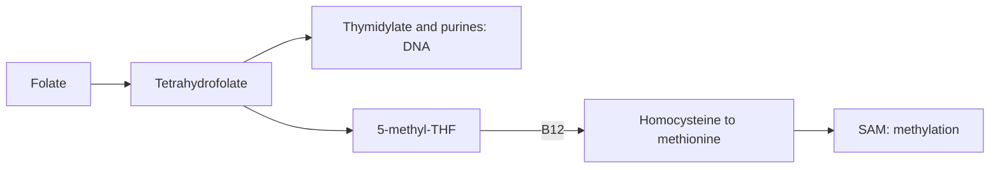

# Vitamin B9 (folate)

## Summary

Folate (vitamin B9) is a water-soluble vitamin needed for DNA synthesis and repair, cell division and amino acid metabolism. Folic acid is the synthetic form used in supplements and fortified foods. Deficiency causes megaloblastic anemia, and low intake in early pregnancy causes neural tube defects such as spina bifida. Taking 400 µg folic acid daily before conception and in early pregnancy reduces neural tube defects substantially.

*This note is educational. It is not medical advice and does not replace a doctor, dietitian or pharmacist, especially during pregnancy, illness or when taking medicines.*

## Prerequisites

- [Vitamins overview](vitamins-overview.md)

## Core concepts

### Definition

*Folate* is the general term for natural forms in food (tetrahydrofolates). *Folic acid* is the synthetic, more stable form. Intake is expressed in *dietary folate equivalents* (DFE): 1 µg folic acid with food equals about 1.7 µg DFE.

### Analogy

Folate is like a delivery service for single carbon atoms. These carbons are needed to build the letters of DNA (thymine and purines) and to recycle homocysteine into methionine. When the delivery service fails, fast-dividing cells such as red blood cell precursors and the cells of the embryo stall. The analogy breaks because folate needs vitamin B12 to complete one of its delivery loops.

### Mechanism

Tetrahydrofolate carries one-carbon units:

- **DNA synthesis.** One-carbon units are used to make thymidylate and purines; deficiency slows DNA synthesis, producing large immature red blood cells (megaloblastic anemia).
- **Methylation and homocysteine.** 5-methyltetrahydrofolate donates a methyl group to homocysteine to form methionine (with B12 as cofactor); methionine forms S-adenosylmethionine, the universal methyl donor.
- **Neural tube.** The neural tube closes in the first 28 days after conception, often before a woman knows she is pregnant, which is why folic acid is recommended before conception.

High folic acid can mask the anemia of B12 deficiency while nerve damage progresses, so B12 status should be checked.

The flowchart shows the folate cycle.

### Intake and food sources

| Item | Value |
| --- | --- |
| RDA | 400 µg DFE; 600 µg in pregnancy |
| Recommendation for women who may become pregnant | 400 µg folic acid daily from supplements or fortified foods, from at least 1 month before conception to 12 weeks of pregnancy |
| UL | 1,000 µg folic acid from supplements and fortified foods |
| Food sources | Leafy vegetables (spinach, kale, lettuce), legumes (lentils, beans, peas, chickpeas), oranges, bananas, avocado, almonds, sunflower seeds, whole grains (brown rice, oats, wheat), fortified bread and cereals |

### Proposed effects and evidence

Each entry states the proposed effect and how strong the human evidence is, using the grades defined in the [Evidence grades](../evidence-grades.md) note.

- **DNA production and repair.** Essential for nucleotide synthesis. Evidence: established physiology.
- **Red blood cell production.** Deficiency causes megaloblastic anemia. Evidence: established physiology.
- **Nervous system function and neurotransmitters.** Needed for synthesis of neurotransmitters through methylation. Evidence: established physiology.
- **Mental health and depression.** Low folate is associated with depression; folate as an add-on to antidepressants has mixed results. Evidence: limited.
- **Healthy pregnancy and neural tube development.** Essential for neural tube closure. Evidence: established physiology.
- **Prevention of neural tube defects.** Folic acid before conception reduced neural tube defects by about 70 percent in the MRC trial. Evidence: strong.
- **Homocysteine regulation.** Lowers homocysteine; small reduction in stroke in a Chinese trial, no effect on heart attacks elsewhere. Evidence: limited.
- **Skin health.** No specific evidence. Evidence: very limited.
- **Digestive health.** Needed for renewal of gut lining; no evidence of benefit beyond adequacy. Evidence: very limited.
- **Antioxidant protection.** Not a major function. Evidence: very limited.

## Worked example

A woman planning pregnancy starts 400 µg folic acid daily three months before trying to conceive and continues through the first trimester. The MRC Vitamin Study showed a 72 percent reduction in recurrence of neural tube defects with folic acid in women with a previously affected pregnancy (they used 4 mg). Countries that fortify flour with folic acid, such as the United States and Canada, saw neural tube defects fall by about 20 to 50 percent.

## Trade offs and when to use it

Folic acid supplements before and in early pregnancy are among the best-supported supplement recommendations. In older adults, check B12 before high-dose folic acid.

## Common mistakes

- **Starting folic acid only after a positive pregnancy test.** The neural tube closes in the first 4 weeks; start before conception.
- **Taking high-dose folic acid without checking B12.** It can mask B12 deficiency.

## Practice

1. What is the difference between folate and folic acid?
2. Why should folic acid start before conception?
3. What anemia does folate deficiency cause?

### Answers

1. Folate is the natural form; folic acid is the synthetic form in supplements.
2. The neural tube closes within about 28 days after conception.
3. Megaloblastic anemia.

## Further reading

- NIH Office of Dietary Supplements. Folate: Fact Sheet for Health Professionals. [Link](https://ods.od.nih.gov/factsheets/Folate-HealthProfessional/). Reference intakes and evidence.
- MRC Vitamin Study Research Group (1991). Prevention of neural tube defects: results of the Medical Research Council Vitamin Study. The Lancet, 338(8760), 131-137. [DOI](https://doi.org/10.1016/0140-6736(91)90133-A). MRC Vitamin Study on neural tube defects.
