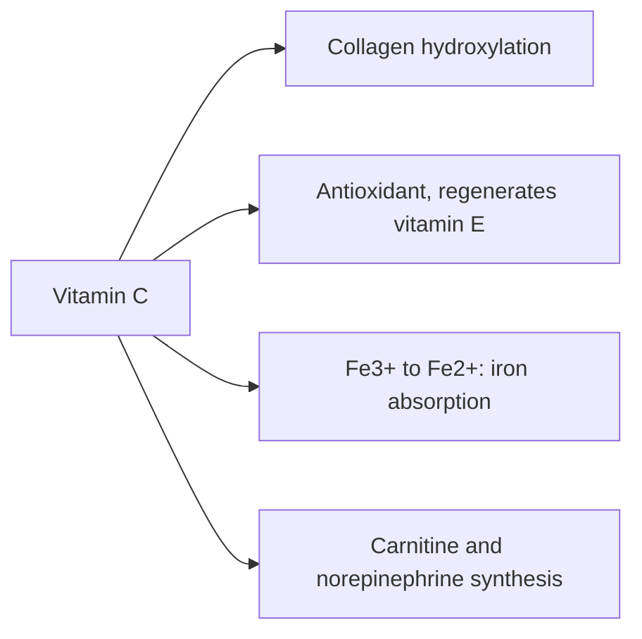

# Vitamin C

## Summary

Vitamin C (ascorbic acid) is a water-soluble vitamin that humans cannot make. It is an antioxidant, a cofactor for collagen synthesis and other enzymes, and it improves absorption of non-heme iron. Deficiency causes scurvy. Good sources are citrus fruit, berries, kiwi, peppers, broccoli and potatoes. Regular supplements slightly shorten colds but do not prevent them in the general population.

*This note is educational. It is not medical advice and does not replace a doctor, dietitian or pharmacist, especially during pregnancy, illness or when taking medicines.*

## Prerequisites

- [Vitamins overview](vitamins-overview.md)

## Core concepts

### Definition

*Vitamin C* (L-ascorbic acid) is a water-soluble antioxidant and enzyme cofactor. Humans, other primates and guinea pigs lack the enzyme L-gulonolactone oxidase and must obtain it from food.

### Analogy

Vitamin C is like a mechanic who keeps resetting the tools used to build collagen. Each time the collagen-building enzyme uses its iron tool, the tool gets "stuck" in the wrong state, and vitamin C resets it. Without the mechanic, collagen comes out weak, and gums bleed. The analogy breaks because vitamin C also has many other jobs, from antioxidant to iron absorption.

### Mechanism

- **Collagen synthesis.** Prolyl and lysyl hydroxylases need vitamin C to keep their iron in the reduced (Fe2+) form. Without hydroxylation, collagen triple helices are unstable, causing the bleeding gums, poor wound healing and fragile vessels of scurvy ([Collagen](../../../../natural-sciences/chemistry/biochemistry/proteins/collagen.md)).
- **Antioxidant.** It donates electrons to neutralize free radicals and regenerates vitamin E.
- **Iron absorption.** It reduces non-heme iron (Fe3+) to the more absorbable Fe2+ in the gut.
- **Other enzymes.** Synthesis of carnitine, norepinephrine and some hormones.

The flowchart shows the main roles of vitamin C.

### Intake and food sources

| Item | Value |
| --- | --- |
| RDA | 90 mg men, 75 mg women; smokers add 35 mg |
| UL | 2,000 mg per day (above this, diarrhea and kidney stone risk) |
| Food sources | Citrus fruit (oranges, lemons), berries, blackcurrants, kiwi, peppers (red pepper about 130 mg per 100 g), broccoli, Brussels sprouts, potatoes |
| Supplement forms | Tablets, capsules, powders and liquids |

### Proposed effects and evidence

Each entry states the proposed effect and how strong the human evidence is, using the grades defined in the [Evidence grades](../evidence-grades.md) note.

- **Antioxidant action.** Well established chemically; supplements do not reduce chronic disease in well-nourished people. Evidence: established physiology.
- **Immune support.** Needed by immune cells; deficiency impairs immunity. Evidence: established physiology.
- **Collagen production and wound healing.** Essential cofactor; deficiency causes scurvy. Evidence: established physiology.
- **Skin health and photoprotection.** Topical vitamin C has some evidence; oral supplements beyond adequacy little. Evidence: limited.
- **Improved non-heme iron absorption.** Consistent effect in absorption studies. Evidence: strong.
- **Heart health and blood pressure.** Small blood pressure reductions in some meta-analyses; no reduction in cardiovascular events. Evidence: limited.
- **Protection against chronic diseases.** Observational associations with fruit and vegetable intake; supplement trials negative. Evidence: not supported.
- **Eye health and AMD.** Part of the AREDS formula; effect of vitamin C alone not shown. Evidence: limited.
- **Shorter and milder colds.** Regular supplements shorten colds by about 8 percent in adults; no prevention except in people under heavy physical stress. Evidence: moderate.
- **Liver detoxification.** Supports liver function as an antioxidant; "detox" claims are vague. Evidence: very limited.

## Worked example

A vegetarian eats lentils (non-heme iron) with a glass of orange juice (about 80 mg vitamin C). The vitamin C can roughly double the absorption of non-heme iron from the meal. In the Cochrane review, people who took at least 200 mg daily had colds about 8 percent shorter (about half a day for a week-long cold); starting vitamin C after symptoms began had no consistent effect.

## Trade offs and when to use it

Food easily covers needs; one orange or half a pepper meets the RDA. High doses give little extra and can cause diarrhea and kidney stones in susceptible people.

## Common mistakes

- **Taking vitamin C only after a cold starts.** Therapeutic use showed no consistent benefit.
- **Megadosing for prevention of chronic disease.** Trials showed no benefit.

## Practice

1. Why do humans need vitamin C from food?
2. What disease does deficiency cause?
3. How does vitamin C help iron absorption?

### Answers

1. They lack the enzyme L-gulonolactone oxidase.
2. Scurvy.
3. It reduces Fe3+ to the more absorbable Fe2+.

## Further reading

- NIH Office of Dietary Supplements. Vitamin C: Fact Sheet for Health Professionals. [Link](https://ods.od.nih.gov/factsheets/VitaminC-HealthProfessional/). Reference intakes and evidence.
- Hemilä, H., Chalker, E. (2013). Vitamin C for preventing and treating the common cold. Cochrane Database of Systematic Reviews, CD000980. [DOI](https://doi.org/10.1002/14651858.CD000980.pub4). Cochrane review of vitamin C and the common cold.
