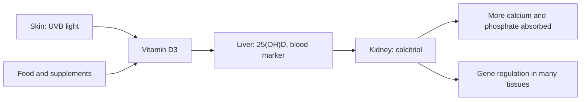

# Vitamin D

## Summary

Vitamin D (D3, cholecalciferol, and D2, ergocalciferol) is a fat-soluble vitamin made in the skin under sunlight and found in fatty fish, liver, egg yolks and fortified foods. It is converted into a hormone, calcitriol, that increases calcium and phosphate absorption and is essential for bones; deficiency causes rickets in children and osteomalacia in adults. Many people are low in winter. Large trials in people who were not deficient found no prevention of cancer, cardiovascular disease or fractures, but correcting deficiency matters.

*This note is educational. It is not medical advice and does not replace a doctor, dietitian or pharmacist, especially during pregnancy, illness or when taking medicines.*

## Prerequisites

- [Vitamins overview](vitamins-overview.md)

## Core concepts

### Definition

*Vitamin D3 (cholecalciferol)* is made in the skin from 7-dehydrocholesterol under UVB light. It is converted in the liver to *25-hydroxyvitamin D* (25(OH)D, the blood marker of status) and in the kidney to *1,25-dihydroxyvitamin D* (calcitriol), the active hormone.

### Analogy

Vitamin D works like a gatekeeper at the border of the gut: it opens the gates for calcium and phosphate to enter the blood. Without the gatekeeper, most calcium in food passes through unused. The analogy breaks because vitamin D also acts inside many tissues as a hormone, not just at the gut border.

### Mechanism

1. UVB light converts 7-dehydrocholesterol in the skin to vitamin D3; food adds D3 or D2.
2. The liver converts it to 25(OH)D.
3. The kidney (and other tissues) converts 25(OH)D to calcitriol, regulated by parathyroid hormone.
4. Calcitriol binds the vitamin D receptor and increases calcium and phosphate absorption in the gut, releases calcium from bone when needed and regulates many genes, including in immune cells.

**Status.** 25(OH)D below 30 nmol/L (12 ng/mL) is deficient; 50 nmol/L (20 ng/mL) or more is adequate for bone health in most people (US National Academy of Medicine). Some societies use 75 nmol/L.

The flowchart shows vitamin D activation.

### Intake and food sources

| Item | Value |
| --- | --- |
| RDA | 15 µg (600 IU) aged 1 to 70; 20 µg (800 IU) over 70 |
| UL | 100 µg (4,000 IU) per day |
| Food sources | Fatty fish (salmon about 10 to 15 µg per 100 g), cod liver oil, egg yolks, liver, fortified milk and margarine |
| Skin synthesis | Summer sun on arms and face for 10 to 30 minutes a few times a week is enough for many light-skinned people; little or no synthesis in winter above about 50° latitude |

### Proposed effects and evidence

Each entry states the proposed effect and how strong the human evidence is, using the grades defined in the [Evidence grades](../evidence-grades.md) note.

- **Bone and teeth health.** Essential for calcium absorption and mineralization; prevents rickets and osteomalacia. Evidence: established physiology.
- **Regulation of blood calcium.** Calcitriol raises absorption and mobilizes bone calcium. Evidence: established physiology.
- **Immune support and infection prevention.** Small reduction in respiratory infections in meta-analyses, mainly in deficient people with daily dosing. Evidence: moderate.
- **Protection against autoimmune diseases.** VITAL found a 22 percent lower rate of autoimmune disease with 2,000 IU daily over about 5 years; needs confirmation. Evidence: limited.
- **Cardiovascular health.** VITAL found no reduction in cardiovascular events. Evidence: not supported.
- **Mental health and depression.** Low levels are associated with depression; trials show little effect except possibly in deficient people. Evidence: limited.
- **Muscle strength and falls.** Deficiency causes weakness; supplements do not reduce falls in people who are not deficient. Evidence: limited.
- **Metabolic health and type 2 diabetes.** Low levels associated with diabetes; a large trial found no significant prevention. Evidence: limited.
- **Cancer prevention.** VITAL found no reduction in cancer incidence; a possible reduction in cancer deaths needs confirmation. Evidence: limited.
- **Skin health and psoriasis.** Topical vitamin D analogs treat psoriasis; oral supplements have little effect. Evidence: limited.
- **Fracture prevention in people who are not deficient.** No effect in a large trial. Evidence: not supported.

## Worked example

A person in Poland (about 52° N) has a 25(OH)D level of 25 nmol/L in February. From October to April the sun is too low for skin synthesis. A doctor recommends 25 to 50 µg (1,000 to 2,000 IU) daily, and the level rises to about 70 nmol/L after 3 months. In VITAL, healthy adults with a mean starting level of about 77 nmol/L gained no protection against cancer or heart disease from 2,000 IU daily.

## Trade offs and when to use it

Supplementation makes sense for people with low sun exposure, dark skin at high latitudes, older adults and those with deficiency. Very high doses cause hypercalcemia and kidney damage.

## Common mistakes

- **Taking very high doses without testing.** Stay below the UL unless a doctor prescribes otherwise.
- **Expecting supplements to prevent chronic disease in people with adequate levels.** Large trials found no benefit.

## Practice

1. Which compound in blood is used to assess vitamin D status?
2. What disease does deficiency cause in children?
3. What did the VITAL trial find for cancer and cardiovascular disease?

### Answers

1. 25-hydroxyvitamin D.
2. Rickets.
3. No reduction in incidence.

## Further reading

- NIH Office of Dietary Supplements. Vitamin D: Fact Sheet for Health Professionals. [Link](https://ods.od.nih.gov/factsheets/VitaminD-HealthProfessional/). Reference intakes, status and evidence.
- Manson, J. E., Cook, N. R., Lee, I. M. et al. (2019). Vitamin D supplements and prevention of cancer and cardiovascular disease. New England Journal of Medicine, 380(1), 33-44. [DOI](https://doi.org/10.1056/NEJMoa1809944). VITAL trial of vitamin D for cancer and cardiovascular disease.
- LeBoff, M. S., Chou, S. H., Ratliff, K. A. et al. (2022). Supplemental vitamin D and incident fractures in midlife and older adults. New England Journal of Medicine, 387(4), 299-309. [DOI](https://doi.org/10.1056/NEJMoa2202106). VITAL fracture analysis.
- Martineau, A. R., Jolliffe, D. A., Hooper, R. L. et al. (2017). Vitamin D supplementation to prevent acute respiratory tract infections: systematic review and meta-analysis of individual participant data. BMJ, 356, i6583. [DOI](https://doi.org/10.1136/bmj.i6583). Meta-analysis on respiratory infections.
