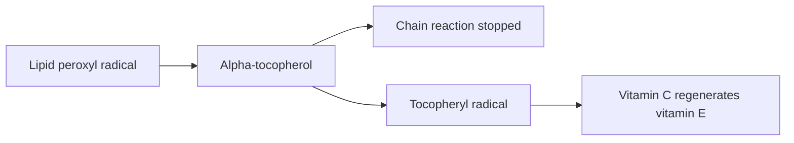

# Vitamin E

## Summary

Vitamin E is a group of fat-soluble compounds (tocopherols and tocotrienols), of which alpha-tocopherol is the form the body keeps. It is the main fat-soluble antioxidant in cell membranes, protecting fatty acids from oxidation. Deficiency is rare and causes nerve and muscle damage. Despite its antioxidant role, large trials found no protection against heart disease or cancer, and the SELECT trial found more prostate cancer with high-dose vitamin E.

*This note is educational. It is not medical advice and does not replace a doctor, dietitian or pharmacist, especially during pregnancy, illness or when taking medicines.*

## Prerequisites

- [Vitamins overview](vitamins-overview.md)

## Core concepts

### Definition

*Vitamin E* is the collective name for four tocopherols (alpha, beta, gamma, delta) and four tocotrienols. *Alpha-tocopherol* is the most active form in humans and the only one the liver preferentially keeps in blood.

### Analogy

Vitamin E is like a fire guard in a building made of oil-soaked wood (cell membranes rich in polyunsaturated fats). When a spark (free radical) lands, the guard smothers it before it spreads. Vitamin C then refreshes the guard. The analogy breaks because adding more guards beyond the normal number did not reduce fires in trials.

### Mechanism

Alpha-tocopherol sits in cell membranes and lipoproteins. It donates a hydrogen atom to lipid peroxyl radicals, stopping the chain reaction of lipid peroxidation. The resulting tocopheryl radical is recycled by vitamin C. Vitamin E also inhibits platelet aggregation and affects cell signaling. Deficiency (from fat malabsorption or genetic disorders) causes peripheral neuropathy, ataxia and retinal damage.

The flowchart shows vitamin E in the antioxidant network.

### Intake and food sources

| Item | Value |
| --- | --- |
| RDA (adults) | 15 mg alpha-tocopherol |
| UL | 1,000 mg per day from supplements |
| Food sources | Sunflower seeds (about 35 mg per 100 g), almonds (about 25 mg), hazelnuts, sunflower and rapeseed oil, spinach, broccoli, whole grains |

### Proposed effects and evidence

Each entry states the proposed effect and how strong the human evidence is, using the grades defined in the [Evidence grades](../evidence-grades.md) note.

- **Antioxidant action in membranes.** Main lipid-soluble chain-breaking antioxidant. Evidence: established physiology.
- **Prevention of heart disease and cancer.** Large trials found no benefit; SELECT found 17 percent more prostate cancer with 400 IU daily. Evidence: not supported.
- **Skin health, wrinkles and inflammation.** Topical use is common; evidence for oral benefits is weak. Evidence: limited.
- **Protection against UV damage.** Topical vitamin E with vitamin C offers some photoprotection in small studies. Evidence: limited.
- **Immune support.** Supplements improved some immune responses in older adults. Evidence: limited.
- **Eye health and AMD.** Part of the AREDS formula that slowed progression of advanced AMD; alone not proven. Evidence: moderate.
- **Protection of LDL from oxidation.** Shown in the laboratory; did not translate to fewer cardiovascular events. Evidence: not supported.
- **Brain function and Alzheimer disease.** One trial found slower functional decline in mild to moderate Alzheimer disease; prevention not shown. Evidence: limited.
- **Inhibition of platelet aggregation.** Real effect; high doses increase bleeding risk with anticoagulants. Evidence: moderate.
- **Reproductive health.** Essential for fertility in rats (origin of the name tocopherol, "bearing offspring"); human benefit unclear. Evidence: very limited.

## Worked example

A handful (30 g) of sunflower seeds provides about 10 mg vitamin E, two thirds of the RDA. In contrast, supplements of 400 IU (about 268 mg) daily in the SELECT trial did not prevent prostate cancer and slightly increased it.

## Trade offs and when to use it

Food sources are safe and beneficial. Supplements offer no proven benefit for prevention and can interact with anticoagulants.

## Common mistakes

- **Taking vitamin E supplements to prevent heart disease.** Trials showed no benefit.
- **Combining high-dose vitamin E with anticoagulants.** It increases bleeding risk.

## Practice

1. What is the main function of vitamin E?
2. Which vitamin regenerates vitamin E?
3. What did SELECT find?

### Answers

1. Stopping lipid peroxidation in membranes.
2. Vitamin C.
3. High-dose vitamin E increased prostate cancer risk.

## Further reading

- NIH Office of Dietary Supplements. Vitamin E: Fact Sheet for Health Professionals. [Link](https://ods.od.nih.gov/factsheets/VitaminE-HealthProfessional/). Reference intakes and evidence.
- Klein, E. A., Thompson, I. M., Tangen, C. M. et al. (2011). Vitamin E and the risk of prostate cancer: the Selenium and Vitamin E Cancer Prevention Trial (SELECT). JAMA, 306(14), 1549-1556. [DOI](https://doi.org/10.1001/jama.2011.1437). SELECT trial of vitamin E and prostate cancer.
- Age-Related Eye Disease Study Research Group (2001). A randomized, placebo-controlled, clinical trial of high-dose supplementation with vitamins C and E, beta carotene, and zinc for age-related macular degeneration and vision loss: AREDS report no. 8. Archives of Ophthalmology, 119(10), 1417-1436. [DOI](https://doi.org/10.1001/archopht.119.10.1417). AREDS trial of antioxidants and AMD.
