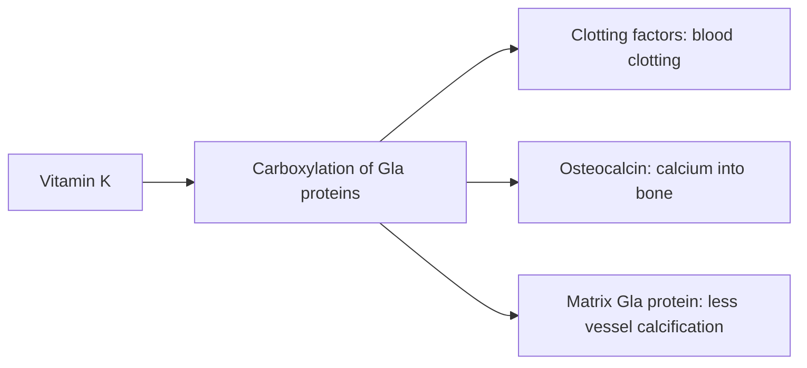

# Vitamin K2

## Summary

Vitamin K2 (menaquinones such as MK-4 and MK-7) is one of the two main forms of vitamin K, alongside vitamin K1 (phylloquinone) from green vegetables. It is found in fermented foods (especially natto), meat, liver, cheese and egg yolks. Vitamin K activates proteins that regulate calcium: clotting factors in the liver, osteocalcin in bone and matrix Gla protein in vessel walls. Observational studies link higher K2 intake to less arterial calcification and heart disease; trials show small effects on bone loss.

*This note is educational. It is not medical advice and does not replace a doctor, dietitian or pharmacist, especially during pregnancy, illness or when taking medicines.*

## Prerequisites

- [Vitamins overview](vitamins-overview.md)

## Core concepts

### Definition

*Vitamin K* is a group of fat-soluble naphthoquinones. *Vitamin K1 (phylloquinone)* comes from plants; *vitamin K2 (menaquinones, MK-n)* comes from bacterial fermentation and animal foods. MK-7 has a long half-life (about 3 days) compared with K1 (hours).

### Analogy

Vitamin K is like a stamp that activates proteins. Without the stamp, osteocalcin cannot place calcium in bone, and matrix Gla protein cannot stop calcium from settling in arteries. The analogy breaks because the stamp is mostly the same chemical change (carboxylation) for all these proteins, and blood clotting gets priority.

### Mechanism

Vitamin K is the cofactor of gamma-glutamyl carboxylase, which converts glutamate residues of specific proteins into gamma-carboxyglutamate (Gla). Gla residues bind calcium. Key Gla proteins:

- clotting factors II, VII, IX and X in the liver;
- osteocalcin in bone, which binds calcium into the bone matrix;
- matrix Gla protein (MGP) in vessel walls, which inhibits calcification.

Warfarin works by blocking vitamin K recycling, which is why vitamin K intake must be stable in people taking it.

The flowchart shows vitamin K-dependent proteins.

### Intake and food sources

| Item | Value |
| --- | --- |
| Adequate intake (total vitamin K, adults) | 120 µg men, 90 µg women (US); EFSA 70 µg |
| UL | Not set |
| K2 sources | Natto (about 900 to 1,000 µg MK-7 per 100 g), hard and soft cheeses, egg yolks, chicken, liver |
| K1 sources | Kale, spinach, broccoli, lettuce |

People taking warfarin must keep vitamin K intake consistent and consult their doctor before using supplements.

### Proposed effects and evidence

Each entry states the proposed effect and how strong the human evidence is, using the grades defined in the [Evidence grades](../evidence-grades.md) note.

- **Bone health and osteoporosis.** Activates osteocalcin; MK-7 slowed bone loss slightly in postmenopausal women; fracture reduction seen in Japanese MK-4 trials at drug doses. Evidence: limited.
- **Regulation of calcium metabolism.** Gla proteins direct calcium to bone and away from vessels. Evidence: established physiology.
- **Cardiovascular protection by preventing arterial calcification.** Observational association (Rotterdam Study); trials on calcification are mixed. Evidence: limited.
- **Dental health.** Plausible through calcium metabolism; little human evidence. Evidence: very limited.
- **Protection against neurodegenerative diseases.** Laboratory and observational data only. Evidence: very limited.
- **Metabolic health and insulin sensitivity.** Small trials suggest improved insulin sensitivity. Evidence: very limited.
- **Hormonal health and menstrual regulation.** No meaningful human evidence. Evidence: very limited.
- **Skin health, bruising and stretch marks.** No meaningful human evidence for oral K2. Evidence: very limited.
- **Anti-inflammatory action.** Laboratory data. Evidence: very limited.
- **Digestive and liver health.** No meaningful human evidence. Evidence: very limited.

## Worked example

A 60-year-old woman takes 180 µg MK-7 daily for 3 years, as in Knapen and colleagues' trial. Compared with placebo, her bone mineral density at the lumbar spine and femoral neck declines slightly less. In the observational Rotterdam Study, people in the highest third of K2 intake had about 50 percent lower risk of coronary death, but such studies cannot prove causation.

## Trade offs and when to use it

K2 from food is safe. Supplements are popular with vitamin D for bone and heart health, but evidence for hard outcomes is limited. They interfere with warfarin.

## Common mistakes

- **Starting K supplements while on warfarin.** Consult the prescribing doctor; intake must be stable.
- **Assuming K2 reverses arterial calcification.** Trial evidence is mixed.

## Practice

1. What reaction does vitamin K enable?
2. Name three vitamin K-dependent proteins.
3. Which food is the richest source of MK-7?

### Answers

1. Carboxylation of glutamate to Gla in specific proteins.
2. Clotting factors, osteocalcin and matrix Gla protein.
3. Natto.

## Further reading

- NIH Office of Dietary Supplements. Vitamin K: Fact Sheet for Health Professionals. [Link](https://ods.od.nih.gov/factsheets/VitaminK-HealthProfessional/). Reference intakes and safety.
- Knapen, M. H. J., Drummen, N. E., Smit, E. et al. (2013). Three-year low-dose menaquinone-7 supplementation helps decrease bone loss in healthy postmenopausal women. Osteoporosis International, 24(9), 2499-2507. [DOI](https://doi.org/10.1007/s00198-013-2325-6). Three-year MK-7 trial on bone loss.
- Geleijnse, J. M., Vermeer, C., Grobbee, D. E. et al. (2004). Dietary intake of menaquinone is associated with a reduced risk of coronary heart disease: the Rotterdam Study. Journal of Nutrition, 134(11), 3100-3105. [DOI](https://doi.org/10.1093/jn/134.11.3100). Rotterdam Study on menaquinone intake and heart disease.
