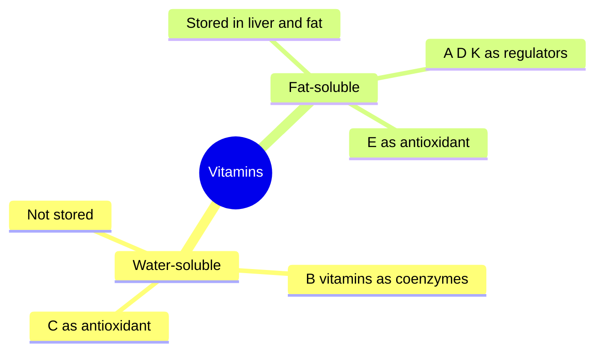

# Vitamins overview

## Summary

Vitamins are organic compounds needed in very small amounts for growth, metabolism, immunity, skin health and energy production. Without them, the body develops metabolic disorders, weakened immunity, skin problems and poor wound healing. Water-soluble vitamins (C and the B group) are not stored in large amounts and must be eaten regularly; fat-soluble vitamins (A, D, E, K) are absorbed with dietary fat and stored in the liver and fat tissue, so excess can accumulate.

*This note is educational. It is not medical advice and does not replace a doctor, dietitian or pharmacist, especially during pregnancy, illness or when taking medicines.*

## Prerequisites

[Enzymes and coenzymes](../../../../natural-sciences/chemistry/biochemistry/enzymes-and-coenzymes.md) explains coenzymes, the main role of B vitamins.

## Core concepts

### Definition

A *vitamin* is an organic compound required in small amounts for normal function that the body cannot synthesize in sufficient quantity, so it must come from the diet (vitamin D is an exception, as the skin makes it in sunlight). The *Recommended Dietary Allowance* (RDA) covers the needs of 97 to 98 percent of healthy people; the *Tolerable Upper Intake Level* (UL) is the highest daily intake unlikely to cause harm.

### Analogy

Vitamins are like the small tools in a workshop: screwdrivers, keys and spanners. They are not the raw material (food energy) or the machines (enzymes), but without them the machines cannot be adjusted or run. Water-soluble vitamins are tools borrowed daily; fat-soluble vitamins are tools kept in the storeroom. The analogy breaks because too many stored tools (fat-soluble vitamins) can become toxic.

### Mechanism

**Two groups.**

- *Water-soluble vitamins* (C and B vitamins) are absorbed easily and not stored in large amounts; excess is excreted in urine, so they must be supplied regularly. Their roles: energy metabolism, nervous system function, skin health and red blood cell production.
- *Fat-soluble vitamins* (A, D, E, K) are absorbed with dietary fat and stored in the liver and fat tissue, where excess can remain for a long time. Their roles: bone health, vision, skin, immune function and blood clotting.

**Three functional roles.**

- *Coenzymes*: B vitamins act as coenzymes in enzymatic reactions of energy metabolism and biosynthesis.
- *Antioxidants*: vitamins C and E neutralize free radicals and limit oxidative damage.
- *Regulators*: vitamins A, D and K act like hormones or regulators, affecting bone health, vision and blood clotting.

**Best sources.** Water-soluble: citrus fruit, leafy vegetables, whole grains, meat and dairy. Fat-soluble: fatty fish, vegetable oils, milk, eggs and leafy vegetables.

The mindmap shows the groups and roles.

### Reference intakes

US values for adults aged 19 to 50 (NIH Office of Dietary Supplements, checked 2026-10). EFSA values differ slightly.

| Vitamin | Group | RDA or AI (men / women) | UL | Classic deficiency |
| --- | --- | --- | --- | --- |
| A | Fat | 900 / 700 µg RAE | 3,000 µg (preformed) | Night blindness |
| D | Fat | 15 µg (600 IU) | 100 µg (4,000 IU) | Rickets, osteomalacia |
| E | Fat | 15 mg | 1,000 mg (supplements) | Neuropathy (rare) |
| K | Fat | 120 / 90 µg (AI) | Not set | Bleeding |
| C | Water | 90 / 75 mg | 2,000 mg | Scurvy |
| B1 thiamin | Water | 1.2 / 1.1 mg | Not set | Beriberi, Wernicke encephalopathy |
| B2 riboflavin | Water | 1.3 / 1.1 mg | Not set | Angular cheilitis, glossitis |
| B3 niacin | Water | 16 / 14 mg NE | 35 mg (supplements) | Pellagra |
| B5 pantothenic acid | Water | 5 mg (AI) | Not set | Very rare |
| B6 | Water | 1.3 mg | 100 mg | Dermatitis, anemia, neuropathy |
| B7 biotin | Water | 30 µg (AI) | Not set | Hair loss, rash (rare) |
| B9 folate | Water | 400 µg DFE | 1,000 µg (synthetic) | Megaloblastic anemia, neural tube defects |
| B12 | Water | 2.4 µg | Not set | Megaloblastic anemia, neuropathy |

## Worked example

A vegan eats plenty of vegetables, fruit, legumes and whole grains. Their intake of folate, vitamin C, vitamin K and most B vitamins is high. Vitamin B12, found almost only in animal foods, is missing, and without supplements or fortified foods they will become deficient within a few years as liver stores run down. Vitamin D may also be low in winter. The overview table shows which vitamins to check for a given diet.

## Trade offs and when to use it

- A varied diet covers most vitamin needs. Supplements are useful for specific groups: B12 for vegans and many older adults, folic acid before and in early pregnancy, vitamin D in low sunlight.
- High-dose supplements of fat-soluble vitamins can be toxic, and some trials found harm (beta-carotene in smokers, vitamin E and prostate cancer).

## Common mistakes

- **Assuming more is better.** Above adequacy, benefits usually stop, and toxicity can begin.
- **Assuming water-soluble vitamins are always harmless.** High-dose B6 causes neuropathy, and niacin causes flushing and liver toxicity.

## Practice

1. Which vitamins are fat-soluble?
2. What are the three functional roles of vitamins?
3. Which vitamin is a concern in a vegan diet?

### Answers

1. A, D, E and K.
2. Coenzymes, antioxidants and regulators.
3. Vitamin B12.

## Further reading

- European Food Safety Authority (2017). *Dietary Reference Values for nutrients: summary report*. EFSA Supporting Publications, 14(12), e15121. [DOI](https://doi.org/10.2903/sp.efsa.2017.e15121). Summary of EFSA dietary reference values.
- NIH Office of Dietary Supplements. Vitamin D: Fact Sheet for Health Professionals. [Link](https://ods.od.nih.gov/factsheets/VitaminD-HealthProfessional/). One of the NIH fact sheets used for the reference table; each vitamin note cites its own.
