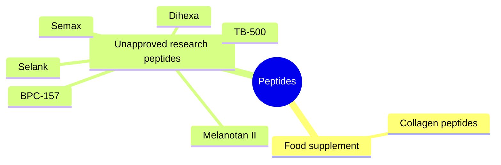

# Peptides

Peptides are short chains of amino acids. Some occur naturally in the body and regulate biological processes; others are synthetic and used for tissue repair, cognition or appearance. This field covers collagen peptides, which are a food supplement, and six "research peptides" sold online: melanotan II, Semax, Selank, Dihexa, BPC-157 and TB-500. Except for collagen, none is approved as a medicine in the EU or US, most have little or no human research, products are often impure, and several are banned in sport. The chemistry of peptides is covered in [Proteins](../../../natural-sciences/chemistry/biochemistry/proteins/proteins.md).

*These notes are educational. They describe claims and evidence and do not recommend using unapproved substances.*

## Map

## Reading order

1. [Peptides overview](overview.md)
2. [Collagen peptides](collagen-peptides.md)
3. [Melanotan II](melanotan-ii.md)
4. [Semax](semax.md)
5. [Selank](selank.md)
6. [Dihexa](dihexa.md)
7. [BPC-157](bpc-157.md)
8. [TB-500](tb-500.md)
