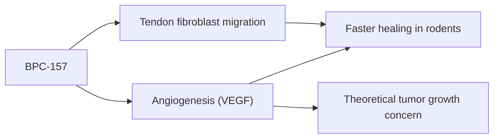

# BPC-157

## Summary

BPC-157 (body protection compound 157) is a synthetic peptide of 15 amino acids based on a sequence from a protein in human gastric juice. In rodents, it accelerated healing of tendons, ligaments, muscles, skin and the gut, and reduced inflammation. It is popular with athletes and is sold as injections and oral products. Human clinical data are almost nonexistent. It is not approved as a medicine, is prohibited by WADA, and the FDA lists it as a substance that may present significant safety risks.

*This note is educational. It is not medical advice and does not replace a doctor, dietitian or pharmacist, especially during pregnancy, illness or when taking medicines.*

## Prerequisites

- [Peptides overview](overview.md)

## Core concepts

### Definition

*BPC-157* is the pentadecapeptide Gly-Glu-Pro-Pro-Pro-Gly-Lys-Pro-Ala-Asp-Asp-Ala-Gly-Leu-Val. It is stable in gastric juice in laboratory tests.

### Analogy

BPC-157 is described as a repair crew that speeds up healing of any tissue. In rats, the crew seems to work; in humans, nobody has properly checked whether the crew shows up, or whether it builds things that should not be built (it promotes blood vessel growth).

### Mechanism

In animal studies, BPC-157 promotes angiogenesis (VEGF signaling), tendon fibroblast migration, nitric oxide modulation and growth hormone receptor expression in tendon cells. Angiogenesis is helpful for healing but also supports tumor growth, a theoretical concern.

The flowchart shows proposed actions and concerns.

### Claimed effects and evidence

Each entry states the proposed effect and how strong the human evidence is, using the grades defined in the [Evidence grades](../nutrition/evidence-grades.md) note.

- **Faster healing of tendons, muscles and skin.** Rodent studies; no adequate human trials. Evidence: very limited.
- **Gut protection, ulcers and inflammatory bowel disease.** Rodent studies; a small early trial in ulcerative colitis was not published in full. Evidence: very limited.
- **Less inflammation.** Rodent studies. Evidence: very limited.
- **Brain and nervous system repair.** Rodent studies. Evidence: very limited.

## Worked example

An athlete with a chronic Achilles tendon problem considers BPC-157 injections. A review (Gwyer and colleagues, 2019) found promising animal data but no human trials for musculoskeletal healing. The athlete would also break anti-doping rules. Progressive loading rehabilitation has proven benefit for tendinopathy ([Eccentric and isometric methods](../physiotherapy/eccentric-and-isometric-methods.md)).

## Trade offs and when to use it

BPC-157 is unapproved, prohibited in sport, and of uncertain quality; injection carries infection risk.

## Common mistakes

- **Using BPC-157 in tested sport.** It is prohibited by WADA.
- **Assuming animal healing data apply to humans.** Human trials are lacking.

## Practice

1. How many amino acids does BPC-157 have?
2. What is the main evidence base?
3. What is its status in sport?

### Answers

1. 15.
2. Rodent studies.
3. Prohibited by WADA.

## Further reading

- Gwyer, D., Wragg, N. M., Wilson, S. L. (2019). Gastric pentadecapeptide body protection compound BPC 157 and its role in accelerating musculoskeletal soft tissue healing. Cell and Tissue Research, 377(2), 153-159. [DOI](https://doi.org/10.1007/s00441-019-03016-8). Review of BPC-157 for soft tissue healing.
- US Food and Drug Administration (2023). Certain bulk drug substances for use in compounding that may present significant safety risks. [Link](https://www.fda.gov/drugs/human-drug-compounding/certain-bulk-drug-substances-use-compounding-may-present-significant-safety-risks). FDA safety concerns.
- World Anti-Doping Agency. World Anti-Doping Code: The Prohibited List. [Link](https://www.wada-ama.org/en/prohibited-list). WADA prohibited list.
