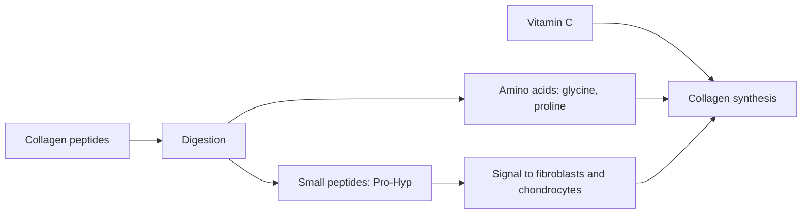

# Collagen peptides

## Summary

Collagen is the most abundant protein in the body, essential for skin, joints, tendons and bones. Collagen supplements are usually hydrolyzed collagen (collagen peptides), broken into small peptides that are easily absorbed. Meta-analyses suggest collagen peptides improve skin hydration and elasticity modestly, and some trials show benefits for joint pain and, with resistance training, body composition. Taking them with vitamin C, which is needed for collagen synthesis, is commonly recommended.

*This note is educational. It is not medical advice and does not replace a doctor, dietitian or pharmacist, especially during pregnancy, illness or when taking medicines.*

## Prerequisites

- [Peptides overview](overview.md)

## Core concepts

### Definition

*Hydrolyzed collagen* (collagen peptides) is collagen broken down by enzymes into peptides of about 2 to 5 kDa. Some dipeptides and tripeptides, such as prolyl-hydroxyproline, are absorbed intact. *Undenatured type II collagen* is a different product used in small doses for joints. See [Collagen](../../../natural-sciences/chemistry/biochemistry/proteins/collagen.md).

### Analogy

Collagen peptides are like delivering both bricks and a few signal flags to a construction site: most of the peptides are digested to amino acids (bricks), but some small peptides act as signals telling fibroblasts and chondrocytes to build more collagen. The analogy breaks because the body cannot direct the bricks specifically to the skin.

### Mechanism

Collagen is rich in glycine, proline and hydroxyproline. After ingestion, blood levels of hydroxyproline-containing peptides rise for hours; in laboratory studies, these stimulate fibroblasts and chondrocytes. Vitamin C is a cofactor for the enzymes that hydroxylate proline and lysine in new collagen ([Vitamin C](../nutrition/vitamins/vitamin-c.md)). Collagen is an incomplete protein (it lacks tryptophan), so it should not replace other protein sources.

**How it is used.** Hydrolyzed collagen (collagen peptides) is easily absorbed; powders or capsules; commonly 2.5 to 15 g daily; taken with vitamin C.

The flowchart shows the fate of collagen peptides.

### Claimed effects and evidence

Each entry states the proposed effect and how strong the human evidence is, using the grades defined in the [Evidence grades](../nutrition/evidence-grades.md) note.

- **Better skin health: elasticity and hydration.** Meta-analysis found improved hydration and elasticity; many trials industry-funded. Evidence: moderate.
- **Stronger joints and bones; cartilage support.** Some trials show reduced joint pain in athletes and osteoarthritis; bone density trials limited. Evidence: limited.
- **Muscle recovery after intense exercise.** With resistance training, greater fat-free mass gains in older men in one trial; recovery data limited. Evidence: limited.
- **Gut health through type II collagen.** No meaningful evidence. Evidence: very limited.

## Worked example

In a 12-week trial (Zdzieblik and colleagues, 2015), 53 older men with sarcopenia did resistance training and took 15 g collagen peptides or placebo daily. The collagen group gained more fat-free mass and strength and lost more fat mass. In another study (Shaw and colleagues, 2017), 15 g gelatin with vitamin C taken 1 hour before exercise doubled a marker of collagen synthesis.

## Trade offs and when to use it

Collagen peptides are safe; they are an incomplete protein and do not replace a balanced protein intake. Product quality varies; heavy metal contamination has been found in some products.

## Common mistakes

- **Counting collagen as complete protein.** It lacks tryptophan.
- **Expecting dramatic skin changes.** Effects are modest.

## Practice

1. What is hydrolyzed collagen?
2. Why is vitamin C recommended with collagen?
3. Which effect has moderate evidence?

### Answers

1. Collagen broken down into small peptides.
2. It is a cofactor for collagen synthesis.
3. Skin hydration and elasticity.

## Further reading

- de Miranda, R. B., Weimer, P., Rossi, R. C. (2021). Effects of hydrolyzed collagen supplementation on skin aging: a systematic review and meta-analysis. International Journal of Dermatology, 60(12), 1449-1461. [DOI](https://doi.org/10.1111/ijd.15518). Meta-analysis of collagen and skin aging.
- Zdzieblik, D., Oesser, S., Baumstark, M. W. et al. (2015). Collagen peptide supplementation in combination with resistance training improves body composition and increases muscle strength in elderly sarcopenic men: a randomised controlled trial. British Journal of Nutrition, 114(8), 1237-1245. [DOI](https://doi.org/10.1017/S0007114515002810). Trial in sarcopenic men.
- Shaw, G., Lee-Barthel, A., Ross, M. L. et al. (2017). Vitamin C-enriched gelatin supplementation before intermittent activity augments collagen synthesis. American Journal of Clinical Nutrition, 105(1), 136-143. [DOI](https://doi.org/10.3945/ajcn.116.138594). Gelatin and vitamin C collagen synthesis study.
