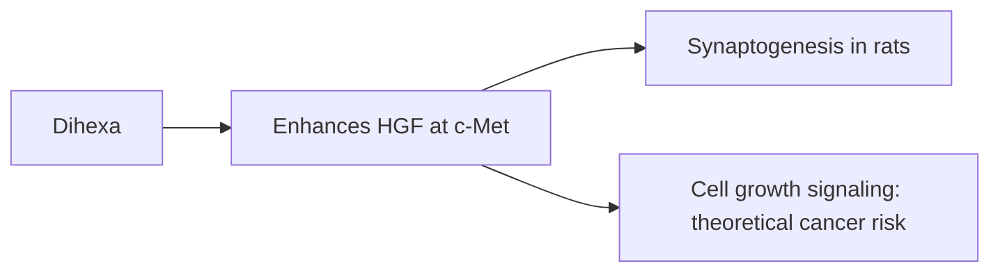

# Dihexa

## Summary

Dihexa is a small synthetic peptide derived from angiotensin IV, developed at Washington State University. In rats, it increased the formation of new synapses and improved memory in models of dementia. It is sold online as a nootropic, but it has never been tested in published human trials. It activates the hepatocyte growth factor (HGF) and c-Met pathway, which also drives cell growth and is involved in some cancers, raising theoretical safety concerns.

*This note is educational. It is not medical advice and does not replace a doctor, dietitian or pharmacist, especially during pregnancy, illness or when taking medicines.*

## Prerequisites

- [Peptides overview](overview.md)

## Core concepts

### Definition

*Dihexa* (N-hexanoic-Tyr-Ile-(6) aminohexanoic amide) is an angiotensin IV analog. *Synaptogenesis* is the formation of new synapses.

### Analogy

Dihexa is like a strong fertilizer for neuron connections in rats. The analogy breaks because the same growth signal (HGF/c-Met) can also fertilize unwanted growth, such as tumors, and no human safety data exist.

### Mechanism

Dihexa binds HGF and enhances its activity at the c-Met receptor, promoting dendritic spine growth and synaptogenesis in rodents. It is orally active and crosses the blood-brain barrier in animals.

The flowchart shows the proposed mechanism and concern.

### Claimed effects and evidence

Each entry states the proposed effect and how strong the human evidence is, using the grades defined in the [Evidence grades](../nutrition/evidence-grades.md) note.

- **Neuron regeneration; potential in Alzheimer and Parkinson disease.** Rodent studies only. Evidence: very limited.
- **Better memory and learning.** Rodent studies only. Evidence: very limited.
- **More neuroplasticity.** Rodent studies only. Evidence: very limited.

## Worked example

In rats with scopolamine-induced memory impairment, Dihexa restored performance in a water maze (Benoist and colleagues, 2011). A person taking Dihexa bought online is effectively an uncontrolled human experiment, with no dosing or safety data.

## Trade offs and when to use it

Dihexa has no human safety data; activation of growth pathways raises theoretical cancer concerns.

## Common mistakes

- **Assuming rat results apply to humans.** No human trials exist.

## Practice

1. From which peptide is Dihexa derived?
2. Which pathway does Dihexa enhance?
3. Has Dihexa been tested in humans?

### Answers

1. Angiotensin IV.
2. HGF/c-Met.
3. No published human trials.

## Further reading

- Benoist, C. C., Wright, J. W., Zhang, M. et al. (2011). Facilitation of hippocampal synaptogenesis and spatial memory by C-terminal truncated Nle1-angiotensin IV analogs. Journal of Pharmacology and Experimental Therapeutics, 339(1), 35-44. [DOI](https://doi.org/10.1124/jpet.111.180802). Rat study of synaptogenesis and memory with angiotensin IV analogs including Dihexa.
