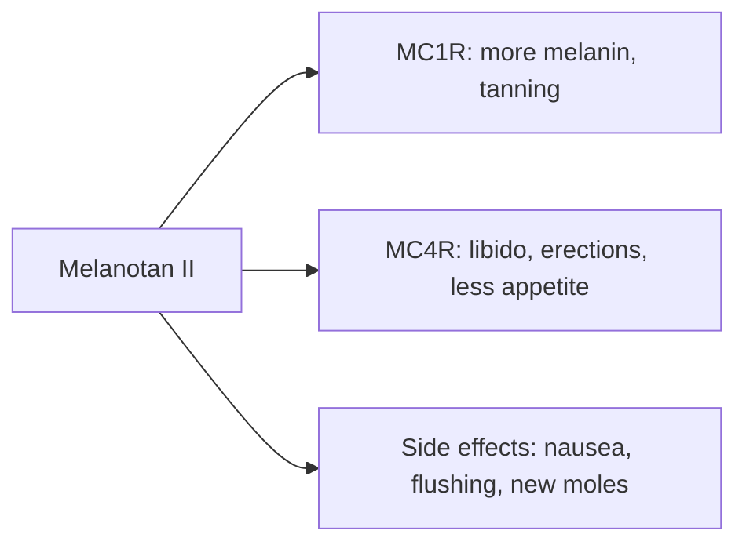

# Melanotan II

## Summary

Melanotan II is a synthetic analog of alpha-melanocyte-stimulating hormone (alpha-MSH) that stimulates melanin production and tanning, and also increases libido and can cause spontaneous erections; it may reduce appetite. It is not approved as a medicine anywhere; it is sold illegally as injections and nasal sprays. Reported side effects include nausea, flushing, headaches, new and darkening moles, and case reports of melanoma, kidney damage and priapism. A related peptide, bremelanotide, is approved in the US for low sexual desire in women.

*This note is educational. It is not medical advice and does not replace a doctor, dietitian or pharmacist, especially during pregnancy, illness or when taking medicines.*

## Prerequisites

- [Peptides overview](overview.md)

## Core concepts

### Definition

*Melanotan II* is a cyclic heptapeptide agonist of melanocortin receptors (MC1R, MC3R, MC4R). *Afamelanotide* (Melanotan I) is an approved, more selective MC1R agonist used as an implant for erythropoietic protoporphyria.

### Analogy

Melanotan II is like a master key for the melanocortin locks: it opens the tanning lock (MC1R) but also locks for sexual arousal and appetite (MC3R and MC4R). The analogy breaks because opening the wrong locks causes unwanted effects such as nausea and erections.

### Mechanism

MC1R activation in melanocytes increases eumelanin (dark pigment) production without UV exposure. MC4R activation in the brain affects sexual function and appetite. Unregulated products vary in dose and purity.

The flowchart shows receptor effects of melanotan II.

### Claimed effects and evidence

Each entry states the proposed effect and how strong the human evidence is, using the grades defined in the [Evidence grades](../nutrition/evidence-grades.md) note.

- **Faster tanning and more pigmentation.** Real effect on pigmentation in small studies. Evidence: moderate.
- **Protection from UV damage.** No evidence that it protects against skin cancer; people often still sunbathe more. Evidence: not supported.
- **More libido; aphrodisiac.** Erections and libido effects documented; bremelanotide (related) is approved for low sexual desire in women. Evidence: moderate.
- **Less appetite and weight control.** Effect through MC4R; not studied for weight loss. Evidence: very limited.

## Worked example

A person injects melanotan II bought online before a holiday. They tan quickly but develop nausea and facial flushing and notice several moles darkening. Dermatologists have reported changes in moles and cases of melanoma in users, though causation is unproven; a skin check is needed.

## Trade offs and when to use it

**Potential side effects:** nausea and headaches; more pigmentation of freckles and moles (melanocytes); spontaneous erections (which led to the development of bremelanotide for sexual dysfunction). Illegal products carry risks of contamination and wrong dosing.

## Common mistakes

- **Believing tanning protects the skin.** Melanotan II is not proven to prevent UV damage.
- **Buying from illegal sources.** Products are unregulated.

## Practice

1. Which receptor does melanotan II activate for tanning?
2. Why does it cause erections?
3. Is melanotan II approved as a medicine?

### Answers

1. MC1R.
2. It activates MC4R in the brain.
3. No.

## Further reading

- Habbema, L., Halk, A. B., Neumann, M. et al. (2017). Risks of unregulated use of alpha-melanocyte-stimulating hormone analogues: a review. International Journal of Dermatology, 56(10), 975-980. [DOI](https://doi.org/10.1111/ijd.13585). Review of risks of unregulated melanocortin analogs.
- US Food and Drug Administration (2023). Certain bulk drug substances for use in compounding that may present significant safety risks. [Link](https://www.fda.gov/drugs/human-drug-compounding/certain-bulk-drug-substances-use-compounding-may-present-significant-safety-risks). FDA safety concerns about melanotan II.
