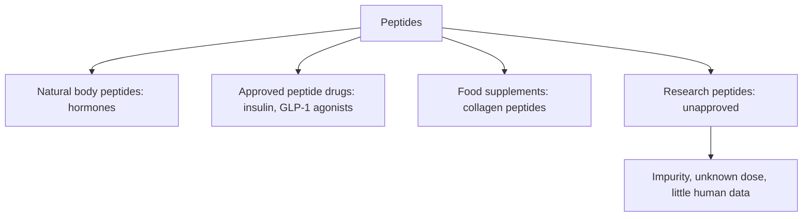

# Peptides overview

## Summary

Peptides are short chains of amino acids linked by peptide bonds, usually 2 to 50 amino acids. Many hormones and signaling molecules are peptides (insulin, oxytocin, endorphins). Peptide drugs are an established medical class (insulin, GLP-1 agonists). Separately, a market of "research peptides" sells compounds such as BPC-157 and TB-500 directly to consumers; these are not approved medicines, have little human data, are often impure or mislabeled, and some are prohibited in sport.

*This note is educational. It is not medical advice and does not replace a doctor, dietitian or pharmacist, especially during pregnancy, illness or when taking medicines.*

## Prerequisites

- [Proteins](../../../natural-sciences/chemistry/biochemistry/proteins/proteins.md)

## Core concepts

### Definition

A *peptide* is a chain of amino acids shorter than a protein (conventionally under about 50 residues). *Research peptides* are synthetic peptides sold "for research use only", a label that sidesteps drug regulation. *Bioavailability* of oral peptides is usually low, because digestive enzymes break them down.

### Analogy

Peptides are like short messages written in the alphabet of amino acids: hormones are official letters with a clear sender and receiver, while research peptides are messages copied from animal experiments, whose effect in humans has not been read. The analogy breaks because even short messages can have unexpected effects on many receivers.

### Mechanism

Peptides act by binding receptors on cell surfaces, triggering signaling cascades. Their effects depend on the receptor, dose, route and stability. Injected peptides avoid digestion; oral peptides are mostly digested to amino acids, with exceptions (some small peptides such as collagen dipeptides are absorbed).

**Regulation.** In the EU and US, medicines must be approved after clinical trials. Research peptides are sold without this, with risks of contamination, wrong dose and sterility problems with self-injection. The FDA lists several (including BPC-157 and melanotan II) among substances that may present significant safety risks in compounding. WADA prohibits non-approved substances and growth factors, which covers BPC-157 and TB-500.

The flowchart separates the peptide categories.

### Claimed effects and evidence

Each entry states the proposed effect and how strong the human evidence is, using the grades defined in the [Evidence grades](../nutrition/evidence-grades.md) note.

- **Approved peptide drugs are effective.** Insulin and GLP-1 agonists are established treatments. Evidence: strong.
- **Research peptides are safe and effective.** Little human evidence; quality problems documented. Evidence: very limited.

## Worked example

A person buys "BPC-157 for research" online. Analyses of such products have found wrong amounts, impurities and bacterial contamination. Injecting an unapproved, non-sterile product risks infection and unknown effects.

## Trade offs and when to use it

Peptide science is promising, but the research peptide market bypasses safety testing. Athletes risk anti-doping violations.

## Common mistakes

- **Equating "research use" with safety.** It means the product has not been approved.
- **Assuming oral peptides reach the blood intact.** Most are digested.

## Practice

1. What is a peptide?
2. Why do research peptides carry risks?
3. Name an approved peptide drug.

### Answers

1. A short chain of amino acids.
2. They are unapproved, often impure and have little human data.
3. Insulin or a GLP-1 agonist.

## Further reading

- US Food and Drug Administration (2023). Certain bulk drug substances for use in compounding that may present significant safety risks. [Link](https://www.fda.gov/drugs/human-drug-compounding/certain-bulk-drug-substances-use-compounding-may-present-significant-safety-risks). FDA list of bulk substances with safety risks.
- World Anti-Doping Agency. World Anti-Doping Code: The Prohibited List. [Link](https://www.wada-ama.org/en/prohibited-list). WADA prohibited list.
