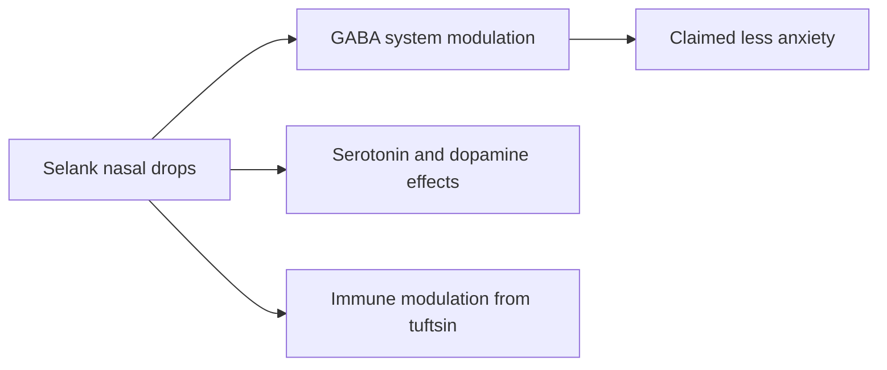

# Selank

## Summary

Selank is a synthetic peptide developed in Russia from tuftsin, a fragment of immunoglobulin G, with an added Pro-Gly-Pro sequence. It is approved in Russia as an anti-anxiety drug (nasal drops), promoted as an alternative to benzodiazepines without addiction or sedation. Claimed effects include less anxiety, better mood, memory and immunity. Evidence comes mainly from small Russian studies and animal research; it is not approved in the EU or US.

*This note is educational. It is not medical advice and does not replace a doctor, dietitian or pharmacist, especially during pregnancy, illness or when taking medicines.*

## Prerequisites

- [Peptides overview](overview.md)

## Core concepts

### Definition

*Selank* is the heptapeptide Thr-Lys-Pro-Arg-Pro-Gly-Pro. *Tuftsin* is a natural tetrapeptide (Thr-Lys-Pro-Arg) that stimulates immune cells. An *anxiolytic* reduces anxiety.

### Analogy

Selank is presented as a gentle volume knob for anxiety that does not make you sleepy, unlike benzodiazepines. The analogy breaks because the "knob" has been tested mostly in small studies with unclear blinding.

### Mechanism

Animal studies suggest Selank modulates GABA-A receptor activity, increases BDNF, affects serotonin and dopamine metabolism, and has immunomodulatory effects (from tuftsin). It is given intranasally.

The flowchart shows proposed actions.

### Claimed effects and evidence

Each entry states the proposed effect and how strong the human evidence is, using the grades defined in the [Evidence grades](../nutrition/evidence-grades.md) note.

- **Less anxiety and stress via the GABA system.** Small Russian clinical studies. Evidence: limited.
- **Better mood via serotonin and dopamine.** Animal studies. Evidence: very limited.
- **Better memory and concentration.** Animal studies. Evidence: very limited.
- **Immune support.** Laboratory and animal studies. Evidence: very limited.

## Worked example

In a Russian study, patients with generalized anxiety disorder received Selank or a benzodiazepine; anxiety improved in both groups, with fewer side effects reported for Selank. The study was small and not blinded in the way modern trials require.

## Trade offs and when to use it

Selank is unapproved outside Russia; quality and dose of products bought online are uncertain. People with anxiety disorders have well-tested treatments available.

## Common mistakes

- **Self-treating anxiety disorders with unapproved peptides.** Seek evaluated treatments.

## Practice

1. Which natural peptide is Selank based on?
2. What is the claimed advantage over benzodiazepines?
3. How strong is the evidence?

### Answers

1. Tuftsin.
2. No addiction or sedation.
3. Limited, mostly small Russian studies.

## Further reading

- US Food and Drug Administration (2023). Certain bulk drug substances for use in compounding that may present significant safety risks. [Link](https://www.fda.gov/drugs/human-drug-compounding/certain-bulk-drug-substances-use-compounding-may-present-significant-safety-risks). Regulatory context for unapproved peptides.
