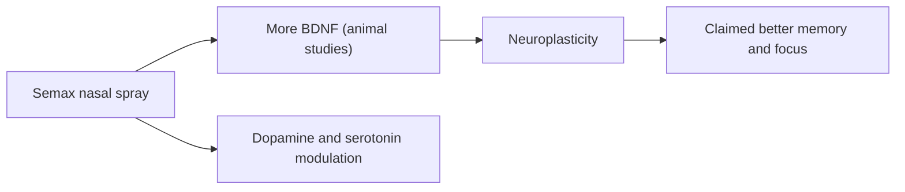

# Semax

## Summary

Semax is a synthetic peptide developed in Russia, based on a fragment of adrenocorticotropic hormone (ACTH 4-10) with an added Pro-Gly-Pro sequence. It is approved in Russia and some neighboring countries, mainly as a nasal spray for stroke and cognitive disorders, but not in the EU or US. It is promoted as a nootropic for memory, concentration and stress resistance. Most studies are Russian, small, or in animals.

*This note is educational. It is not medical advice and does not replace a doctor, dietitian or pharmacist, especially during pregnancy, illness or when taking medicines.*

## Prerequisites

- [Peptides overview](overview.md)

## Core concepts

### Definition

*Semax* is the heptapeptide Met-Glu-His-Phe-Pro-Gly-Pro. A *nootropic* is a substance claimed to enhance cognitive function.

### Analogy

Semax is described as a tune-up kit for the brain: it is said to raise growth factors such as BDNF, which help neurons form connections. The analogy breaks because evidence that it tunes up healthy human brains is minimal.

### Mechanism

In animal studies, Semax increases brain-derived neurotrophic factor (BDNF) and its receptor, modulates dopamine and serotonin systems and has anti-inflammatory effects after ischemia. The ACTH fragment lacks hormonal (cortisol-releasing) activity. It is usually given as a nasal spray, sometimes by injection.

The flowchart shows proposed actions.

### Claimed effects and evidence

Each entry states the proposed effect and how strong the human evidence is, using the grades defined in the [Evidence grades](../nutrition/evidence-grades.md) note.

- **Better memory and concentration through neuroplasticity.** Small Russian studies and animal data. Evidence: very limited.
- **Less stress and anxiety via dopamine modulation.** Animal studies. Evidence: very limited.
- **Brain recovery after injury or stroke.** Russian clinical studies in stroke of variable quality. Evidence: limited.
- **Greater resistance to oxidative stress.** Animal studies. Evidence: very limited.

## Worked example

A student buys Semax nasal spray online hoping to study better. There are no high-quality trials in healthy people, and the product's identity and purity cannot be verified. Sleep, spaced repetition and exercise have far better evidence for learning.

## Trade offs and when to use it

Semax is regulated as a medicine in Russia; elsewhere it is unapproved and of uncertain quality.

## Common mistakes

- **Treating Russian approval as proof of efficacy.** Evidence is mostly small or animal studies.

## Practice

1. What hormone fragment is Semax based on?
2. How is Semax usually given?
3. Where is Semax approved?

### Answers

1. ACTH 4-10.
2. As a nasal spray.
3. In Russia and some neighboring countries.

## Further reading

- US Food and Drug Administration (2023). Certain bulk drug substances for use in compounding that may present significant safety risks. [Link](https://www.fda.gov/drugs/human-drug-compounding/certain-bulk-drug-substances-use-compounding-may-present-significant-safety-risks). Regulatory context for unapproved peptides.
