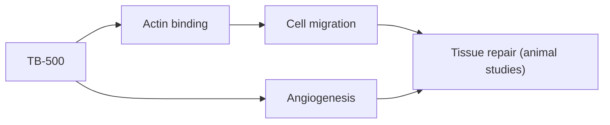

# TB-500

## Summary

TB-500 is a synthetic peptide based on the active region of thymosin beta-4, a natural protein that binds actin and is involved in cell migration, wound healing and blood vessel formation. It is used, mostly by athletes and in horse racing, to speed recovery from muscle and tendon injuries. Human data are lacking; thymosin beta-4 itself has been tested in small trials for wounds and eye injury. TB-500 is prohibited by WADA and is not approved as a medicine.

*This note is educational. It is not medical advice and does not replace a doctor, dietitian or pharmacist, especially during pregnancy, illness or when taking medicines.*

## Prerequisites

- [Peptides overview](overview.md)

## Core concepts

### Definition

*Thymosin beta-4* is a 43-amino acid protein. *TB-500* refers to a synthetic peptide containing its actin-binding region (often described as Ac-LKKTETQ), though products vary.

### Analogy

Thymosin beta-4 is like a mobile scaffolding crew that helps cells move to a wound and build new vessels. TB-500 is marketed as a concentrated version of that crew. The analogy breaks because the synthetic fragment may not reproduce the full protein's effects, and its safety is unknown.

### Mechanism

Thymosin beta-4 sequesters G-actin, regulating cytoskeleton dynamics and cell migration; it promotes angiogenesis and has anti-inflammatory effects in animal models, including after heart attack in mice. The notes describe a loading phase followed by maintenance dosing, a practice from user communities without clinical basis.

The flowchart shows the proposed mechanism.

### Claimed effects and evidence

Each entry states the proposed effect and how strong the human evidence is, using the grades defined in the [Evidence grades](../nutrition/evidence-grades.md) note.

- **Muscle and tendon regeneration.** Animal studies; no human trials of TB-500. Evidence: very limited.
- **Better mobility after injuries.** No human evidence. Evidence: very limited.
- **Heart regeneration after a heart attack.** Mouse studies of thymosin beta-4. Evidence: very limited.
- **Anti-inflammatory action.** Animal studies. Evidence: very limited.

## Worked example

In horse racing, TB-500 use led to positive doping tests and suspensions. A human athlete using it faces the same anti-doping risk, with no proven benefit.

## Trade offs and when to use it

TB-500 is unapproved and prohibited in sport; product identity and purity are uncertain.

## Common mistakes

- **Following "loading protocols" from forums.** They have no clinical basis.

## Practice

1. Which natural protein is TB-500 based on?
2. What does thymosin beta-4 bind?
3. Is TB-500 allowed in sport?

### Answers

1. Thymosin beta-4.
2. Actin.
3. No, WADA prohibits it.

## Further reading

- World Anti-Doping Agency. World Anti-Doping Code: The Prohibited List. [Link](https://www.wada-ama.org/en/prohibited-list). WADA prohibited list.
