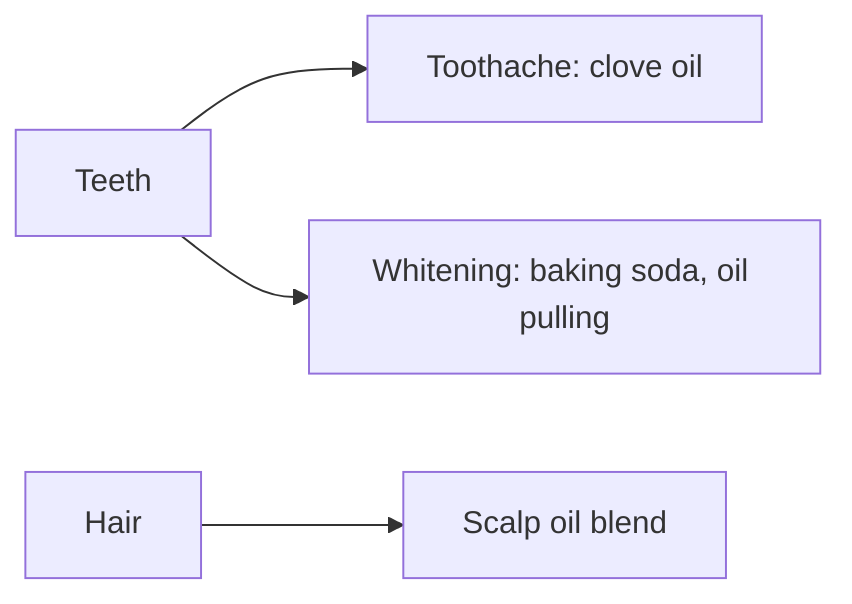

# Personal care

Notes on care of teeth, skin and hair with natural methods, and what the evidence shows: clove oil for toothache, home teeth whitening with baking soda and coconut oil, and a scalp oil blend for hair. Chemicals in cosmetics are covered in [environmental health](../environmental-health/README.md).

## Map

## Reading order

1. [Clove oil for toothache](toothache-clove-oil.md)
2. [Home teeth whitening](teeth-whitening-home-methods.md)
3. [Scalp oil blend](scalp-oil-blend.md)
