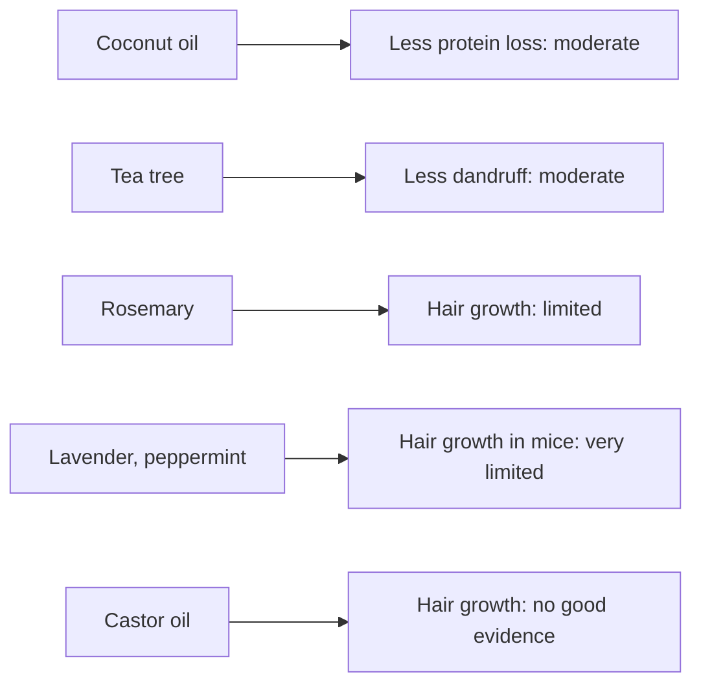

# Scalp oil blend

## Summary

A scalp and hair oil blend combines carrier oils (coconut, jojoba, argan, castor) with essential oils (rosemary, lavender, peppermint, tea tree) chosen for their effects on hair moisture, scalp health, dandruff and hair growth. Coconut oil reduces protein loss from hair; tea tree oil shampoo reduces dandruff; rosemary oil showed hair growth similar to 2 percent minoxidil in one trial; lavender and peppermint promoted hair growth in mice. Castor oil has no good evidence for hair growth despite its popularity.

*This note is educational. It is not medical advice and does not replace a doctor, dietitian or pharmacist, especially during pregnancy, illness or when taking medicines.*

## Prerequisites

No prior notes are needed.

## Core concepts

### Definition

*Carrier oils* are fatty oils that dilute essential oils and moisturize. *Androgenetic alopecia* is patterned hair loss; *seborrheic dermatitis* and dandruff involve Malassezia yeast.

### Analogy

A scalp oil blend is like a care package for the scalp: carrier oils are the moisturizing base, and a few drops of essential oils add targeted actions. The analogy breaks because only some contents of the package have evidence behind them.

### Mechanism

**1. Carrier oils (moisturizing and nourishing).**

- *Coconut oil*: penetrates the hair shaft, a good moisturizer and strengthener; reduces damage from protein loss and helps prevent split ends ([Coconut oil](../complementary-medicine/coconut-oil.md)).
- *Jojoba oil*: technically a liquid wax, structurally similar to natural skin sebum, so it moisturizes the scalp without clogging pores; claims that it supports hair growth have little evidence.
- *Argan oil*: high in vitamin E, antioxidants and fatty acids that nourish hair and scalp and protect from mechanical and UV damage; may improve elasticity and reduce breakage.
- *Castor oil*: contains ricinoleic acid, said to be anti-inflammatory, to improve scalp microcirculation and stimulate hair growth with regular use; ricinoleic acid also has antibacterial and antifungal properties that may help dandruff; it is rich in omega-9 fatty acid (ricinoleic acid is an omega-9 hydroxy fatty acid) that strengthens hair, improves elasticity and prevents breakage; its thick consistency makes it a good mask for dry, damaged hair, giving shine and softness and acting as a moisture barrier.

**2. Essential oils (scalp health and hair growth).**

- *Rosemary* ([Rosemary oil](../complementary-medicine/essential-oils/rosemary.md)): stimulates hair growth, comparable to minoxidil in one trial, without its itching; also antibacterial and antifungal.
- *Lavender* ([Lavender oil](../complementary-medicine/essential-oils/lavender.md)): stimulated hair growth and density in animal studies; calming and anti-inflammatory, may soothe scalp irritation.
- *Peppermint* ([Peppermint oil](../complementary-medicine/essential-oils/peppermint.md)): may improve blood flow to the scalp and support growth (mouse study); cooling and anti-inflammatory, relieves irritation and itching.
- *Tea tree* ([Tea tree oil](../complementary-medicine/essential-oils/tea-tree.md)): strongly antibacterial and antifungal, effective against dandruff and seborrheic dermatitis; may help unblock follicles.

**Example blend.**

- 10 mL coconut oil
- 10 mL jojoba oil
- 10 mL argan oil
- 10 mL castor oil
- 5 drops rosemary oil
- 5 drops lavender oil
- 3 drops peppermint oil
- 3 drops tea tree oil

This gives 16 drops of essential oils, about 0.8 mL at roughly 20 drops per mL (dropper sizes vary), in 40 mL of carrier oils: about a 2 percent dilution, within the usual range for skin use.

The flowchart maps ingredients to evidence.

### Claimed effects and evidence

Each entry states the proposed effect and how strong the human evidence is, using the grades defined in the [Evidence grades](../nutrition/evidence-grades.md) note.

- **Coconut oil reduces protein loss from hair.** Laboratory study of hair fibers. Evidence: moderate.
- **Jojoba oil moisturizes without clogging pores.** Plausible from composition; little clinical research. Evidence: limited.
- **Argan oil improves hair elasticity.** Small laboratory studies. Evidence: limited.
- **Castor oil stimulates hair growth.** No clinical evidence. Evidence: very limited.
- **Rosemary oil stimulates hair growth.** One trial versus 2 percent minoxidil. Evidence: limited.
- **Lavender and peppermint stimulate hair growth.** Mouse studies. Evidence: very limited.
- **Tea tree oil reduces dandruff.** 5 percent tea tree shampoo reduced dandruff by 41 percent versus 11 percent with placebo. Evidence: moderate.

## Worked example

A person with dandruff and mild thinning applies the blend to the scalp twice a week, leaves it for an hour and washes it out with shampoo. Tea tree oil has trial support for dandruff (Satchell and colleagues, 2002); rosemary oil has some support for androgenetic alopecia. For significant hair loss, they see a dermatologist, because minoxidil and finasteride have much stronger evidence.

## Trade offs and when to use it

Oil blends can improve hair feel and scalp comfort; evidence for hair growth is limited. Patch-test before use; oils can worsen seborrheic dermatitis in some people because Malassezia yeast feeds on certain oils.

## Common mistakes

- **Applying undiluted essential oils to the scalp.** Dilute in carrier oils.
- **Expecting castor oil to regrow hair.** There is no clinical evidence.
- **Ignoring medical causes of hair loss.** Thyroid disease, iron deficiency and others need diagnosis.

## Practice

1. Which carrier oil reduces hair protein loss?
2. Which essential oil has trial evidence against dandruff?
3. What is the dilution of the example blend?

### Answers

1. Coconut oil.
2. Tea tree oil.
3. About 2 percent.

## Further reading

- Rele, A. S., Mohile, R. B. (2003). Effect of mineral oil, sunflower oil, and coconut oil on prevention of hair damage. Journal of Cosmetic Science, 54(2), 175-192. Study of coconut oil and hair protein loss.
- Satchell, A. C., Saurajen, A., Bell, C. et al. (2002). Treatment of dandruff with 5% tea tree oil shampoo. Journal of the American Academy of Dermatology, 47(6), 852-855. [DOI](https://doi.org/10.1067/mjd.2002.122734). Trial of tea tree shampoo for dandruff.
- Panahi, Y., Taghizadeh, M., Marzony, E. T. et al. (2015). Rosemary oil vs minoxidil 2% for the treatment of androgenetic alopecia: a randomized comparative trial. Skinmed, 13(1), 15-21. Trial of rosemary oil versus minoxidil.
- Oh, J. Y., Park, M. A., Kim, Y. C. (2014). Peppermint oil promotes hair growth without toxic signs. Toxicological Research, 30(4), 297-304. [DOI](https://doi.org/10.5487/TR.2014.30.4.297). Mouse study of peppermint oil and hair growth.
- Lee, B. H., Lee, J. S., Kim, Y. C. (2016). Hair growth-promoting effects of lavender oil in C57BL/6 mice. Toxicological Research, 32(2), 103-108. [DOI](https://doi.org/10.5487/TR.2016.32.2.103). Mouse study of lavender oil and hair growth.
