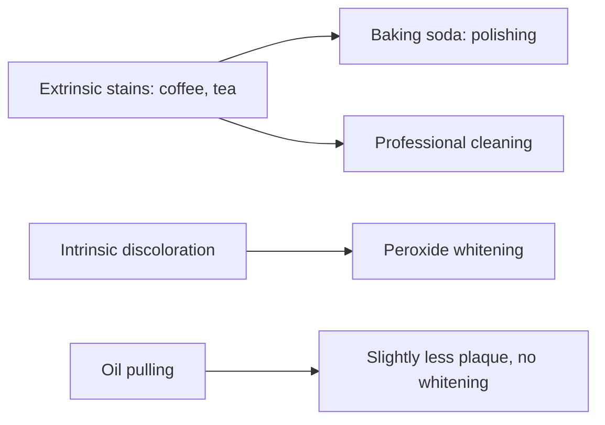

# Home teeth whitening

## Summary

Baking soda and coconut oil are popular natural ingredients in home teeth whitening. Baking soda is a mild abrasive that removes surface stains and neutralizes acids; toothpastes containing it remove stains effectively. Coconut oil "oil pulling" (swishing oil for 10 to 20 minutes) may reduce plaque bacteria slightly but does not whiten teeth, and the American Dental Association does not recommend it. Neither changes the intrinsic color of teeth like peroxide whitening; overuse of abrasives can wear enamel.

*This note is educational. It is not medical advice and does not replace a doctor, dietitian or pharmacist, especially during pregnancy, illness or when taking medicines.*

## Prerequisites

No prior notes are needed.

## Core concepts

### Definition

*Extrinsic stains* are surface stains (coffee, tea, tobacco); *intrinsic stains* are inside the tooth. *Abrasivity* is measured as relative dentin abrasivity (RDA); baking soda has low RDA (about 7) compared with many toothpastes (up to 250). *Oil pulling* is swishing oil in the mouth.

### Analogy

Baking soda works like a gentle polish on a car: it removes the dirt on the paint but does not change the paint color. Peroxide whitening is like changing the paint. Oil pulling is like rinsing the car with oil: it may loosen some dirt, but it does not polish. The analogy breaks because enamel, unlike paint, does not regrow once worn away.

### Mechanism

**Baking soda.** It is mildly abrasive and can remove surface stains. It is alkaline, neutralizing mouth acids and helping maintain a healthy pH. Regular use in small amounts can improve the appearance of teeth, but it will not whiten them as much as professional treatments. Do not use it too often, because overuse can damage enamel over time. To use, make a paste with a little water or toothpaste and brush gently for about 2 minutes, avoiding hard brushing.

**Coconut oil.** It is known for antibacterial and antifungal properties and may reduce bacteria that contribute to plaque and stains. Oil pulling means swishing 1 tablespoon of coconut oil in the mouth for 10 to 20 minutes, then spitting it out (into the trash, not the sink, to avoid clogging) and rinsing with water; some do this as a morning routine. Coconut oil does not whiten teeth in the traditional sense; any effect on appearance comes from less plaque and is subtle.

**Combining them.** Some people mix baking soda and coconut oil into a homemade whitening paste: soda removes surface stains and oil adds antibacterial action. Because soda is abrasive, once or twice a week is enough. Results depend on the type of stain: surface stains may be reduced, deeper discoloration needs professional treatment. Fluoride toothpaste and regular dental visits remain essential.

The flowchart separates stain types and methods.

### Claimed effects and evidence

Each entry states the proposed effect and how strong the human evidence is, using the grades defined in the [Evidence grades](../nutrition/evidence-grades.md) note.

- **Baking soda removes surface stains.** Baking soda toothpastes remove extrinsic stains effectively. Evidence: moderate.
- **Baking soda neutralizes mouth acids.** Established chemistry. Evidence: established physiology.
- **Oil pulling whitens teeth.** No evidence of whitening. Evidence: not supported.
- **Oil pulling reduces plaque and bacteria.** Small trials of low quality; ADA does not recommend it. Evidence: limited.
- **Baking soda damages enamel.** Baking soda has low abrasivity; damage comes from overuse with hard brushing. Evidence: limited.

## Worked example

A coffee drinker brushes once or twice a week with a baking soda paste and uses fluoride toothpaste daily. After a month, coffee stains look lighter. For a deeper whitening effect, the dentist suggests carbamide peroxide trays after checking for cavities and gum disease.

## Trade offs and when to use it

Baking soda is a safe, low-abrasive stain remover; oil pulling adds time but little benefit. Fluoride toothpaste prevents caries and should not be replaced by homemade pastes, which lack fluoride.

## Common mistakes

- **Replacing fluoride toothpaste with homemade paste.** Homemade pastes lack fluoride.
- **Scrubbing hard with baking soda daily.** Use gently and not too often.
- **Expecting oil pulling to whiten.** It does not.

## Practice

1. What type of stains can baking soda remove?
2. Does oil pulling whiten teeth?
3. Why is fluoride toothpaste still needed?

### Answers

1. Extrinsic, surface stains.
2. No.
3. It prevents caries, and homemade pastes lack fluoride.

## Further reading

- Li, Y. (2017). Review of the use of sodium bicarbonate in dentifrices for whitening and stain removal. Journal of the American Dental Association, 148(11S), S20-S26. [DOI](https://doi.org/10.1016/j.adaj.2017.09.002). Review of sodium bicarbonate dentifrices for whitening.
- American Dental Association. Oil pulling: ADA Science and Research Institute statement. [Link](https://www.ada.org/resources/ada-library/oral-health-topics/oil-pulling). ADA statement on oil pulling.
- Walsh, T., Worthington, H. V., Glenny, A. M. et al. (2019). Fluoride toothpastes of different concentrations for preventing dental caries. Cochrane Database of Systematic Reviews, CD007868. [DOI](https://doi.org/10.1002/14651858.CD007868.pub3). Cochrane review of fluoride toothpaste.
