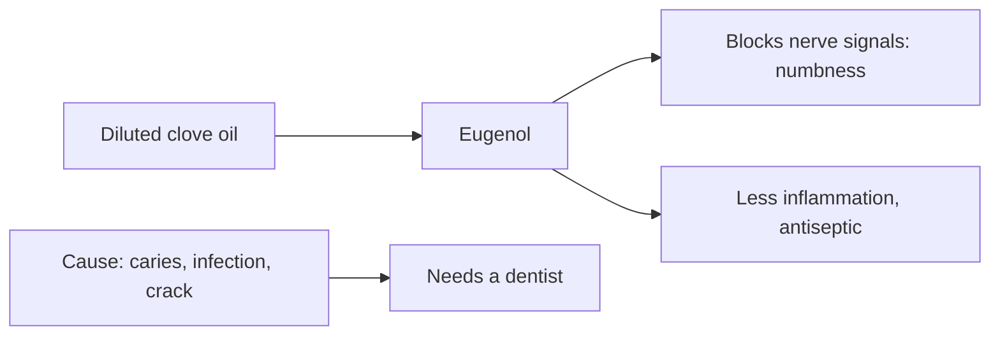

# Clove oil for toothache

## Summary

Clove oil is a popular natural remedy for toothache because of its analgesic, anti-inflammatory and antiseptic properties. Its active compound, eugenol, acts as a local anesthetic. Diluted clove oil on a cotton swab applied to the painful tooth or gum can give temporary relief. It does not treat the cause; persistent toothache needs a dentist.

*This note is educational. It is not medical advice and does not replace a doctor, dietitian or pharmacist, especially during pregnancy, illness or when taking medicines.*

## Prerequisites

No prior notes are needed.

## Core concepts

### Definition

*Eugenol* is the phenylpropanoid that makes up 70 to 90 percent of clove oil. Dentists use zinc oxide-eugenol materials for temporary fillings and dry socket dressings ([Clove oil](../complementary-medicine/essential-oils/clove.md)).

### Analogy

Clove oil is like a temporary bandage for tooth pain: it numbs the area but does not repair the hole or infection beneath. The analogy breaks because, unlike a bandage, undiluted clove oil can itself damage tissue.

### Mechanism

Eugenol blocks sodium channels in nerve fibers (like local anesthetics) and inhibits prostaglandin synthesis.

**How to use clove oil for toothache.**

1. *Preparation:* essential clove oil is very strong; dilute it with a carrier oil such as coconut or olive oil at 1:1 or 1:2.
2. *Application:* dip a cotton ball or swab in the diluted oil and gently apply it to the painful tooth or gum, avoiding the tongue and the inside of the mouth, which may burn. Leave it in place for a few minutes.
3. *Alternative:* chew a whole clove (the spice), which slowly releases oil that acts locally; this is less effective than applying the oil.

**What to keep in mind.**

- *Duration:* relief is usually short-lived; persistent toothache needs a dental visit.
- *Irritation:* clove oil is very strong and can irritate sensitive tissues in the mouth.
- *Contraindications:* not recommended for children, pregnant women or people allergic to cloves.

The flowchart shows what clove oil does and does not do.

### Claimed effects and evidence

Each entry states the proposed effect and how strong the human evidence is, using the grades defined in the [Evidence grades](../nutrition/evidence-grades.md) note.

- **Analgesic effect on toothache.** Clove gel matched benzocaine for needle pain in a trial; used in dental materials. Evidence: moderate.
- **Anti-inflammatory and antiseptic effects.** Laboratory evidence and dental use. Evidence: limited.

## Worked example

At night, a person develops throbbing pain from a tooth with a large cavity. They apply clove oil diluted 1:2 in olive oil on a cotton ball for a few minutes, which dulls the pain enough to sleep. The next day they call the dentist, because the pain signals pulp inflammation that clove oil cannot treat.

## Trade offs and when to use it

Useful as short-term relief until dental care; repeated undiluted use can burn gums and damage pulp tissue.

## Common mistakes

- **Using undiluted oil.** Dilute 1:1 or 1:2.
- **Delaying dental care.** The cause needs treatment.

## Practice

1. What is the active compound of clove oil?
2. How should clove oil be diluted for toothache?
3. Who should not use it?

### Answers

1. Eugenol.
2. 1:1 or 1:2 with a carrier oil.
3. Children, pregnant women and people allergic to cloves.

## Further reading

- Alqareer, A., Alyahya, A., Andersson, L. (2006). The effect of clove and benzocaine versus placebo as topical anesthetics. Journal of Dentistry, 34(10), 747-750. [DOI](https://doi.org/10.1016/j.jdent.2006.01.009). Trial of clove gel as a topical anesthetic.
- Tisserand, R., Young, R. (2014). *Essential Oil Safety: A Guide for Health Care Professionals (2nd ed.)*. Churchill Livingstone. Safety of clove oil.
