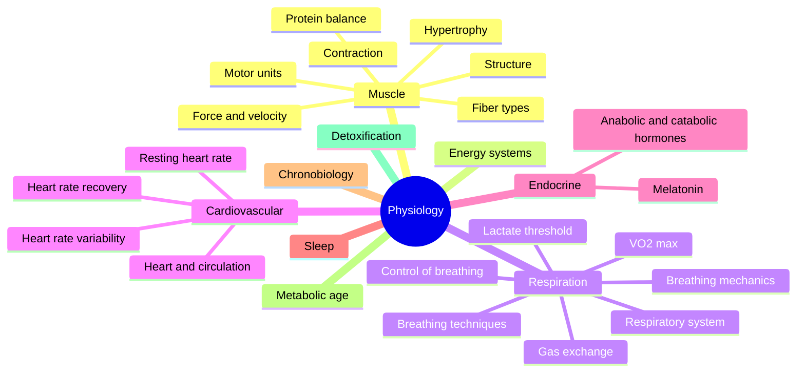

# Physiology

Physiology explains how the body works: how muscles contract, how energy is supplied, how we breathe, how the heart adapts, how hormones and sleep regulate recovery, and how the body handles waste and toxins. These notes build on [Anatomy](../anatomy/README.md) and [Biochemistry](../../../natural-sciences/chemistry/biochemistry/README.md), and they are the basis for [Exercise and fitness](../exercise-and-fitness/README.md).

## Map of the field

## Reading order

1. [Muscle physiology](muscle/README.md): from the sarcomere to hypertrophy.
2. [Energy systems](energy-systems.md): the three systems that supply ATP during exercise.
3. [Respiration](respiration/README.md): breathing, gas exchange, VO2 max and the lactate threshold.
4. [Cardiovascular system](cardiovascular/README.md): the heart and the heart rate measures used in training.
5. [Endocrine system](endocrine/README.md): hormones that build and break down tissue, and melatonin.
6. [Sleep](sleep/README.md): sleep stages, sleep metrics and techniques for falling asleep.
7. [Chronobiology](chronobiology.md): circadian rhythms and the body clock.
8. [Metabolic age](metabolic-age.md): what the "metabolic age" number on scales means.
9. [Detoxification](detoxification.md): how the liver and kidneys remove toxins.

## Scope and evidence

- Basic physiology is well established. Numbers for normal ranges come from textbooks and guidelines and are approximate, because they vary with age, sex and measurement method.
- Claims about training adaptations and recovery practices are graded where the evidence is mixed.
