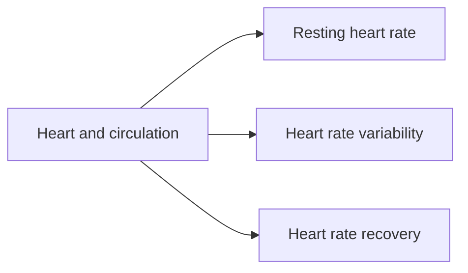

# Cardiovascular system

The heart and blood vessels deliver oxygen and nutrients and remove waste. This subfield explains the heart and circulation and three heart rate measures widely used to monitor fitness and recovery.

## Map

## Reading order

1. [Heart and circulation](heart-and-circulation.md)
2. [Resting heart rate](resting-heart-rate.md)
3. [Heart rate variability](heart-rate-variability.md)
4. [Heart rate recovery](heart-rate-recovery.md)
