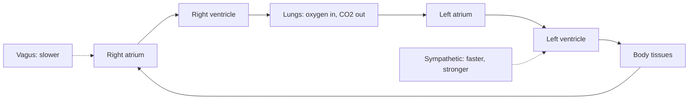

# Heart and circulation

## Summary

The heart is a muscular pump with two sides: the right side sends blood through the lungs to pick up oxygen, and the left side pumps oxygenated blood to the body. Cardiac output, the volume pumped per minute, equals heart rate times stroke volume and rises from about 5 L per minute at rest to 20 to 40 L in exercise. The autonomic nervous system adjusts heart rate: the parasympathetic (vagus) nerve slows it and the sympathetic nerves speed it up. Endurance training enlarges the heart's chambers and lowers resting heart rate.

## Prerequisites

- [Gas exchange and oxygen transport](../respiration/gas-exchange.md)

## Core concepts

### Definition

The *cardiovascular system* consists of the heart, arteries, capillaries and veins. *Cardiac output* (Q) is heart rate (HR) multiplied by *stroke volume* (SV), the blood ejected per beat. The *pulmonary circulation* runs from the right ventricle through the lungs to the left atrium; the *systemic circulation* runs from the left ventricle through the body to the right atrium.

### Analogy

The heart is like two pumps working side by side in one housing. The right pump sends water through a filter loop (the lungs), and the left pump sends filtered water around a large building (the body). Both must pump the same amount per minute, or water would pile up in one loop. The analogy breaks because the pumps change speed and stroke size every few seconds in response to signals, and their pipes (arteries) can widen and narrow.

### Mechanism

1. **Pacemaker.** The sinoatrial node in the right atrium fires spontaneously about 60 to 100 times a minute; the vagus nerve normally slows it to a resting rate below its intrinsic rate.
2. **Conduction.** The impulse spreads through the atria, is delayed at the atrioventricular node and then rapidly spreads through the ventricles.
3. **Cycle.** Ventricles contract (systole) and eject blood; then relax and fill (diastole). Valves keep the flow one-way.
4. **Regulation.** Sympathetic activity and adrenaline raise heart rate and contractility; parasympathetic activity lowers heart rate. Greater filling stretches the ventricle and increases stroke volume (Frank-Starling mechanism).
5. **Vessels.** Arterioles adjust their diameter to direct blood: during exercise, blood flow to working muscles rises from about 15 to 20 percent of cardiac output to over 80 percent.

The diagram shows the two circulations.

### Training adaptations

Endurance training enlarges the left ventricle and increases blood volume, so stroke volume rises (from about 70 ml at rest in untrained adults to over 100 ml in trained endurance athletes). The same cardiac output at rest then needs fewer beats, which lowers resting heart rate. Maximal heart rate changes little with training and falls with age (roughly 208 − 0.7 × age, Tanaka formula; individual values vary by about 10 beats).

## Worked example

At rest, an untrained person has HR 70 and SV 70 ml: Q = 4.9 L/min. A trained runner has HR 45 and SV 110 ml: Q ≈ 5.0 L/min, the same output with far fewer beats. At maximum, the untrained person reaches HR 190 and SV 110 ml (Q ≈ 21 L/min), while the runner reaches HR 185 and SV 180 ml (Q ≈ 33 L/min). This difference in maximal cardiac output is the main reason for the difference in VO2 max ([VO2 max](../respiration/vo2-max.md)).

## Trade offs and when to use it

- A large stroke volume is efficient, but very high volumes of lifelong endurance exercise are associated with a modestly higher risk of atrial fibrillation in some studies.

## Common mistakes

- **Thinking a low resting heart rate always means fitness.** It can also reflect medication or conduction problems.
- **Using 220 − age as an exact maximum.** Individual maximal heart rates vary widely.

## Practice

1. Write the formula for cardiac output.
2. Which nerve slows the heart?
3. Why does endurance training lower resting heart rate?

### Answers

1. Cardiac output = heart rate × stroke volume.
2. The vagus nerve (parasympathetic).
3. Stroke volume increases, so fewer beats are needed for the same output.

## Further reading

- Betts, J. G., Young, K. A., Wise, J. A. et al. (2022). *Anatomy and Physiology 2e*. OpenStax, Rice University. [Link](https://openstax.org/details/books/anatomy-and-physiology-2e). Chapters 19 and 20 on the heart and blood vessels.
- Kenney, W. L., Wilmore, J. H., Costill, D. L. (2020). *Physiology of Sport and Exercise (7th ed.)*. Human Kinetics. Cardiovascular adaptations to training.
