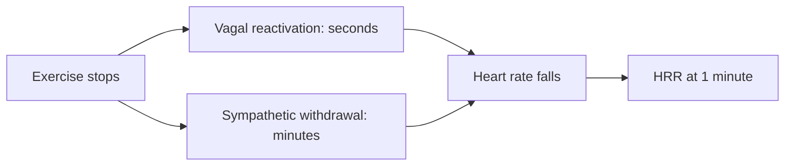

# Heart rate recovery

## Summary

Heart rate recovery (HRR) is how much the heart rate falls in the first minute after stopping hard exercise. A fall of 12 beats or more in one minute is usually considered normal, and 18 or more indicates good fitness. HRR reflects how quickly the parasympathetic system reactivates. A slow recovery predicted higher mortality in a classic study of patients undergoing exercise tests (Cole and colleagues, 1999).

## Prerequisites

- [Resting heart rate](resting-heart-rate.md)

## Core concepts

### Definition

*Heart rate recovery* is the difference between peak heart rate at the end of exercise and heart rate one minute later (HRR1). Some protocols also use two minutes or measure with a cool-down instead of complete rest.

### Analogy

HRR is like how fast a car slows when you lift off the accelerator. A car with good engine braking (strong vagal reactivation) slows quickly; one with poor braking coasts. The analogy breaks because the "brake" in the heart is a nervous signal, which also depends on how hard and long the "drive" was.

### Mechanism

At the end of exercise, the parasympathetic system reactivates within seconds and slows the heart; sympathetic withdrawal and clearing of adrenaline follow more slowly. Fitness enhances this vagal reactivation. Cardiovascular disease and autonomic dysfunction impair it.

The diagram shows the recovery process.

### Norms

| HRR at 1 minute | Interpretation |
| --- | --- |
| Less than 12 bpm | Abnormal in clinical testing; associated with higher risk |
| 12 to 17 bpm | Normal |
| 18 bpm or more | Good fitness |

### Improving HRR

Interval training, good recovery (sleep and nutrition), controlled breathing after training (for example a 4-7-8 pattern) and monitoring for overtraining all contribute.

## Worked example

After a final hard interval, a cyclist's heart rate is 172 bpm; one minute later, sitting still, it is 140 bpm. HRR1 = 32 bpm, a very good value. Six weeks earlier, HRR1 after a similar effort was 22 bpm. The improvement suggests better autonomic fitness. Because HRR depends on the effort and the recovery position, the test must be repeated the same way to compare results.

## Trade offs and when to use it

- HRR is easy to measure with a heart rate monitor, but differences in the preceding effort and recovery mode (sitting, standing, walking) change the number.

## Common mistakes

- **Comparing HRR after different efforts.** Standardize the test.
- **Using a single result to diagnose.** Clinical interpretation requires a supervised exercise test.

## Practice

1. How is HRR at 1 minute calculated?
2. What HRR value is usually considered abnormal?
3. Which branch of the nervous system mainly drives the early fall in heart rate?

### Answers

1. Peak heart rate at the end of exercise minus heart rate one minute later.
2. Less than 12 bpm.
3. The parasympathetic (vagal) branch.

## Further reading

- Cole, C. R., Blackstone, E. H., Pashkow, F. J. et al. (1999). Heart-rate recovery immediately after exercise as a predictor of mortality. New England Journal of Medicine, 341(18), 1351-1357. [DOI](https://doi.org/10.1056/NEJM199910283411804). Study linking slow heart rate recovery to mortality.
- Kenney, W. L., Wilmore, J. H., Costill, D. L. (2020). *Physiology of Sport and Exercise (7th ed.)*. Human Kinetics. Heart rate during recovery.
