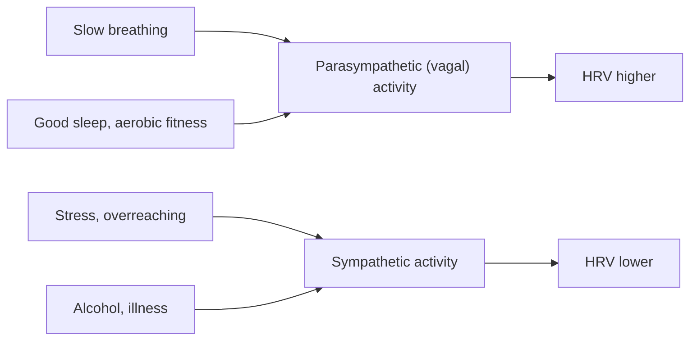

# Heart rate variability

## Summary

Heart rate variability (HRV) is the variation in time between consecutive heartbeats (RR intervals). A healthy heart does not beat like a metronome: the intervals change with breathing and with the balance of the autonomic nervous system. Higher HRV at rest generally reflects stronger parasympathetic activity and better recovery; lower HRV is linked to stress, fatigue and illness. Values differ greatly between people, so the personal trend matters more than any single number.

## Prerequisites

- [Resting heart rate](resting-heart-rate.md)

## Core concepts

### Definition

*Heart rate variability* is the variation in the intervals between successive heartbeats, measured in milliseconds. Common measures are *RMSSD* (root mean square of successive differences, reflecting parasympathetic activity) and *SDNN* (standard deviation of all normal intervals). The 1996 Task Force of the European Society of Cardiology defined the standards of measurement.

### Analogy

HRV is like the responsiveness of a car's steering. A car with good steering makes small, constant corrections to keep straight; a car with stiff steering cannot adjust. A heart with high variability adjusts beat by beat to breathing and demands; low variability means the system is locked in a stressed setting. The analogy breaks because very high or irregular variability can also signal arrhythmia, not health.

### Mechanism

The vagus nerve can change heart rate within one beat; sympathetic effects are slower. During inhalation, vagal activity briefly falls and heart rate rises; during exhalation, it rises and heart rate falls (respiratory sinus arrhythmia). The more vagal influence, the larger these fluctuations, and the higher RMSSD.

The diagram shows influences on HRV.

### Values

Typical resting RMSSD values in healthy adults range widely, roughly 20 to 100 ms, decreasing with age. Trained people often show higher values, for example around 60 ms or more, but individual variation is large, so trends over weeks are what matter.

### Improving HRV

Diaphragmatic breathing and meditation, good sleep, low-intensity cardio training, and reducing alcohol, caffeine and stress tend to raise HRV.

### HRV-guided training

Some athletes adjust training to daily HRV: if the morning value falls clearly below the personal rolling average, they reduce intensity. Studies in endurance athletes suggest this approach can match or slightly improve outcomes compared with fixed plans (Plews and colleagues, 2013).

## Worked example

A person measures RMSSD every morning for 2 minutes lying down with a chest strap. The 7-day average is 55 ms with normal day-to-day variation of about 5 ms. After a night of drinking, the value is 34 ms; two days later it is back to 53 ms. The drop shows the effect of alcohol on recovery, and the rolling average shows the return to baseline.

## Trade offs and when to use it

- HRV is a sensitive marker but noisy; it needs standardized measurement (same time, position, breathing).
- Wrist devices that measure HRV during sleep are convenient but less accurate than chest straps.

## Common mistakes

- **Comparing your HRV with others'.** It varies widely between people.
- **Reacting to one low reading.** Look at the trend.

## Practice

1. What does RMSSD mainly reflect?
2. What is respiratory sinus arrhythmia?
3. Name two factors that lower HRV.

### Answers

1. Parasympathetic (vagal) activity.
2. The normal rise in heart rate during inhalation and fall during exhalation.
3. Stress and alcohol (also illness, poor sleep, overreaching).

## Further reading

- Task Force of the European Society of Cardiology and the North American Society of Pacing and Electrophysiology (1996). Heart rate variability: standards of measurement, physiological interpretation and clinical use. Circulation, 93(5), 1043-1065. [DOI](https://doi.org/10.1161/01.CIR.93.5.1043). Standards of HRV measurement.
- Plews, D. J., Laursen, P. B., Stanley, J. et al. (2013). Training adaptation and heart rate variability in elite endurance athletes: opening the door to effective monitoring. Sports Medicine, 43(9), 773-781. [DOI](https://doi.org/10.1007/s40279-013-0071-8). HRV monitoring in elite endurance athletes.
