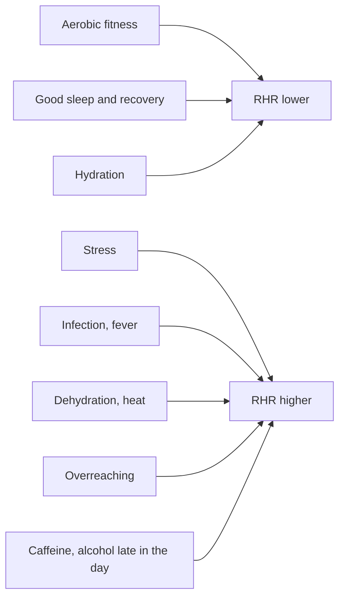

# Resting heart rate

## Summary

Resting heart rate (RHR) is the number of heartbeats per minute at complete rest, usually measured in the morning after waking. In healthy adults it is typically 50 to 70 bpm by many sources (the clinical range is often given as 60 to 100), and endurance athletes often have 40 to 50 bpm. A lower RHR generally reflects better cardiovascular fitness and recovery, while a rise of several beats above a person's usual value can signal stress, dehydration, infection or overreaching.

## Prerequisites

- [Heart and circulation](heart-and-circulation.md)

## Core concepts

### Definition

*Resting heart rate* is the heart rate measured at rest, ideally lying down after waking and before getting up, or after at least 5 minutes of quiet sitting.

### Analogy

RHR is like the idle speed of an engine. A well-tuned, larger engine idles slowly and quietly; a strained engine idles faster. If the idle speed suddenly rises, something is working harder than usual: perhaps the engine is hot (fever) or low on fluid (dehydration). The analogy breaks because a very low idle can also indicate a fault in the ignition (conduction system), not only a strong engine.

### Mechanism

At rest, the vagus nerve keeps the heart rate below the intrinsic rate of the sinoatrial node (about 100 bpm). Fitness lowers RHR mainly through larger stroke volume and greater vagal tone. Sympathetic activation from stress, poor sleep, illness, heat, caffeine or alcohol raises it.

The diagram shows what moves RHR up and down.

### Norms

| Group | Typical RHR (bpm) |
| --- | --- |
| Healthy adults | 50 to 70 (clinical normal range often 60 to 100) |
| Endurance athletes | 40 to 50, sometimes lower |
| Concerning in an untrained person | Persistently below 50 with symptoms, or above 100 |

Large cohort studies associate a higher RHR with higher cardiovascular and all-cause mortality; a meta-analysis (Aune and colleagues, 2017) found about 9 to 17 percent higher risk for each 10 bpm increase.

### Improving RHR

Regular aerobic training, good sleep and recovery, adequate hydration and avoiding stimulants before sleep tend to lower RHR.

## Worked example

A runner's usual morning RHR is 48 bpm, measured with a chest strap for a week. On Monday after a hard weekend race it is 55 bpm, on Tuesday 54. A rise of more than about 5 to 7 beats over baseline suggests incomplete recovery or the start of an illness; the runner swaps a hard interval session for an easy run, and RHR returns to 49 by Thursday. Tracking the trend is more useful than any single value.

## Trade offs and when to use it

- RHR is simple and cheap to measure but noisy day to day. Use a 7-day average and consistent conditions.
- A low RHR with dizziness or fainting needs medical assessment.

## Common mistakes

- **Comparing your RHR with others.** Individual baselines differ.
- **Measuring at random times.** Measure at the same time and position.

## Practice

1. When is the best time to measure resting heart rate?
2. Name three causes of a raised RHR.
3. Why is a single low value not enough to judge fitness?

### Answers

1. In the morning after waking, before getting up.
2. Stress, illness or fever, dehydration (also overreaching, heat, caffeine or alcohol).
3. Daily variation is large and other causes, such as medication or conduction disorders, can lower it.

## Further reading

- Aune, D., Giovannucci, E., Boffetta, P. et al. (2017). Fruit and vegetable intake and the risk of cardiovascular disease, total cancer and all-cause mortality: a systematic review and dose-response meta-analysis of prospective studies. International Journal of Epidemiology, 46(3), 1029-1056. [DOI](https://doi.org/10.1093/ije/dyw319). Meta-analysis of resting heart rate and mortality.
- Kenney, W. L., Wilmore, J. H., Costill, D. L. (2020). *Physiology of Sport and Exercise (7th ed.)*. Human Kinetics. Heart rate responses to training.
