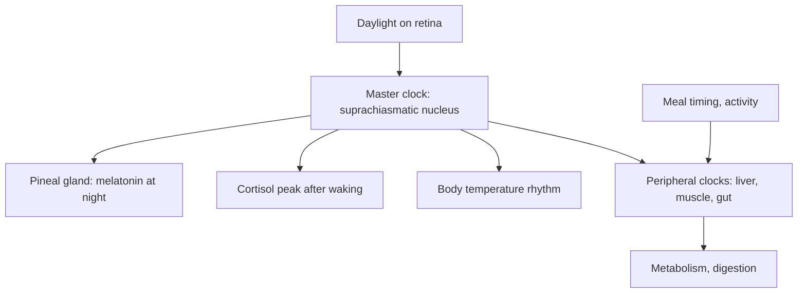

# Chronobiology

## Summary

Chronobiology studies the natural cycles of living things and how they are tuned to the cycles of the sun and the moon. The most important human cycle is the circadian rhythm, a roughly 24-hour clock that times sleep, hormone release, eating and digestion, and body temperature. A master clock in the brain, the suprachiasmatic nucleus, is reset each day mainly by light, and clocks in other organs follow it. The 2017 Nobel Prize in Physiology or Medicine went to Jeffrey Hall, Michael Rosbash and Michael Young for discovering the molecular mechanism of this clock.

## Prerequisites

No prior notes are needed. Basic knowledge of hormones helps; see [Endocrine system](endocrine/README.md).

## Core concepts

### Definition

*Chronobiology* is the branch of biology that studies periodic (cyclic) phenomena in living organisms and their adaptation to solar and lunar rhythms. A *circadian rhythm* (Latin *circa diem*, about a day) is an endogenous rhythm with a period of about 24 hours that persists without external cues and is synchronized (entrained) by *zeitgebers*, mainly light, and also meals, activity and temperature.

### Analogy

The circadian system is like an orchestra. The conductor (the suprachiasmatic nucleus) keeps time and sets the tempo each morning by checking a clock on the wall (daylight). Each section (liver, muscles, gut, fat tissue) has its own players who follow the conductor but also respond to their own cues, such as meal times. Jet lag and shift work are like the sections starting to play out of time. The analogy breaks because each section can keep playing roughly in time even without the conductor for a while.

### Mechanism

1. **Molecular clock.** In fruit flies, Hall, Rosbash and Young identified the *period* gene. Its protein (PER) accumulates in cells during the night and is degraded during the day; it represses its own gene, forming a feedback loop of about 24 hours. Humans have similar clock genes (CLOCK, BMAL1, PER, CRY).
2. **Master clock.** The suprachiasmatic nucleus (SCN) in the hypothalamus receives light information from the retina through the retinohypothalamic tract.
3. **Melatonin.** In dim light, such as at night, the SCN lets the pineal gland produce more melatonin, promoting sleepiness ([Melatonin](endocrine/melatonin.md)).
4. **Peripheral clocks.** Organs such as the liver, muscle and gut have their own clocks, set by the SCN and by meal timing and activity.
5. **Outputs.** The rhythm shapes the timing of hormone release (cortisol peaks after waking, melatonin at night), appetite and digestion, body temperature (lowest in the early morning), alertness and, most noticeably for many people, sleep patterns.

The diagram shows the hierarchy of the circadian system.

### Organ clocks and the "body clock" chart

Charts that assign each organ a two-hour window of maximal activity, with minimal activity 12 hours later, come from traditional Chinese medicine (the "organ clock"). They are sometimes presented as a guide to healthy living. Modern research confirms that organs have daily rhythms of activity, but these rhythms do not follow the fixed two-hour schedule of such charts, and the charts have no experimental support. Practical advice that does have support: get daylight in the morning, keep regular sleep and meal times, and avoid large meals and bright light late at night.

### Chronotypes

People differ in their preferred timing ("larks" and "owls"). Chronotype is partly genetic, shifts later in adolescence and earlier with age. Forcing a late chronotype into an early schedule creates "social jet lag", a mismatch associated with poorer sleep and metabolic health.

## Worked example

A night-shift nurse works 21:00 to 07:00. Her SCN is still entrained to daylight, so at 04:00 her body temperature and alertness are at their lowest and the risk of errors is highest. Strategies used in practice include bright light during the first half of the shift, sunglasses on the drive home, a dark, cool bedroom and a consistent sleep time on work days. Long-term night work is associated with higher risks of metabolic and cardiovascular disease, and IARC classifies night shift work as probably carcinogenic (Group 2A).

## Trade offs and when to use it

- Aligning activity with the circadian rhythm improves sleep and performance, but jobs and social life often require compromise.
- The evidence for timing meals ("chrononutrition") is growing but still mixed.

## Common mistakes

- **Following organ clock charts as medical advice.** They have no experimental support.
- **Using bright screens late at night.** Light delays the clock and melatonin release.

## Practice

1. What is a circadian rhythm?
2. Where is the master clock located?
3. For what discovery was the 2017 Nobel Prize awarded?

### Answers

1. An internal rhythm of about 24 hours that persists without external cues and is synchronized by light and other cues.
2. In the suprachiasmatic nucleus of the hypothalamus.
3. The molecular mechanisms controlling the circadian rhythm, including the period gene and its protein that accumulates at night and is degraded by day.

## Further reading

- Nobel Assembly at Karolinska Institutet (2017). The Nobel Prize in Physiology or Medicine 2017: press release. [Link](https://www.nobelprize.org/prizes/medicine/2017/press-release/). Announcement and summary of the 2017 Nobel Prize for circadian rhythm research.
- Betts, J. G., Young, K. A., Wise, J. A. et al. (2022). *Anatomy and Physiology 2e*. OpenStax, Rice University. [Link](https://openstax.org/details/books/anatomy-and-physiology-2e). Circadian control by the hypothalamus and pineal gland.
