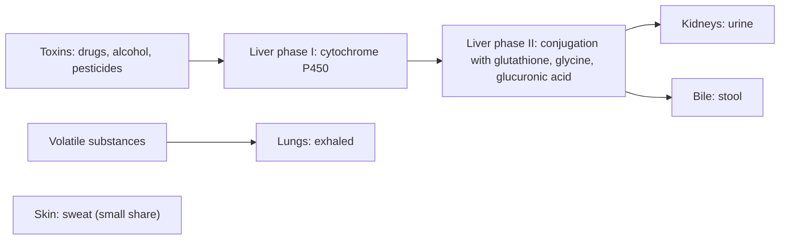

# Detoxification

## Summary

Detoxification is the body's continuous process of neutralizing, transforming and removing toxins and metabolic waste. It is carried out mainly by the liver (in two phases of chemical transformation), the kidneys (filtering blood into urine), the gut (excreting waste in stool), the lungs (exhaling volatile substances) and to a small extent the skin (sweat). Healthy habits support these organs. Commercial "detox" diets, juices and cleanses have not been shown to remove toxins in controlled studies, and some popular "detox" foods have risks, such as grapefruit, which blocks the breakdown of many medicines.

## Prerequisites

- [Enzymes and coenzymes](../../../natural-sciences/chemistry/biochemistry/enzymes-and-coenzymes.md)

## Core concepts

### Definition

*Detoxification* (biotransformation and elimination) is the set of processes by which the body converts foreign substances (xenobiotics) and its own waste into less harmful, more water-soluble forms and excretes them. The main organs are the liver, kidneys, gut, lungs and skin.

### Analogy

The detox system is like a city's waste management. The liver is the sorting and processing plant: it breaks waste down (phase I) and packs it into labeled bags (phase II). The kidneys and gut are the trucks that carry bags out of town (urine and stool). The lungs vent gases, and the skin is a small side exit. Buying special products to "clean" the city does little if the plant and trucks work; what helps is not overloading them and keeping them well maintained. The analogy breaks because some substances, such as alcohol, damage the plant itself.

### Mechanism

**Liver.** The liver is the main detoxification organ and works in two phases:

- *Phase I (biotransformation)*: enzymes, mainly cytochrome P450, convert toxins such as drugs, alcohol and pesticides by oxidation, reduction and hydroxylation. This prepares them for phase II, but some phase I products are more reactive than the original substance.
- *Phase II (conjugation)*: phase I products are linked to other molecules (glutathione, glycine, glucuronic acid, sulfate), which makes them more water-soluble so they can be excreted by the kidneys (urine) or bile (stool).

**Kidneys.** They filter about 180 L of blood plasma per day, remove excess water, electrolytes and metabolic waste (urea, creatinine) as urine, and regulate acid-base and electrolyte balance.

**Gut.** The intestines remove undigested food residues and toxins excreted in bile. The gut microbiota also metabolizes some toxins.

**Skin.** Sweat contains small amounts of substances, including traces of heavy metals and metabolic products. Quantitatively, sweating removes far less than the kidneys and liver.

**Lungs.** They exhale volatile substances such as alcohol and some metabolites. Mucus and cilia in the airways trap inhaled pollutants.

The diagram shows the two liver phases and the routes of excretion.

### Supporting detoxification

| Measure | Rationale | Evidence |
| --- | --- | --- |
| Adequate hydration | Needed for kidney function and urine production | Strong |
| Fiber-rich diet (leafy greens, fruit, whole grains, nuts, seeds) | Better bowel movements; healthy gut flora | Strong for gut health |
| Liver-supporting foods (cruciferous vegetables, garlic, onion, beets, citrus, milk thistle, turmeric) | Said to support phases I and II | Cruciferous compounds induce phase II enzymes (moderate in mechanistic studies); milk thistle and turmeric limited |
| Regular physical activity | Circulation and lymph flow, sweating | Strong for general health |
| Sauna and cold baths | Sweating; cold exposure for immunity and recovery | Not supported as detox |
| Sleep and stress management | Recovery and hormonal balance | Strong for general health |
| Supplements: glutathione, NAC, alpha-lipoic acid, vitamins C and E, selenium, zinc | Support phase II and antioxidant defenses | NAC is a medical antidote in paracetamol poisoning; otherwise limited in healthy people |

### Foods promoted for detox

| Food | Claim | What is known |
| --- | --- | --- |
| Grapefruit | Vitamin C, naringenin; said to increase phase I enzymes and speed drug metabolism | The opposite: furanocoumarins in grapefruit inhibit intestinal CYP3A4, which can raise blood levels of many drugs dangerously (Bailey and colleagues, 1998). People on medication should check before eating grapefruit |
| Coriander (cilantro) | Chelates mercury, lead and cadmium; mild diuretic | Animal studies only; no reliable human evidence for chelation |
| Cruciferous vegetables | Glucosinolates become sulforaphane and indole-3-carbinol, which induce phase II enzymes, neutralize carcinogens and regulate estrogen metabolism | Mechanism shown in cell, animal and small human studies; associated with lower cancer risk in some observational studies |
| Spirulina | Protein, vitamins, antioxidants; binds heavy metals; blood sugar balance | Limited (small trials, some on arsenic) |
| Chlorella | Chelates heavy metals; chlorophyll supports liver and kidneys | Limited |
| Kombucha | Probiotics, enzymes, organic acids for gut and liver | Very limited human data; contamination risk with home brewing |
| Activated charcoal | Adsorbs toxins and gases in the gut | Used by medical professionals in selected acute poisonings soon after ingestion; not a routine detox, and it also binds medicines and nutrients |
| Vitamin B9 (folate) | Methylation, liver regeneration, lowers homocysteine | Needed for methylation; supplementation helps only if intake is low |
| Lemonade (fresh lemon juice) | Vitamin C, flavonoids, digestion, hydration, "pH regulation" | Contributes to hydration and vitamin C; does not change blood pH |

In summary of the claims: grapefruit, cruciferous vegetables, spirulina and chlorella are promoted for liver support; coriander, spirulina and chlorella as heavy metal chelators; kombucha for gut health; activated charcoal for fast adsorption; folate for methylation; and lemonade for digestion and hydration.

### What burdens detoxification

- **Excess alcohol**: metabolized by the liver; overloads it, damages it and creates free radicals.
- **Diet high in processed food and sugar**: burdens digestion, leads to constipation and fatty liver.
- **Lack of physical activity**: slows circulation and lymph flow.
- **Environmental toxins**: air pollution, heavy metals, pesticides, industrial chemicals and tobacco smoke.
- **Lack of sleep and chronic stress**: raise cortisol and impair recovery.
- **Misuse of medicines and supplements**: overuse of painkillers (for example paracetamol) or some herbal products can damage the liver and kidneys.

### Pesticides and paraoxonase-1

The enzyme paraoxonase-1, made in the liver, breaks down some organophosphate pesticide metabolites and oxidized lipids. Supplements of quercetin (300 to 500 mg a day) and sulforaphane are promoted to increase its activity and so remove more pesticides. Some cell and animal studies show increased paraoxonase-1 with quercetin, sulforaphane or curcumin, but there is no human evidence that supplements increase pesticide removal. Sulforaphane supplements are usually dosed in tens of milligrams, not hundreds. Humic and fulvic acid supplements are also promoted for pesticides, without good evidence. Food sources of sulforaphane are broccoli sprouts, cauliflower, cabbage and rocket; of quercetin, onions, cabbage and leafy greens. Washing and peeling produce reduces pesticide residues.

## Worked example

A person on a calcium channel blocker (felodipine) for blood pressure starts drinking a glass of grapefruit juice each morning as a "detox". One glass can inhibit intestinal CYP3A4 for about 24 hours, raising felodipine levels several-fold in some people, with a risk of low blood pressure and dizziness. The same interaction affects some statins (simvastatin), immunosuppressants and others. The supposed detox food thus blocks a detox enzyme, the reverse of the claim.

## Trade offs and when to use it

- Supporting the body's own systems with hydration, fiber, sleep, activity and avoiding alcohol and smoking is well supported. Commercial detox products lack evidence (Klein and Kiat, 2015) and can be harmful.

## Common mistakes

- **Believing sweat removes most toxins.** The liver and kidneys do nearly all of the work.
- **Combining grapefruit with medicines without checking.** Many interactions are dangerous.
- **Using activated charcoal regularly.** It binds medicines and nutrients and is meant for specific poisonings under medical guidance.

## Practice

1. Describe the two phases of liver detoxification.
2. Why can grapefruit be dangerous with some medicines?
3. Which organ removes urea and creatinine?

### Answers

1. Phase I transforms toxins with enzymes such as cytochrome P450; phase II conjugates them with molecules like glutathione to make them water-soluble for excretion.
2. It inhibits CYP3A4 in the gut, raising blood levels of drugs metabolized by this enzyme.
3. The kidneys.

## Further reading

- Bailey, D. G., Malcolm, J., Arnold, O. et al. (1998). Grapefruit juice-drug interactions. British Journal of Clinical Pharmacology, 46(2), 101-110. [DOI](https://doi.org/10.1046/j.1365-2125.1998.00764.x). Review of grapefruit juice and drug interactions.
- Klein, A. V., Kiat, H. (2015). Clinical efficacy of popular commercial "detox" diets: a systematic review. Journal of Human Nutrition and Dietetics, 28(6), 675-686. [DOI](https://doi.org/10.1111/jhn.12286). Systematic review of commercial detox diets.
- Betts, J. G., Young, K. A., Wise, J. A. et al. (2022). *Anatomy and Physiology 2e*. OpenStax, Rice University. [Link](https://openstax.org/details/books/anatomy-and-physiology-2e). Liver and kidney function.
