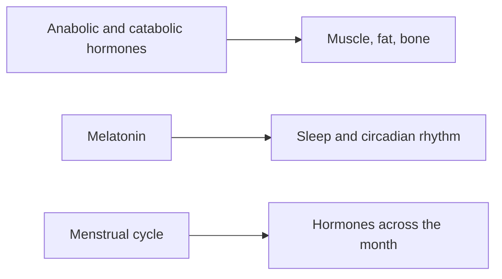

# Endocrine system

Hormones are chemical messengers released into the blood that coordinate growth, metabolism, stress responses and sleep. These notes cover the hormones that build and break down tissue, which matter for training and nutrition, and melatonin, the hormone of darkness.

## Map

## Reading order

1. [Anabolic and catabolic hormones](anabolic-and-catabolic-hormones.md)
2. [Melatonin](melatonin.md)
3. [Menstrual cycle](menstrual-cycle.md): the four phases, hormones and supporting a partner.
