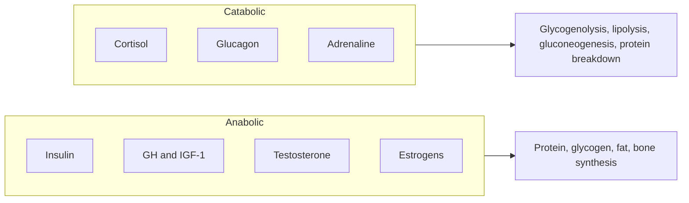

# Anabolic and catabolic hormones

## Summary

Anabolic hormones promote the building of tissue: insulin, growth hormone and IGF-1, testosterone and estrogens. Catabolic hormones mobilize stored energy and break tissue down: cortisol, glucagon and adrenaline. Their balance shifts with meals, fasting, sleep, stress and training. Short-term rises in hormones after a workout matter less for muscle growth than once believed; long-term levels, as in hypogonadism or chronic stress, do matter.

## Prerequisites

- [Anabolism](../../../../natural-sciences/chemistry/biochemistry/anabolism.md)

## Core concepts

### Definition

An *anabolic hormone* stimulates synthesis of complex molecules and tissue growth. A *catabolic hormone* stimulates breakdown of stored molecules to release energy and building blocks. Many hormones are both, depending on the tissue: growth hormone builds muscle and bone but breaks down fat.

### Analogy

Hormones are like managers of a construction company with two departments. The building department (anabolic hormones) orders materials and assigns workers when money comes in (after meals, during sleep). The demolition and recycling department (catabolic hormones) takes over in emergencies or when money is short (fasting, stress). Both are needed. The analogy breaks because the "departments" talk to every tissue differently, so the same manager can build in one place and demolish in another.

### Mechanism

| Hormone | Source | Main effects | Rises with |
| --- | --- | --- | --- |
| Insulin | Pancreas (beta cells) | Glucose and amino acid uptake, glycogen and fat synthesis, less protein breakdown | Meals, especially carbohydrate and protein |
| Growth hormone (GH, HGH) | Pituitary | Growth of bone and soft tissue via IGF-1, fat breakdown | Deep sleep, fasting, intense exercise |
| IGF-1 | Liver and muscle | Cell growth, protein synthesis | GH, adequate nutrition |
| Testosterone | Testes, ovaries, adrenal glands | Muscle protein synthesis, bone density, red blood cells | Puberty; falls slowly with age in men |
| Estrogens | Ovaries, fat tissue | Bone maintenance, reproductive tissues, some muscle protection | Menstrual cycle; fall at menopause |
| Cortisol | Adrenal cortex | Gluconeogenesis, protein breakdown, fat mobilization, anti-inflammatory | Stress, fasting, waking, prolonged exercise |
| Glucagon | Pancreas (alpha cells) | Liver glycogen breakdown, gluconeogenesis | Fasting, low blood glucose |
| Adrenaline | Adrenal medulla | Glycogen and fat breakdown, heart rate | Acute stress, exercise |

The diagram groups the hormones by their net effect.

### Hormones and training

Resistance training produces short rises in GH and testosterone. A study by West and colleagues (2010) found that these acute rises did not predict muscle growth, while long-term hormone levels and training variables did. Chronically high cortisol from stress, sleep loss or very large energy deficits favors muscle loss. Abuse of anabolic steroids raises muscle mass but causes serious harm, including heart disease, liver damage, infertility and mood disorders.

## Worked example

During a night of good sleep, most GH is released in pulses during the first periods of deep sleep. Sleep restriction to 5 hours for a week reduced testosterone by about 10 to 15 percent in young men in one study (Leproult and Van Cauter, 2011). This illustrates why sleep is part of recovery for muscle building ([Sleep](../sleep/README.md)).

## Trade offs and when to use it

- Chasing acute hormone spikes with specific workouts or supplements has little effect on results.
- Long-term hormonal health, influenced by sleep, nutrition, body fat and stress, matters for body composition and well-being.

## Common mistakes

- **Training to maximize the post-workout hormone spike.** It does not predict growth.
- **Calling cortisol "bad".** It is essential for waking, stress and controlling inflammation; the problem is chronic elevation.

## Practice

1. Name three anabolic hormones.
2. What does cortisol do to muscle protein?
3. During which sleep stage is most growth hormone released?

### Answers

1. Insulin, growth hormone (and IGF-1), testosterone (also estrogens).
2. It increases protein breakdown to supply amino acids for gluconeogenesis.
3. During deep (slow-wave) sleep.

## Further reading

- West, D. W., Burd, N. A., Tang, J. E. et al. (2010). Elevations in ostensibly anabolic hormones with resistance exercise enhance neither training-induced muscle hypertrophy nor strength of the elbow flexors. Journal of Applied Physiology, 108(1), 60-67. [DOI](https://doi.org/10.1152/japplphysiol.01147.2009). Study showing acute hormone rises do not predict hypertrophy.
- Leproult, R., Van Cauter, E. (2011). Effect of 1 week of sleep restriction on testosterone levels in young healthy men. JAMA, 305(21), 2173-2174. [DOI](https://doi.org/10.1001/jama.2011.710). Sleep restriction and testosterone in young men.
- Betts, J. G., Young, K. A., Wise, J. A. et al. (2022). *Anatomy and Physiology 2e*. OpenStax, Rice University. [Link](https://openstax.org/details/books/anatomy-and-physiology-2e). Chapter 17 on the endocrine system.
