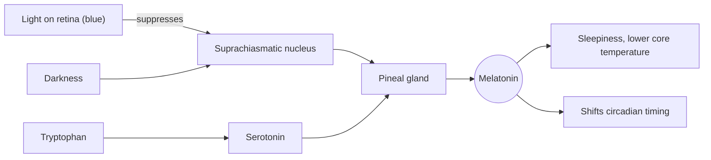

# Melatonin

## Summary

Melatonin is a hormone made mainly by the pineal gland in the brain. It rises in the evening as light fades and signals to the body that it is night, which helps time the sleep-wake cycle (circadian rhythm). It is also sold as a supplement. Melatonin reliably helps with jet lag and with shifting the body clock in delayed sleep phase, and it shortens the time to fall asleep modestly, by about 7 to 12 minutes on average in meta-analyses. It is not a strong sleeping pill.

*This note is educational. It is not medical advice and does not replace a doctor, dietitian or pharmacist, especially during pregnancy, illness or when taking medicines.*

## Prerequisites

- [Chronobiology](../chronobiology.md)

## Core concepts

### Definition

*Melatonin* (N-acetyl-5-methoxytryptamine) is a hormone produced mainly by the pineal gland from serotonin, which is made from tryptophan (see [Tryptophan](../../../../natural-sciences/chemistry/biochemistry/amino-acids/tryptophan.md)). It regulates the sleep-wake cycle. It occurs naturally in the body and is also available as a dietary supplement (in the EU in doses up to about 1 mg as a food supplement, higher doses as a prescription medicine in many countries; in the US over the counter at much higher doses). Small amounts occur in some foods, such as tart cherries, grapes, rice, nuts and cereals.

### Analogy

Melatonin is like the dusk signal of a city: when the streetlights come on, offices begin to close and the city shifts into night mode. Melatonin does not force the city to sleep; it announces that night has begun. The analogy breaks because the signal can be shifted: taking melatonin at a different time can move the whole city's schedule earlier or later.

### Mechanism

1. Light hitting special cells in the retina (containing melanopsin, most sensitive to blue light) signals to the suprachiasmatic nucleus (SCN), the master clock in the hypothalamus.
2. In darkness, the SCN allows the pineal gland to produce melatonin; light, especially bright and blue-rich light, suppresses it.
3. Melatonin levels rise about 2 hours before habitual sleep (dim light melatonin onset), peak in the middle of the night and fall toward morning.
4. Melatonin acts on MT1 and MT2 receptors: it lowers alertness and core temperature and shifts the timing of the clock. Taken in the late afternoon or evening, it advances the clock; taken in the morning, it can delay it.
5. Production declines with age.

The diagram shows the light-dark control of melatonin.

### Proposed effects and evidence

Each entry states the proposed effect and how strong the human evidence is, using the grades defined in the [Evidence grades](../../nutrition/evidence-grades.md) note.

- **Regulating the sleep-wake cycle.** Melatonin is most often used to support sleep. Studies show it may improve sleep quality, shorten the time to fall asleep and improve sleep efficiency, especially in insomnia, shift workers and jet lag. A meta-analysis (Ferracioli-Oda and colleagues, 2013) found it shortened sleep latency by about 7 minutes and increased total sleep by about 8 minutes in primary sleep disorders. Evidence: moderate for a small effect.
- **Delayed sleep phase syndrome (DSPS).** Melatonin can help people with delayed sleep phase, who struggle to fall asleep and wake at appropriate times. Regular use, timed a few hours before the desired bedtime, can advance their rhythm. Evidence: moderate.
- **Jet lag.** Melatonin is effective in easing jet lag, sleep disturbance caused by a sudden change of time zones, by helping reset the circadian rhythm. A Cochrane review (Herxheimer and Petrie, 2002) found it reduced jet lag when crossing five or more time zones, especially eastward. Evidence: strong.
- **Children with neurodevelopmental disorders.** In children with conditions such as autism or ADHD, melatonin may improve sleep. Studies suggest it is effective and safe for insomnia in these patients, shortening time to fall asleep and lengthening total sleep. Use should be supervised by a doctor. Evidence: moderate.
- **Age-related sleep problems.** Melatonin levels fall naturally with age, which may contribute to sleep problems. Studies show supplements may improve sleep quality in older adults; prolonged-release melatonin is approved in the EU for insomnia in people over 55. Effects on cognitive function are not established. Evidence: moderate for sleep, not supported for cognition.
- **Antioxidant properties.** Melatonin has antioxidant properties and may protect cells from free radical damage. It is studied for protecting nerve cells in Alzheimer and Parkinson disease. Evidence in humans is limited. Evidence: limited.
- **Immune function.** Some studies suggest melatonin modulates the immune system, which may help reduce inflammation and improve immune responses; it is studied as an adjunct in some viral infections. Evidence: very limited.
- **Mental health.** Melatonin may help improve mood and reduce symptoms of depression, especially seasonal affective disorder (SAD), linked to lack of sunlight and disturbed circadian rhythm. Evidence is weak; light therapy has better evidence for SAD. Evidence: very limited.
- **Cancer.** Early studies suggest melatonin may support treatment of some cancers alongside standard therapy, possibly through antioxidant effects and regulation of cell processes. More research is needed; it is not a cancer treatment. Evidence: very limited.

## Worked example

A traveler flies from Warsaw to Tokyo, 7 hours east. To shift the body clock earlier, a common evidence-based plan is 0.5 to 3 mg of melatonin at local bedtime (around 22:00 to 23:00 Tokyo time) for 3 to 5 nights after arrival, together with morning light and avoiding bright light in the evening. Higher doses are not more effective for jet lag and cause more next-day drowsiness.

## Trade offs and when to use it

- **Safety.** Short-term use appears safe in adults. Side effects include morning drowsiness, headache and vivid dreams. Long-term safety data are limited, especially in children.
- **Product quality.** Studies of supplements found actual content ranging widely from the label, sometimes with serotonin as a contaminant.
- **Interactions.** Melatonin may interact with anticoagulants, antiepileptics, immunosuppressants and sedatives.
- **Alternatives.** Cognitive behavioral therapy for insomnia is the first-line treatment for chronic insomnia; light exposure management is central for circadian problems.

## Common mistakes

- **Taking large doses as a sleeping pill.** Low doses timed correctly work as well for circadian effects; melatonin is not a sedative.
- **Taking melatonin while staying under bright screens.** Light suppresses natural melatonin and counteracts the timing signal.
- **Expecting food to supply meaningful amounts.** Food contains tiny amounts compared with supplements.

## Practice

1. Which gland produces most melatonin?
2. What suppresses melatonin production?
3. For which use does melatonin have the strongest evidence?

### Answers

1. The pineal gland.
2. Light, especially bright, blue-rich light.
3. Jet lag (and circadian rhythm disorders).

## Further reading

- Ferracioli-Oda, E., Qawasmi, A., Bloch, M. H. (2013). Meta-analysis: melatonin for the treatment of primary sleep disorders. PLoS One, 8(5), e63773. [DOI](https://doi.org/10.1371/journal.pone.0063773). Meta-analysis of melatonin in primary sleep disorders.
- Herxheimer, A., Petrie, K. J. (2002). Melatonin for the prevention and treatment of jet lag. Cochrane Database of Systematic Reviews, CD001520. [DOI](https://doi.org/10.1002/14651858.CD001520). Cochrane review of melatonin for jet lag.
- Auld, F., Maschauer, E. L., Morrison, I. et al. (2017). Evidence for the efficacy of melatonin in the treatment of primary adult sleep disorders. Sleep Medicine Reviews, 34, 10-22. [DOI](https://doi.org/10.1016/j.smrv.2016.06.005). Review of melatonin efficacy in adult sleep disorders.
