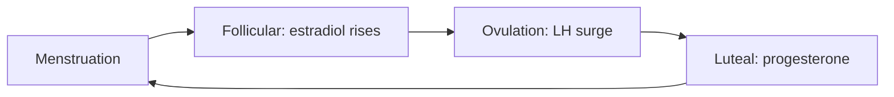

# Menstrual cycle

## Summary

The menstrual cycle is a recurring sequence of hormonal and tissue changes that prepares the body for possible pregnancy. It runs from the first day of one period to the day before the next, commonly about 28 days, with wide normal variation. Four phases are described: menstruation, the follicular phase, ovulation and the luteal phase. Mood and energy change for some people across the cycle, and the size of these changes differs a great deal between individuals. A partner can help by listening and by not assuming how the other person feels.

*This note is educational. It is not medical advice. Severe pain, very heavy bleeding or marked mood changes are reasons to see a doctor.*

## Prerequisites

- [Anabolic and catabolic hormones](anabolic-and-catabolic-hormones.md) for the idea of hormones as signals.

## Core concepts

### Definition

The cycle is controlled by the hypothalamus, the pituitary gland and the ovaries. Reed and Carr (Endotext) describe the main events: follicle-stimulating hormone (FSH) from the pituitary drives follicles in the ovary to mature, which raises estradiol. A surge of luteinizing hormone (LH) triggers ovulation, the release of an egg. The empty follicle becomes the corpus luteum and secretes progesterone. If there is no pregnancy, hormone levels fall and the uterine lining is shed.

### Analogy

The cycle is like a monthly production run with a quality check: the ovary prepares a batch, one egg is selected, the lining is built, and if the product is not used, the line is cleared and restarted. The limit of the analogy is that real cycles vary in timing from person to person and from month to month.

### The phases

| Phase | Typical timing (28-day cycle) | Main hormones | What happens |
| --- | --- | --- | --- |
| Menstruation | Days 1 to 5 | Low estradiol and progesterone | The lining sheds. Prostaglandins can cause cramps |
| Follicular | Days 1 to 13 (overlaps) | FSH, rising estradiol | Follicles mature and the lining rebuilds |
| Ovulation | About day 14 | LH surge | An egg is released |
| Luteal | Days 15 to 28 | Progesterone, estradiol | The lining is maintained, and falls if no pregnancy occurs |

Timing varies: the luteal phase is fairly constant in length, and the follicular phase varies more.

### Mood and the cycle

Some people notice changes before a period, such as irritability, low mood, fatigue and breast tenderness, which is called premenstrual syndrome. A smaller group has severe symptoms that disrupt life, a condition called premenstrual dysphoric disorder, which needs medical assessment. The pattern differs greatly between people, and generalizing "how she feels" by phase is unreliable.

### Supporting a partner

| Do | Avoid |
| --- | --- |
| Ask what would help | Assuming a mood is caused by the cycle |
| Offer practical help: heat pack, a quiet evening, tasks | Dismissing symptoms |
| Listen without trying to fix | Joking about hormones |
| Encourage seeing a doctor if symptoms are severe | Giving medical advice |

## Worked example

A person tracks the cycle for three months with a calendar.

| Month | Day 1 | Cycle length |
| --- | --- | --- |
| 1 | 3 March | 29 days |
| 2 | 1 April | 27 days |
| 3 | 28 April | 29 days |

The lengths are 29, 27 and 29 days, an average of about 28 days. Variation of a few days is common. Tracking helps to predict the next period and to show a doctor changes, such as a cycle that is persistently shorter or much longer than usual.

## Trade offs and when to use it

Understanding the cycle helps with planning, with spotting irregularities and with partner support. Apps that predict fertile days are not reliable contraception. Hormonal methods change the cycle.

## Common mistakes

- **Assuming a 28-day cycle for everyone.** Normal variation is wide.
- **Attributing mood to hormones by default.** Other causes exist.
- **Ignoring severe symptoms.** Treatments are available.

## Practice

1. Name the four phases.
2. What triggers ovulation?
3. Why is predicting mood by cycle phase unreliable?

### Answers

1. Menstruation, follicular phase, ovulation and luteal phase.
2. A surge of luteinizing hormone.
3. The pattern differs greatly between people and between cycles.

## Further reading

- Reed, B. G. and Carr, B. R. (2018). The Menstrual Cycle. Endotext, NCBI Bookshelf. [Link](https://www.ncbi.nlm.nih.gov/books/NBK279054/). A clinical review of the hormones and phases of the menstrual cycle.
